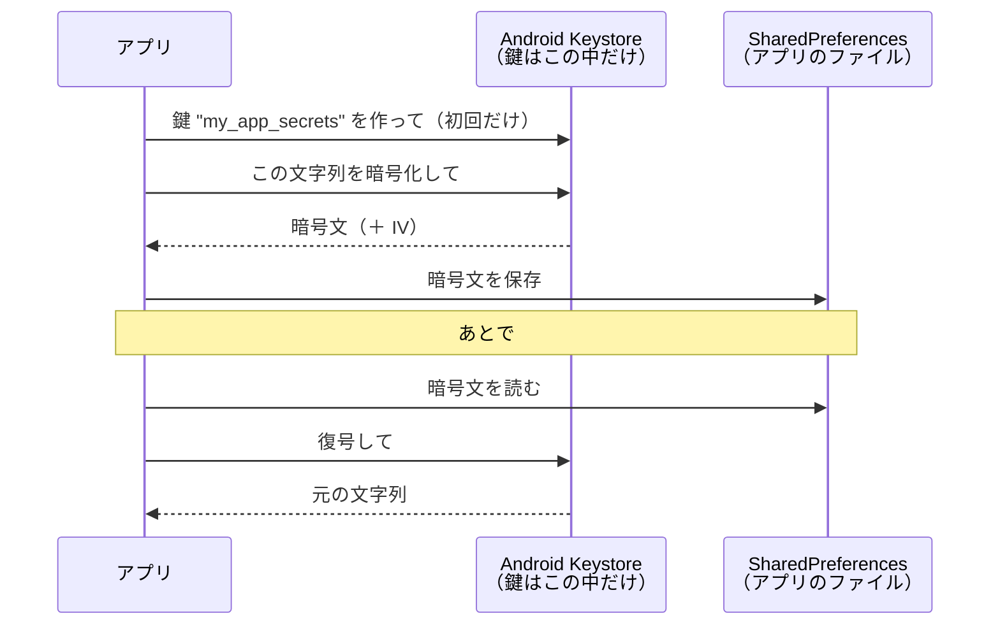

# Android Keystore

[目次](../README.md) ＞ [技術カード](README.md) ＞ Android Keystore

## 一言で

暗号の鍵を、**アプリから取り出せない場所** で作って保管し、暗号化・復号・署名をその中で行ってくれる Android の仕組みです。パスワードや API キーなどの秘密を、端末に安全に保存するのに使います。

## 仕組み



- **鍵を取り出せない**: アプリは鍵の **名前（別名）** だけを知っていて、鍵そのものは読めません。暗号化や復号を頼むと、Keystore の中で行って結果だけを返します。対応している端末では、鍵は OS から切り離された安全な場所（TEE や専用のチップ）に置かれます
- **アプリごと**: ほかのアプリの鍵は使えません
- **鍵の用途を決める**: 作るときに、暗号化用か署名用か、どの方式（AES-GCM など）で使うかを決め、それ以外には使えません
- **鍵が消えることがある**: アプリのデータを消したとき、端末の設定によっては、鍵がなくなります。復号できない場合に備える必要があります

AWS KMS（[技術カード: AWS KMS](aws-kms.md)）と同じ「鍵を外に出さず、使うときは中でやってもらう」考え方を、端末の中で行うものです。

### AES-GCM と IV

秘密の文字列を暗号化するには、**AES-GCM** がよく使われます。

- **AES**: 広く使われている、同じ鍵で暗号化と復号をする方式（共通鍵暗号）
- **GCM**: AES の使い方の 1 つ。暗号化と同時に、改ざんを見つけるための印（認証タグ）も付ける。書き換えられた暗号文は、復号のときにエラーになる
- **IV**（初期化ベクトル）: 暗号化のたびに使う、使い捨ての乱数（12 バイト）。同じ文字列でも毎回違う暗号文になる。復号に同じ IV が要るので、暗号文と一緒に保存する（秘密にする必要はない）

## 最小の使い方

Android の端末かエミュレータで動きます（散策ガイドのプロジェクトの中で、コンパイルが通ることを確かめたものです）。ライブラリは要りません。

```kotlin
object SecretBox {
    private const val ALIAS = "my_app_secrets"
    private const val IV_BYTES = 12

    /** 鍵を用意する。あればそれを、なければ Keystore の中で作る。 */
    private fun key(): SecretKey {
        val ks = KeyStore.getInstance("AndroidKeyStore").apply { load(null) }
        (ks.getKey(ALIAS, null) as? SecretKey)?.let { return it }
        return KeyGenerator.getInstance(KeyProperties.KEY_ALGORITHM_AES, "AndroidKeyStore").apply {
            init(
                KeyGenParameterSpec.Builder(ALIAS, KeyProperties.PURPOSE_ENCRYPT or KeyProperties.PURPOSE_DECRYPT)
                    .setBlockModes(KeyProperties.BLOCK_MODE_GCM)
                    .setEncryptionPaddings(KeyProperties.ENCRYPTION_PADDING_NONE)
                    .setKeySize(256)
                    .build(),
            )
        }.generateKey()
    }

    /** 暗号化して、IV ＋ 暗号文 を base64 の文字列にする。 */
    fun encrypt(plain: String): String {
        val cipher = Cipher.getInstance("AES/GCM/NoPadding").apply { init(Cipher.ENCRYPT_MODE, key()) }
        return Base64.encodeToString(cipher.iv + cipher.doFinal(plain.toByteArray()), Base64.NO_WRAP)
    }

    /** 復号する。できなければ null（鍵が消えた、書き換えられた、など）。 */
    fun decrypt(encoded: String): String? = runCatching {
        val bytes = Base64.decode(encoded, Base64.NO_WRAP)
        val cipher = Cipher.getInstance("AES/GCM/NoPadding").apply {
            init(Cipher.DECRYPT_MODE, key(), GCMParameterSpec(128, bytes, 0, IV_BYTES))
        }
        String(cipher.doFinal(bytes, IV_BYTES, bytes.size - IV_BYTES))
    }.getOrNull()
}
```

```kotlin
// 使う側
prefs.edit { putString("api_key", SecretBox.encrypt(apiKey)) }
val apiKey: String? = prefs.getString("api_key", null)?.let(SecretBox::decrypt)
```

- 暗号化のとき、IV は `Cipher` が自動で作る（`cipher.iv` で取り出す）。自分で決めない
- `GCMParameterSpec(128, …)` の 128 は、改ざんを見つける印の長さ（ビット）
- 復号に失敗したら null を返し、「保存されていない」扱いにする

このコードは端末の Keystore を使うので、パソコンの単体テスト（JVM）では動きません。

## このリポジトリでは

| 場所 | 見どころ | 章 |
|---|---|---|
| [KeyCipher.kt](../../SanpoGuide/platform/kit-llm/src/main/java/io/github/duwenji/yorisoi/kit/llm/KeyCipher.kt) | AI のキーと Google Maps のキーを AES-GCM で暗号化。IV を前に付けて保存。復号できなければ null | [4-5](../04-outside/05-storage.md) |
| [SettingsRepository.kt](../../SanpoGuide/apps/sanpoguide/app/src/main/java/io/github/duwenji/sanpoguide/settings/SettingsRepository.kt) | 保存のときに `KeyCipher.encrypt`、読むときに `KeyCipher.decrypt` | [4-5](../04-outside/05-storage.md) |
| [AndroidManifest.xml](../../SanpoGuide/apps/sanpoguide/app/src/main/AndroidManifest.xml) | `android:allowBackup="false"`（バックアップに含めない） | [1-3](../01-kotlin-android/03-android-components.md) |

## よくある間違い

| 間違い | 起きること | 正しくは |
|---|---|---|
| 暗号化の鍵をアプリのファイルやコードに書く | ファイルを読める人は鍵も読めるので、暗号化の意味がない | 鍵は Keystore の中で作る |
| IV を固定にする・使い回す | 同じ文字列が同じ暗号文になる。GCM では安全性が大きく損なわれる | 毎回 `Cipher` に作らせ、暗号文と一緒に保存する |
| IV を保存し忘れる | 復号できなくなる | 暗号文の前に付けて保存する |
| 復号の失敗で落ちる | 鍵が消えた端末で、アプリが起動しなくなる | 失敗したら「保存されていない」扱いにして、入れ直してもらう |
| 古い方式（AES の ECB など）を使う | 中身の模様が透けて見えるなど、安全でない | AES-GCM を使う |
| 単体テスト（JVM）で動かそうとする | `AndroidKeyStore` がないので失敗する | 端末やエミュレータで動かす。ロジックは暗号化と切り離してテストする |

## 版と公式ドキュメント

ライブラリは使っていません。Android に最初から入っています（AES-GCM の鍵は Android 6.0 から）。散策ガイドの最低の版は Android 8（`minSdk = 26`）です。

- [Android Keystore システム](https://developer.android.com/privacy-and-security/keystore?hl=ja)
- [暗号化（Android の推奨）](https://developer.android.com/privacy-and-security/cryptography?hl=ja)
