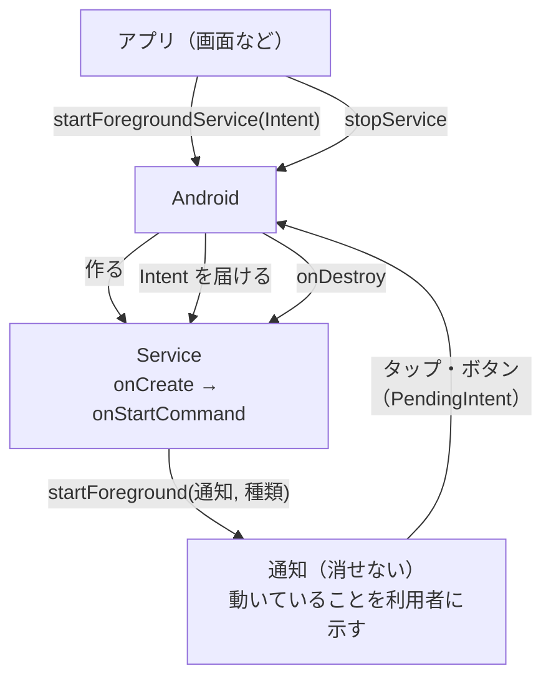

# Android のサービスと通知

[目次](../README.md) ＞ [技術カード](README.md) ＞ Android のサービスと通知

## 一言で

**Service** は、画面がなくても動き続ける Android の部品です。**通知** は、ステータスバーや通知の一覧に出るお知らせです。画面の裏で長く動く処理は、通知を出しながら動く **フォアグラウンドサービス** にします。

## 仕組み



### Service

- **画面と寿命が別**: Activity が閉じても動き続けます
- **フォアグラウンドサービス**: 今の Android は、電池を守るため裏の処理を厳しく制限しています。長く動き続けたいなら、通知を出し続けるフォアグラウンドサービスにします。何のために動くか（位置情報、音楽の再生など）を **種類** として宣言します
- **`onStartCommand`**: 起動の依頼（Intent）が届くたびに呼ばれます。戻り値で、OS に止められたあと作り直してほしいか（`START_STICKY`）を伝えます
- **`LifecycleService`**: AndroidX の Service で、`lifecycleScope`（Service が壊れると止まるコルーチンのスコープ）を使えます

### 通知

- **チャンネル**: Android 8 からは、通知を出す前にチャンネルを作ります。チャンネルごとに重要度（音を鳴らすか、画面の上に出すか）を決め、利用者は設定でチャンネルごとにオン・オフできます。**重要度は作ったあとアプリから変えられません**
- **ID**: 同じ ID で通知を出すと、前の通知を上書きします
- **PendingIntent**: 通知のタップやボタンで何をするかを、OS に預けておく依頼書です
- **権限**: Android 13 からは、通知を出すのに実行時の権限（`POST_NOTIFICATIONS`）が要ります

### 重要度

| 重要度 | 音 | 画面の上に出る | 向いている通知 |
|---|---|---|---|
| `IMPORTANCE_HIGH` | 鳴る | 出る | 気づいてほしい知らせ |
| `IMPORTANCE_DEFAULT` | 鳴る | 出ない | ふつうの知らせ |
| `IMPORTANCE_LOW` | 鳴らない | 出ない | 動いていることを示すだけの通知 |
| `IMPORTANCE_MIN` | 鳴らない | 出ない（たたまれる） | ほとんど見なくてよいもの |

## 最小の使い方

位置情報を使うフォアグラウンドサービスの最小の形です（散策ガイドのプロジェクトの中で、コンパイルが通ることを確かめたものです。動かすには、マニフェストへの登録と、位置情報・通知の権限が要ります）。

### マニフェスト

```xml
<uses-permission android:name="android.permission.FOREGROUND_SERVICE" />
<uses-permission android:name="android.permission.FOREGROUND_SERVICE_LOCATION" />
<uses-permission android:name="android.permission.POST_NOTIFICATIONS" />

<application …>
    <service
        android:name=".TrackingService"
        android:exported="false"
        android:foregroundServiceType="location" />
</application>
```

### Service

```kotlin
class TrackingService : LifecycleService() {
    override fun onStartCommand(intent: Intent?, flags: Int, startId: Int): Int {
        super.onStartCommand(intent, flags, startId)
        if (intent?.action == ACTION_STOP) {
            stopSelf()
            return START_NOT_STICKY
        }
        ServiceCompat.startForeground(this, NOTIFICATION_ID, notification("記録しています"), ServiceInfo.FOREGROUND_SERVICE_TYPE_LOCATION)
        lifecycleScope.launch {
            var minutes = 0
            while (isActive) {
                delay(60_000)
                minutes++
                getSystemService(NotificationManager::class.java).notify(NOTIFICATION_ID, notification("${minutes}分たちました"))
            }
        }
        return START_STICKY
    }

    private fun notification(text: String): Notification {
        val stop = PendingIntent.getService(
            this, 0, Intent(this, TrackingService::class.java).setAction(ACTION_STOP), PendingIntent.FLAG_IMMUTABLE,
        )
        return NotificationCompat.Builder(this, CHANNEL_ID)
            .setSmallIcon(R.drawable.ic_walk)
            .setContentTitle("散歩中")
            .setContentText(text)
            .addAction(0, "終了", stop)
            .setOngoing(true)
            .setOnlyAlertOnce(true)
            .build()
    }

    companion object {
        const val CHANNEL_ID = "tracking"
        private const val NOTIFICATION_ID = 1
        private const val ACTION_STOP = "stop"

        fun createChannel(context: Context) {
            context.getSystemService(NotificationManager::class.java).createNotificationChannel(
                NotificationChannel(CHANNEL_ID, "散歩の記録", NotificationManager.IMPORTANCE_LOW),
            )
        }

        fun start(context: Context) = context.startForegroundService(Intent(context, TrackingService::class.java))
        fun stop(context: Context) = context.stopService(Intent(context, TrackingService::class.java))
    }
}
```

- `createChannel` は、アプリの起動時（`Application.onCreate`）に 1 回呼ぶ。同じ ID で何度呼んでも問題ない
- 起動したら、すぐに `startForeground` で通知を出す
- 1 分ごとに、同じ ID の通知を上書きして経過時間を出す。`setOnlyAlertOnce(true)` なので、更新のたびには鳴らない
- 通知の「終了」ボタンは、`ACTION_STOP` 付きの Intent でこの Service を呼び、`stopSelf()` で止まる
- `lifecycleScope` のタイマーは、Service が壊れると自動で止まる

### 動いているかを確かめる

```sh
adb shell dumpsys activity services <パッケージ名>   # 動いているサービス
adb shell dumpsys notification                       # 通知とチャンネル（長いので grep で絞る）
```

## このリポジトリでは

| 場所 | 見どころ | 章 |
|---|---|---|
| [AndroidManifest.xml](../../yorisoi-sanpoguide/app/src/main/AndroidManifest.xml) | `WalkService` の登録と、位置情報のフォアグラウンドサービスの権限 | [1-3](../01-kotlin-android/03-android-components.md) |
| [SanpoApp.kt](../../yorisoi-sanpoguide/app/src/main/java/io/github/duwenji/yorisoi/sanpoguide/SanpoApp.kt) | 4 つの通知のチャンネル（チャンネルの案内・散策モード・スポット案内・雷雨の予報）と重要度 | [1-3](../01-kotlin-android/03-android-components.md)、[3-2](../03-walk/02-service.md) |
| [WalkService.kt](../../yorisoi-sanpoguide/app/src/main/java/io/github/duwenji/yorisoi/sanpoguide/walk/WalkService.kt) | 散策の開始と終了、通知の上書き、「終了」ボタン、雷雨だけ音つきの通知 | [3-2](../03-walk/02-service.md) |
| [MainActivity.kt](../../yorisoi-sanpoguide/app/src/main/java/io/github/duwenji/yorisoi/sanpoguide/ui/MainActivity.kt) | Android 13 以上でだけ通知の権限を求める | [1-3](../01-kotlin-android/03-android-components.md) |

## よくある間違い

| 間違い | 起きること | 正しくは |
|---|---|---|
| `startForegroundService` のあと、すぐに `startForeground` を呼ばない | 一定の時間がたつと、OS にアプリを止められる | `onStartCommand` の最初で呼ぶ |
| マニフェストの `foregroundServiceType`・`startForeground` の種類・権限がそろっていない | 新しい Android では起動時に例外 | 3 つをそろえる |
| PendingIntent に `FLAG_IMMUTABLE`（または `FLAG_MUTABLE`）を付けない | Android 12 以降は例外 | 書き換える必要がなければ `FLAG_IMMUTABLE` |
| 通知のチャンネルを作らずに通知を出す | Android 8 以降は通知が出ない | 起動時にチャンネルを作る |
| 毎回違う ID で通知を出す | 通知がたまっていく | 置き換えたい通知は同じ ID で出す |
| `onDestroy` で後片付けをしない | 位置の更新や音が止まらず、電池を減らす | コルーチン以外の仕組みは自分で止める |

## 版と公式ドキュメント

| 項目 | 版 |
|---|---|
| `androidx.core:core-ktx`（`NotificationCompat`・`ServiceCompat`） | 1.16.0（SanpoGuide の `app/build.gradle.kts`） |
| `androidx.lifecycle:lifecycle-service`（`LifecycleService`） | 2.9.1 |
| `targetSdk` | 35 |

- [サービスの概要](https://developer.android.com/develop/background-work/services?hl=ja)
- [フォアグラウンド サービス](https://developer.android.com/develop/background-work/services/fgs?hl=ja)
- [通知の作成](https://developer.android.com/develop/ui/views/notifications/build-notification?hl=ja)
- [通知チャンネル](https://developer.android.com/develop/ui/views/notifications/channels?hl=ja)
