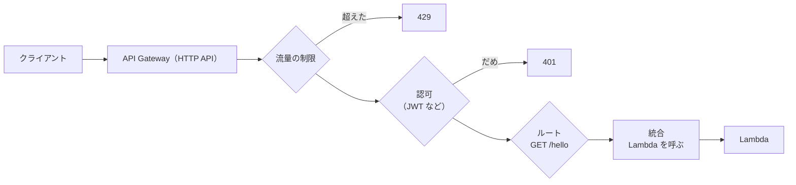

# API Gateway（HTTP API）

[目次](../README.md) ＞ [技術カード](README.md) ＞ API Gateway（HTTP API）

## 一言で

HTTP の要求を受けて、Lambda などに渡す入口のサービスです。ログインのトークンの確認や、流量の制限を、Lambda の手前で行えます。**HTTP API** は、そのうちの安くて単純な種類です（ほかに、機能の多い REST API があります）。

## 仕組み



- **ルート**: メソッドと道の組（`GET /hello`、`ANY /api/{proxy+}`）。`{proxy+}` は、それより下の道を全部受ける
- **統合**: ルートをどこにつなぐか（Lambda・HTTP の先など）
- **認可**: JWT の確認（発行元・宛先・期限・署名）など。だめなら、Lambda を呼ばずに `401`
- **ステージ**: 公開の単位。流量の制限などを決める（`$default` のステージ）
- **イベントの形**: Lambda には、要求をまとめた JSON（ペイロードの版 2.0）が渡る。JWT を確かめたら、その中身（`claims`）も入る

## 最小の使い方

CDK で、Lambda と JWT の確認をつなぎます（[scripts/cdk-samples.ts](../08-aws/scripts/cdk-samples.ts) で合成を確かめた例。配備には AWS が要ります）。

```ts
const api = new apigw.HttpApi(stack, 'Api');
api.addRoutes({
  path: '/hello',
  methods: [apigw.HttpMethod.GET],
  integration: new integrations.HttpLambdaIntegration('HelloIntegration', hello),
  authorizer: new authorizers.HttpJwtAuthorizer(
    'Jwt',
    `https://cognito-idp.ap-northeast-1.amazonaws.com/${pool.userPoolId}`,   // 発行元（Cognito のユーザープール）
    { jwtAudience: [client.userPoolClientId] },                              // 宛先（このアプリ）
  ),
});
```

Lambda の側では、確かめたあとの中身を読みます。

```ts
export async function handler(event: APIGatewayProxyEventV2WithJWTAuthorizer) {
  const claims = event.requestContext.authorizer.jwt.claims;   // sub・cognito:groups など
  // …
}
```

流量の制限（CDK の L2 にないので、L1 の項目を直接書く）:

```ts
const stage = api.defaultStage?.node.defaultChild as apigw.CfnStage;
stage.defaultRouteSettings = { throttlingRateLimit: 20, throttlingBurstLimit: 40 };
```

## このリポジトリでは

| 場所 | 見どころ | 章 |
|---|---|---|
| [infra/lib/console-app.ts](../../sanpo-channel-console/infra/lib/console-app.ts) | `/api/{proxy+}` を `ANY` で 1 つの Lambda に。JWT の確認。1 秒 20 回の制限 | [8-3](../08-aws/03-lambda-apigw.md) |
| 同 `ConsoleDistribution` | CloudFront の `api/*` から API Gateway へ。画面と同じ場所なので CORS が要らない | [8-6](../08-aws/06-s3-cloudfront.md) |
| [api/src/console/handler.ts](../../sanpo-channel-console/api/src/console/handler.ts) | イベントを、ルーターの形に直すつなぎ。`claims` から役割を取り出す | [8-3](../08-aws/03-lambda-apigw.md) |

## よくある間違い

| 間違い | 起きること | 正しくは |
|---|---|---|
| ログインの確認を API Gateway に任せたから、役割の確認も済んだと思う | 配信元が運用者の操作をできてしまう | 役割（グループ）は Lambda で確かめる |
| JWT の宛先（`jwtAudience`）を指定しない | ほかのアプリのために発行されたトークンも通る | このアプリのクライアントの ID を指定する |
| 画面と API を別の場所に置き、CORS の設定を広く開ける | どこからでも呼べてしまう | 同じ場所（CloudFront の下）に置くか、許す場所を絞る |
| 時間のかかる仕事を同期で行う | 約 30 秒の上限で切られる | 非同期・待ち行列に |

## 版と公式ドキュメント

CDK では `aws-cdk-lib/aws-apigatewayv2`・`aws-apigatewayv2-authorizers`・`aws-apigatewayv2-integrations`（2.272 以上）。

- [HTTP API の開発者ガイド](https://docs.aws.amazon.com/ja_jp/apigateway/latest/developerguide/http-api.html)
- [JWT オーソライザー](https://docs.aws.amazon.com/ja_jp/apigateway/latest/developerguide/http-api-jwt-authorizer.html)
- [HTTP API と REST API の比べ方](https://docs.aws.amazon.com/ja_jp/apigateway/latest/developerguide/http-api-vs-rest.html)
