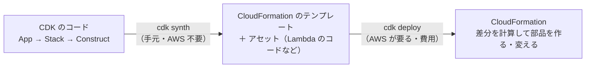

# AWS CDK

[目次](../README.md) ＞ [技術カード](README.md) ＞ AWS CDK

## 一言で

AWS の部品（インフラ）を、TypeScript などのプログラミング言語で定義する道具です。書いたコードから CloudFormation のテンプレートを作り（合成）、それを AWS に配備します。

## 仕組み



- **コンストラクト**: 部品の単位。木の形に組み立てる。いちばん上が `App`、その下に **スタック**（CloudFormation の 1 単位）、その下に部品
- **L1・L2・L3**: L1 は CloudFormation の項目そのまま（`Cfn…`）、L2 は使いやすくした部品（`s3.Bucket`・`grant…` つき）、L3 は複数の部品の組み合わせ
- **合成**（`cdk synth`）: コードを動かして、テンプレートとアセットを手元に作る。AWS にはつながらない
- **配備**（`cdk deploy`）: テンプレートとアセットを AWS に送り、CloudFormation に部品を作らせる。初回は `cdk bootstrap`（配備用の場所の準備）が要る
- **コンテキスト**: `-c 名前=値` でコードに値を渡す（環境の選び分けなど）
- **removalPolicy**: スタックから外したとき、部品を消すか（DESTROY）残すか（RETAIN）

## 最小の使い方

管理システムのフォルダには CDK が入っているので、そこで試せます。下の例は [scripts/cdk-samples.ts](../08-aws/scripts/cdk-samples.ts) の一部で、手元で合成できることを確かめたものです。

```ts
import { App, Duration, RemovalPolicy, Stack } from 'aws-cdk-lib';
import { Template } from 'aws-cdk-lib/assertions';
import * as dynamodb from 'aws-cdk-lib/aws-dynamodb';
import * as lambda from 'aws-cdk-lib/aws-lambda';

const app = new App();
const stack = new Stack(app, 'CardSamples', { env: { region: 'ap-northeast-1', account: '123456789012' } });

const hello = new lambda.Function(stack, 'Hello', {
  runtime: lambda.Runtime.NODEJS_22_X,
  handler: 'index.handler',
  code: lambda.Code.fromInline("exports.handler = async () => ({ statusCode: 200, body: 'hello' });"),
  timeout: Duration.seconds(10),
});

const table = new dynamodb.TableV2(stack, 'Walks', {
  partitionKey: { name: 'PK', type: dynamodb.AttributeType.STRING },
  sortKey: { name: 'SK', type: dynamodb.AttributeType.STRING },
  removalPolicy: RemovalPolicy.DESTROY,
});
table.grantReadWriteData(hello);            // IAM の許可を自動で組み立てる
hello.addEnvironment('TABLE_NAME', table.tableName);

// 合成したテンプレートを調べる（テストでも使う）
const t = Template.fromStack(stack);
t.hasResourceProperties('AWS::Lambda::Function', { Runtime: 'nodejs22.x' });
console.log(Object.keys(t.toJSON().Resources).length, 'resources');
```

```sh
cd /c/Dev/apps/michizure-console
mkdir -p .local/cdk-cards && cp ../michizure-tutorial/08-aws/scripts/cdk-samples.ts .local/cdk-cards/app.ts
cd infra && npx tsx ../.local/cdk-cards/app.ts
#  → 27 resources …
```

### よく使うコマンド（CDK のプロジェクトで）

| コマンド | 何をするか | AWS |
|---|---|---|
| `npx cdk synth` | テンプレートを作る | 要らない |
| `npx cdk diff` | 配備済みのものとの差分 | 要る |
| `npx cdk deploy` | 配備する | 要る（費用） |
| `npx cdk destroy` | スタックを消す | 要る |
| `npx cdk bootstrap` | 配備の準備（アカウント・リージョンごとに 1 回） | 要る |

## このリポジトリでは

| 場所 | 見どころ | 章 |
|---|---|---|
| [infra/bin/app.ts](../../michizure-console/infra/bin/app.ts) | `-c env=dev -c rootPublicKey=…`。ルート鍵の公開鍵を外から必ず渡させる。タグ | [8-2](../08-aws/02-cdk.md) |
| [infra/lib/config.ts](../../michizure-console/infra/lib/config.ts) | 開発用・本番用の違いを 1 か所に。判別できるユニオンで設定を守る | [8-2](../08-aws/02-cdk.md) |
| [infra/lib/console-stack.ts](../../michizure-console/infra/lib/console-stack.ts)・[console-app.ts](../../michizure-console/infra/lib/console-app.ts) | スタックと自作のコンストラクト。`RETAIN` と `DESTROY` の使い分け | [8-2](../08-aws/02-cdk.md) |
| [infra/test/console-stack.test.ts](../../michizure-console/infra/test/console-stack.test.ts) | `Template.hasResourceProperties` で、大事な設定をテストで守る | [8-2](../08-aws/02-cdk.md) |

## よくある間違い

| 間違い | 起きること | 正しくは |
|---|---|---|
| `synth` と `deploy` を混同する | 試しのつもりで、本物の部品（費用）を作る | 確かめるだけなら `synth` |
| 消してはいけない部品を `DESTROY` のままにする | スタックを消したとき、データや鍵も消える | データ・鍵・記録は `RETAIN` |
| 秘密（鍵・パスワード）をコードやコンテキストに書く | テンプレートや CI のログで読める | Secrets Manager などに。公開してよい値だけを渡す |
| 部品の論理 ID（`'Table'` など）を気軽に変える | CloudFormation が別の部品とみなし、作り直す（データが消えることも） | ID は変えない。変えるなら影響を確かめる |
| 画面で手で変えた設定を放っておく | 次の配備で上書きされる、または食い違う（ドリフト） | 変更は必ずコードで |

## 版と公式ドキュメント

| 項目 | 版 |
|---|---|
| `aws-cdk-lib` | 2.272 以上（`infra/package.json`） |
| `aws-cdk`（コマンド） | 2.1144 以上 |

- [AWS CDK の開発者ガイド](https://docs.aws.amazon.com/ja_jp/cdk/v2/guide/home.html)
- [CDK の API リファレンス](https://docs.aws.amazon.com/cdk/api/v2/)
- [assertions（テスト）](https://docs.aws.amazon.com/cdk/api/v2/docs/aws-cdk-lib.assertions-readme.html)
