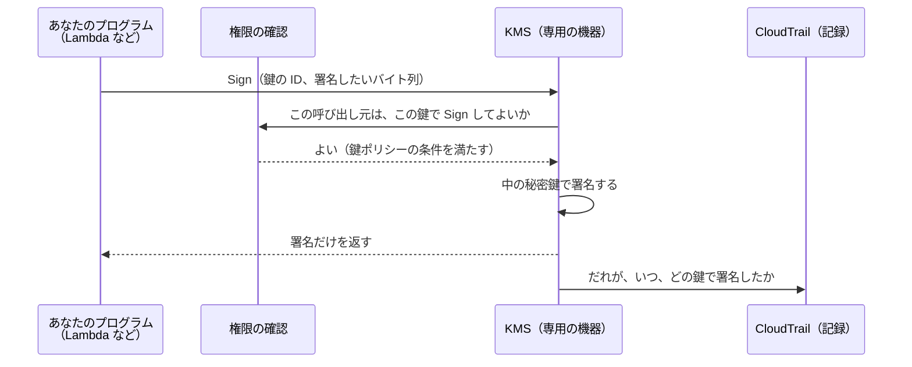

# AWS KMS

[目次](../README.md) ＞ [技術カード](README.md) ＞ AWS KMS

## 一言で

暗号の鍵を AWS の専用の機器の中で作って保管し、**鍵を外に出さずに** 暗号化や署名をしてくれるサービスです。KMS は Key Management Service の略です。

## 仕組み



- **秘密鍵は KMS の外に出ない**: 取り出す API がありません。署名がほしいときは、データを KMS に送って署名してもらいます。だから、プログラムやサーバーが乗っ取られても、秘密鍵そのものは盗まれません
- **公開鍵は取り出せる**: 署名の鍵（非対称鍵）なら、`GetPublicKey` で公開鍵を取り出せます。KMS を使わない相手（スマートフォンのアプリなど）にも、それで署名を確かめてもらえます
- **鍵ごとに「だれが何をしてよいか」を決める**: どの鍵にも必ず 1 つ **鍵ポリシー** があり、ここで許された人やプログラムだけが鍵を使えます。「この署名の方式でだけ」のような条件も付けられます
- **すべての使用が記録される**: Sign などの呼び出しは CloudTrail に残ります。乗っ取られたときに「いつ、何に署名されたか」を後から調べられます
- **鍵には状態がある**: 有効（Enabled）・無効（Disabled）・削除待ち（PendingDeletion）など。無効にすれば、すぐに署名できなくなります。削除は 7〜30 日の待ち期間のあとで行われ、待ち期間中なら取り消せます

### 鍵の種類

| 種類 | 用途 | 例 |
|---|---|---|
| 対称鍵 | 暗号化・復号 | S3 や DynamoDB のデータの暗号化 |
| 非対称鍵（署名用、`SIGN_VERIFY`） | 署名・検証 | **このリポジトリはこれ**。Ed25519 の鍵（`ECC_NIST_EDWARDS25519`） |
| 非対称鍵（暗号用） | 公開鍵で暗号化、KMS の中で復号 | — |
| HMAC 鍵 | メッセージ認証コード | — |

### 署名の上限: 4,096 バイト

`Sign` に渡せるデータは **4,096 バイトまで** です。大きなデータに署名したいときは、データのハッシュ（要約）を作り、それに署名します。

Ed25519 の鍵には署名の方式が 2 つあります。

| 方式 | `MessageType` | 何に署名するか |
|---|---|---|
| `ED25519_SHA_512` | `RAW` だけ | 渡したバイト列そのもの（普通の Ed25519、RFC 8032）。**このリポジトリはこれ** |
| `ED25519_PH_SHA_512` | `DIGEST` だけ | 渡したハッシュ（Ed25519ph という別の方式） |

2 つは別の方式で、できる署名も違います。確かめる側も同じ方式でなければなりません。

## 最小の使い方

> **お金と AWS のアカウントが要ります。** KMS の鍵は 1 つにつき月 1 USD かかります（時間割り）。署名用の鍵（非対称鍵）への Sign などの呼び出しは無料枠の対象外で、呼び出しごとに少額かかります。単価は [料金のページ](https://aws.amazon.com/kms/pricing/) で確かめてください。試し終わったら、最後の手順で必ず削除を予約してください。
>
> AWS のアカウントがなければ、読むだけでかまいません。手元で同じ流れを試したいときは、[6-7 ハンズオン](../06-trust/07-hands-on.md) が KMS の代わりに手元の鍵で署名します。

AWS CLI（第 2 版）を使います。リージョンは東京（`ap-northeast-1`）にします。

### 1. 鍵を作る

```sh
aws kms create-key --region ap-northeast-1 \
  --key-spec ECC_NIST_EDWARDS25519 --key-usage SIGN_VERIFY \
  --description "kms-card-trial" \
  --query KeyMetadata.KeyId --output text
```

表示された鍵の ID を、以下では `<鍵ID>` と書きます。

### 2. 署名してもらう

```sh
printf 'hello sanpo' > msg.txt
aws kms sign --region ap-northeast-1 --key-id <鍵ID> \
  --message fileb://msg.txt --message-type RAW --signing-algorithm ED25519_SHA_512 \
  --query Signature --output text | base64 -d > sig.bin
```

- `fileb://` は「このファイルの中身をバイト列のまま渡す」という意味です
- CLI は署名を base64 で表示するので、`base64 -d` でバイト列に戻して保存します。Ed25519 の署名は 64 バイトです

### 3. 公開鍵を取り出して、KMS を使わずに確かめる

```sh
aws kms get-public-key --region ap-northeast-1 --key-id <鍵ID> \
  --query PublicKey --output text | base64 -d > pub.der

node -e "
const c = require('crypto'), f = require('fs');
const key = c.createPublicKey({ key: f.readFileSync('pub.der'), format: 'der', type: 'spki' });
console.log(c.verify(null, f.readFileSync('msg.txt'), key, f.readFileSync('sig.bin')));
"
```

`true` と出れば、KMS の署名を KMS の外で確かめられたことになります。`msg.txt` を 1 文字変えると `false` になります。

`GetPublicKey` が返す公開鍵は **DER（SubjectPublicKeyInfo）** の形です。Ed25519 なら 44 バイトで、先頭の 12 バイトはいつも `302a300506032b6570032100`、残りの 32 バイトが生の公開鍵です（[6-2](../06-trust/02-ed25519-and-ids.md) の「生の鍵と DER」）。

### 4. 後片付け（削除を予約する）

```sh
aws kms schedule-key-deletion --region ap-northeast-1 --key-id <鍵ID> --pending-window-in-days 7
```

7 日後に削除されます。待ち期間中も、鍵の月額は日割りでかかります。

## このリポジトリでは

| 場所 | 何をしているか | 章 |
|---|---|---|
| [infra/lib/console-stack.ts](../../sanpo-channel-console/infra/lib/console-stack.ts) | Ed25519 の鍵を作る。鍵ポリシーで、Sign を公開の Lambda と管理 API の Lambda（試用チケット用）だけに、方式を `ED25519_SHA_512`・`RAW` だけに絞る。スタックを消しても鍵は残す（`RemovalPolicy.RETAIN`） | [6-4](../06-trust/04-two-tier-keys.md) |
| [api/src/publish/aws.ts](../../sanpo-channel-console/api/src/publish/aws.ts) の `kmsSigner` | 承認済みチャンネル・リストの要約と、試用チケットに署名する。4,096 バイトを超えるデータは送る前に断る | [6-4](../06-trust/04-two-tier-keys.md) |
| [api/src/console/operator.ts](../../sanpo-channel-console/api/src/console/operator.ts) の `registerSigningKey` | 運用者が KMS の鍵を署名鍵として登録するとき、`GetPublicKey` で鍵の種類が Ed25519 かを確かめ、DER から生の 32 バイトを取り出して記録する | [8-7](../08-aws/07-sqs-ses-kms.md) |
| [tools/provision/src/cli.ts](../../sanpo-channel-console/tools/provision/src/cli.ts) | 初期登録で、同じように公開鍵を取り出して登録する | [8-7](../08-aws/07-sqs-ses-kms.md) |

### なぜ KMS を使うのか

承認済みチャンネル・リストは、承認のたびに自動で署名します。そのため、署名鍵はいつも動いているシステムの近くに置く必要があります。KMS に置けば、システムが乗っ取られても鍵は盗まれず、乗っ取られている間の悪用だけで済みます。さらに、そのあいだに作られた偽の署名も、[ルート鍵で署名鍵を失効させる](../06-trust/04-two-tier-keys.md) ことで無効にできます。

### なぜ要約に署名するのか

リストは最大 1MB あり、Sign の上限 4,096 バイトを超えます。そこで、リスト本体の SHA-256 を含む小さな要約に、`ED25519_SHA_512`（`RAW`）で署名します（API-002 P-8）。`ED25519_PH_SHA_512` を使わないのは、アプリが Tink の普通の Ed25519 だけで確かめられるようにするためです。

## よくある間違い

| 間違い | 起きること | 正しくは |
|---|---|---|
| 署名の方式を確かめる側と合わせない（`ED25519_PH_SHA_512` で署名して、普通の Ed25519 で確かめる） | 署名がいつまでも合わない | 署名と検証で同じ方式を使う |
| `GetPublicKey` の結果を、生の 32 バイトとして扱う | 鍵の長さが合わない、または検証に失敗する | DER から生の鍵を取り出す。Node.js なら `createPublicKey({ format: 'der', type: 'spki' })` で読める |
| 4,096 バイトを超えるデータを Sign に送る | エラーになる | ハッシュや要約に署名する |
| 鍵を無効にすれば安全だと考える | 無効にする前に作られた偽の署名は、確かめる側から見れば本物のまま | 確かめる側にも失効を伝える仕組みを用意する（このリポジトリでは鍵セットの `revokedKeys`） |
| 使い終わった鍵を放置する | 鍵 1 つにつき月 1 USD かかり続ける | 削除を予約する。ただし、その鍵の署名をまだ確かめる必要があるなら消さない |
| CDK でスタックごと鍵を消す設定にする | 過去の署名を確かめられなくなる。削除の予約は取り消せるが、待ち期間を過ぎると戻せない | 署名の鍵は `RemovalPolicy.RETAIN` にする |

## 版と公式ドキュメント

| 項目 | 版 |
|---|---|
| `@aws-sdk/client-kms`（api、tools/provision） | 3.1146 以上（`api/package.json`） |
| `aws-cdk-lib` の `aws-kms`（infra） | 2.272 以上（`infra/package.json`） |

- [AWS KMS 開発者ガイド](https://docs.aws.amazon.com/kms/latest/developerguide/overview.html)
- [Sign API リファレンス](https://docs.aws.amazon.com/kms/latest/APIReference/API_Sign.html)（4,096 バイトの上限、Ed25519 の `MessageType`）
- [鍵の状態](https://docs.aws.amazon.com/kms/latest/developerguide/key-state.html)
- [料金](https://aws.amazon.com/kms/pricing/)
- [CDK の aws-kms モジュール](https://docs.aws.amazon.com/cdk/api/v2/docs/aws-cdk-lib.aws_kms-readme.html)
