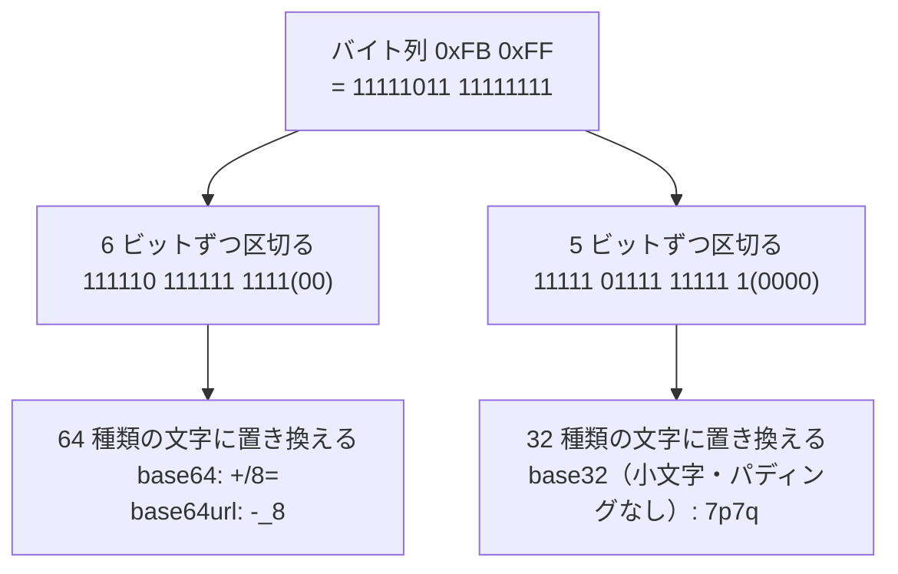

# base64url と base32

[目次](../README.md) ＞ [技術カード](README.md) ＞ base64url と base32

## 一言で

バイト列（0〜255 の数の並び）を、JSON や URL に入れられる **文字** にする方法です。**base64url** は短く、**base32** は人が読み書きしやすいのが特徴です。どちらも RFC 4648 で決められています。

## 仕組み



- **ビットを区切って、文字に置き換える**: base64 は 6 ビット（64 種類）ずつ、base32 は 5 ビット（32 種類）ずつ区切ります。余ったビットは 0 で埋めます
- **大きさ**: base64 は元の約 1.33 倍、base32 は約 1.6 倍の長さになります
- **暗号ではない**: だれでも元に戻せます。中身を隠す働きはありません

### 4 つの方式の違い

| 方式 | 使う文字 | 末尾の `=`（パディング） | 向いている場所 |
|---|---|---|---|
| base64 | `A-Z a-z 0-9 + /` | 付ける | メールの添付、一般的なデータ |
| **base64url** | `A-Z a-z 0-9 - _` | 付けないことが多い | URL・ファイル名・JSON・QR コード |
| base32（標準） | `A-Z 2-7` | 付ける | — |
| **base32（このリポジトリ）** | `a-z 2-7`（小文字） | 付けない | 人が読み上げたり、手で入力したりする ID |

base64 の `+` `/` `=` は、URL の中で特別な意味を持ちます。base64url はそれを `-` `_` に替え、`=` を省きます。

base32 は英字 1 種類（このリポジトリでは小文字）と数字 `2`〜`7` だけを使います。大文字と小文字の区別がなく、英字と見間違えやすい `0`・`1` も使わないので、人が扱う ID に向いています。

## 最小の使い方

すべて手元で、お金をかけずに試せます。

### Node.js（TypeScript）

```ts
const bytes = Buffer.from([0xfb, 0xff]);
bytes.toString('base64');       // '+/8='
bytes.toString('base64url');    // '-_8'
Buffer.from('-_8', 'base64url');  // <Buffer fb ff>
```

Node.js には base32 がないので、このリポジトリは自分で書いています（[encoding.ts](../../sanpo-channel-console/packages/protocol/src/encoding.ts) の `base32`）。RFC 4648 の例を小文字・パディングなしにしたものと一致します。

| 入力 | 出力 |
|---|---|
| `f` | `my` |
| `foo` | `mzxw6` |
| `foobar` | `mzxw6ytboi` |

### Kotlin（JVM・Android 8 以上）

```kotlin
import java.util.Base64

val text = Base64.getUrlEncoder().withoutPadding().encodeToString(byteArrayOf(0xfb.toByte(), 0xff.toByte()))  // "-_8"
val bytes = Base64.getUrlDecoder().decode("-_8")
```

`java.util.Base64` は Android では API 26（Android 8）から使えます。散策ガイドの最低の版（`minSdk = 26`）とちょうど同じです。

## 読むときは厳しく

デコード（文字からバイト列に戻す）は、ライブラリによって寛容さがまったく違います。実際に試した結果です。

| 入力 | Node.js `Buffer.from(…, 'base64url')` | Java `Base64.getUrlDecoder()` |
|---|---|---|
| `-_8` | `fb ff` | `fb ff` |
| `-_8=`（パディングつき） | `fb ff` | `fb ff` |
| `+/8=`（普通の base64） | `fb ff`（**受け入れる**） | エラー |
| `-_$8`（余計な文字） | `fb ff`（**黙って読み飛ばす**） | エラー |

Node.js は、違う方式の文字も、知らない文字も、黙って受け入れます。Java は `=` を受け入れます。どちらも「API-002 の決まり（base64url・パディングなし）以外は拒む」とはなりません。

署名を確かめるコードで寛容なデコードを使うと、**同じバイト列を表す文字列が何通りもある** ことになり、比較や記録で食い違いが起きます。そこでこのリポジトリは、デコードの前に正規表現 `^[A-Za-z0-9_-]*$` で文字を確かめています。

- TypeScript: [encoding.ts](../../sanpo-channel-console/packages/protocol/src/encoding.ts) の `b64url.decode`
- Kotlin: [PublisherSignature.kt](../../SanpoGuide/station-format/src/main/kotlin/com/example/sanpoguide/station/format/PublisherSignature.kt) の `decodeBase64Url`

## このリポジトリでは

| 方式 | 使い道 | 章 |
|---|---|---|
| base64url | 署名つき文書の `payload`・`sig`、公開鍵（`rootKey`・`publicKey`） | [6-2](../06-trust/02-ed25519-and-ids.md)、[6-3](../06-trust/03-signed-documents.md) |
| base32（小文字・パディングなし） | 提供元ID `sc1…`・アカウントID `sg1…`（SHA-256 の先頭 160 ビット = 32 文字） | [6-2](../06-trust/02-ed25519-and-ids.md) |
| 16 進数（小文字） | パッケージ・リストの SHA-256（`sha256` の項目） | [6-4](../06-trust/04-two-tier-keys.md) |

## よくある間違い

| 間違い | 起きること | 正しくは |
|---|---|---|
| base64 と base64url を取り違える | `-` `_` を含む値で失敗したり、別の値になったりする | どちらの方式かを決めて、そろえる。API-002 は base64url |
| 寛容なデコーダーをそのまま使う | 決まりに反する文字列を受け入れてしまう | 正規表現などで文字の種類を確かめてからデコードする |
| base64 を暗号化だと思う | だれでも元に戻せるので、何も守られない | 隠したいなら暗号化する。本物だと示したいなら署名する |
| 文字列を base64 にする前の文字コードをそろえない | 同じ文字列から別のバイト列ができる | 先に UTF-8 のバイト列にする |

## 版と公式ドキュメント

ライブラリは使っていません。Node.js の `Buffer`、Java・Android の `java.util.Base64` に標準で入っています。base32 だけは自分で書いています。

- [RFC 4648（base64・base64url・base32 の規格、英語）](https://www.rfc-editor.org/rfc/rfc4648)
- [Node.js: Buffer の文字コード](https://nodejs.org/api/buffer.html#buffers-and-character-encodings)
- [Java: java.util.Base64](https://docs.oracle.com/en/java/javase/17/docs/api/java.base/java/util/Base64.html)
