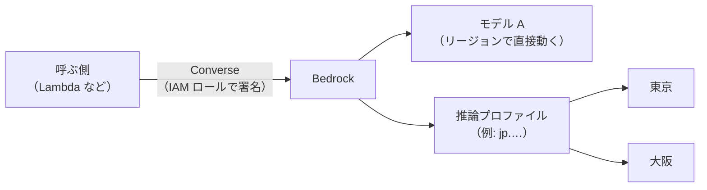

# Amazon Bedrock

[目次](../README.md) ＞ [技術カード](README.md) ＞ Amazon Bedrock

## 一言で

AWS の中で、いくつもの会社の生成 AI のモデル（Anthropic の Claude、DeepSeek、Amazon Nova など）を、同じやり方で呼べるサービスです。AI サービスごとのキーは要らず、AWS の IAM の許可で呼びます。料金は AWS の請求にまとまります。

## 仕組み



- **モデル ID**: 呼ぶモデルを名前で指定する（例: `deepseek.v3.2`）。モデルによって、動いているリージョンが違う
- **推論プロファイル**: 複数のリージョンに処理を振り分ける名前（例: `jp.anthropic.claude-haiku-4-5-…`）。`jp.` なら日本の中（東京・大阪）だけで処理する。プロファイルで呼ぶときは、IAM で **プロファイルと、振り分け先の各リージョンのモデルの両方** を許可する
- **Converse API**: モデルによらず同じ形（`system`・`messages`・`inferenceConfig`）で呼ぶ API。モデルを差し替えても、呼ぶ側のコードは変わらない。モデルごとの形で送る `InvokeModel` もある
- **終わり方**（`stopReason`）: `end_turn`（最後まで書いた）、`max_tokens`（長さの上限で切れた）、`content_filtered`・`guardrail_intervened`（断った）など
- **料金**: 入力と出力の **トークン数** で決まる。単価はモデルとリージョンで違い、「100 万トークンあたり何ドル」で示される
- **使う前の手続き**: モデルによっては、アカウントで利用の手続きが要る

## 最小の使い方

（呼び出しには、AWS のアカウントと、そのモデルを呼べる IAM の許可が要ります）

```ts
import { BedrockRuntimeClient, ConverseCommand } from '@aws-sdk/client-bedrock-runtime';

const bedrock = new BedrockRuntimeClient({ region: 'ap-northeast-1' });
const out = await bedrock.send(
  new ConverseCommand({
    modelId: 'deepseek.v3.2',
    system: [{ text: 'あなたは散歩の案内人です。' }],
    messages: [{ role: 'user', content: [{ text: '鶴岡八幡宮を 100 字で紹介してください。' }] }],
    inferenceConfig: { maxTokens: 512 },
  }),
);
const text = (out.output?.message?.content ?? []).flatMap((b) => (b.text !== undefined ? [b.text] : [])).join('');
console.log(text, out.stopReason, out.usage?.inputTokens, out.usage?.outputTokens);
```

呼ぶ側の IAM の許可（CDK。[scripts/cdk-samples.ts](../08-aws/scripts/cdk-samples.ts) で合成を確かめた例）。呼んでよいモデルだけを並べます。

```ts
fn.addToRolePolicy(new iam.PolicyStatement({
  actions: ['bedrock:InvokeModel'],
  resources: [`arn:${stack.partition}:bedrock:ap-northeast-1::foundation-model/deepseek.v3.2`],
}));
```

`bedrock:InvokeModel` の許可で、Converse も呼べます。

## このリポジトリでは

| 場所 | 見どころ | 章 |
|---|---|---|
| [api/src/relay/aws.ts](https://github.com/duwenji/yorisoi-console/blob/main/api/src/relay/aws.ts) の `generate` | Converse で呼び、`stopReason` を 3 つにまとめる。トークン数を費用の計算に使う | [8-9](../08-aws/09-ai-relay.md) |
| [infra/lib/relay-config.ts](https://github.com/duwenji/yorisoi-console/blob/main/infra/lib/relay-config.ts) | 呼んでよいモデルの一覧（東京で動く DeepSeek V3.2、`jp.` のプロファイルの Claude Haiku 4.5）と単価 | [8-9](../08-aws/09-ai-relay.md) |
| [infra/lib/relay-stack.ts](https://github.com/duwenji/yorisoi-console/blob/main/infra/lib/relay-stack.ts) | 一覧のモデルだけを許可する IAM。プロファイルなら、東京と大阪のモデルも | [8-9](../08-aws/09-ai-relay.md) |

## よくある間違い

| 間違い | 起きること | 正しくは |
|---|---|---|
| `bedrock:InvokeModel` を `Resource: '*'` で許可する | どのモデルでも、どのリージョンでも呼べてしまう | 呼ぶモデルの ARN だけを許可する |
| 推論プロファイルだけを許可する | 振り分け先のリージョンのモデルで `AccessDenied` | プロファイルと、各リージョンのモデルの両方を許可する |
| `maxTokens` を決めない | 長い答えで費用がかさむ | 用途に合う上限を決める。`max_tokens` で切れたときの扱いも決める |
| 返事の終わり方を見ない | 途中で切れた文や断りの文を、そのまま使う | `stopReason` で分ける |
| プロンプトをログに書く | 利用者の情報がログに残る | 数（トークン数・時間）だけを書く |

## 版と公式ドキュメント

| 項目 | 版 |
|---|---|
| `@aws-sdk/client-bedrock-runtime` | 3.1153 以上（`api/package.json`） |

- [Amazon Bedrock のユーザーガイド](https://docs.aws.amazon.com/ja_jp/bedrock/latest/userguide/what-is-bedrock.html)
- [Converse API](https://docs.aws.amazon.com/ja_jp/bedrock/latest/userguide/conversation-inference.html)
- [推論プロファイル（クロスリージョン推論）](https://docs.aws.amazon.com/ja_jp/bedrock/latest/userguide/cross-region-inference.html)
- [Amazon Bedrock の料金](https://aws.amazon.com/jp/bedrock/pricing/)
