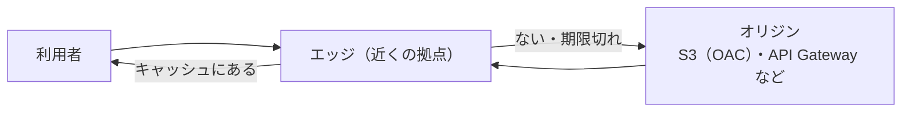

# CloudFront

[目次](../README.md) ＞ [技術カード](README.md) ＞ CloudFront

## 一言で

AWS の CDN です。世界中の拠点（エッジ）にファイルを写して持ち（キャッシュ）、利用者の近くから速く配ります。S3 や API の前に置いて、HTTPS・安全のためのヘッダー・道の振り分けなどを受け持たせることもできます。

## 仕組み



- **ディストリビューション**: 配信の設定の単位。独自のドメイン・証明書・オリジン・振る舞いを持つ
- **オリジン**: 元のファイルや API の場所。S3 のバケットなら **OAC**（そのバケットを、この CloudFront だけが読める）で守る
- **振る舞い**（behavior）: 道（`api/*` など）ごとに、どのオリジンへ、キャッシュするか、どのメソッドを許すか
- **キャッシュ**: オリジンが返す `Cache-Control` などに従って、エッジに持つ。変わったら **無効化**（invalidation）で消せる
- **CloudFront Functions**: エッジで要求・応答を書き換える小さな関数（道の書き換えなど）
- **レスポンスヘッダーポリシー**: CSP・HSTS などの安全のためのヘッダーを付ける

## 最小の使い方

公開しない S3 のバケットを、CloudFront だけから配ります（[scripts/cdk-samples.ts](../08-aws/scripts/cdk-samples.ts) で合成を確かめた例。配備には AWS が要ります）。

```ts
new cloudfront.Distribution(stack, 'Cdn', {
  defaultBehavior: {
    origin: origins.S3BucketOrigin.withOriginAccessControl(bucket),   // OAC
    viewerProtocolPolicy: cloudfront.ViewerProtocolPolicy.HTTPS_ONLY,
    cachePolicy: cloudfront.CachePolicy.CACHING_OPTIMIZED,            // オリジンの Cache-Control に従う
  },
});
```

`withOriginAccessControl` を使うと、CDK がバケットの許可（バケットポリシー）に「この CloudFront だけが読める」を書いてくれます。

置き換えたファイルをすぐに配るには、キャッシュを消します。

```ts
await cf.send(new CreateInvalidationCommand({
  DistributionId, InvalidationBatch: { CallerReference: String(Date.now()), Paths: { Quantity: 1, Items: ['/v1/channels.json'] } },
}));
```

## このリポジトリでは

| 場所 | 見どころ | 章 |
|---|---|---|
| [infra/lib/console-stack.ts](../../michizure-console/infra/lib/console-stack.ts) の `PublicDistribution` | 公開用のバケットを OAC で。HTTPS だけ、読むだけ | [8-6](../08-aws/06-s3-cloudfront.md) |
| [api/src/publish/publisher.ts](../../michizure-console/api/src/publish/publisher.ts) | リストは 5 分、置いたらキャッシュを消す。ハッシュの名前のファイルは 1 年・`immutable` | [6-4](../06-trust/04-two-tier-keys.md)、[8-6](../08-aws/06-s3-cloudfront.md) |
| [infra/lib/console-app.ts](../../michizure-console/infra/lib/console-app.ts) の `ConsoleDistribution` | 画面と `api/*`（キャッシュしない）を 1 つに。SPA の道の振り分け（CloudFront Functions）。CSP・HSTS | [8-6](../08-aws/06-s3-cloudfront.md) |

## よくある間違い

| 間違い | 起きること | 正しくは |
|---|---|---|
| オリジンの S3 を公開したままにする | CloudFront を通さずに直接読まれる | OAC にして、バケットは公開しない |
| よく変わるファイルを長くキャッシュする | 古いものが配られ続ける | 短くするか、変えたら無効化する |
| 中身の変わるファイルを同じ名前で置き換え、長くキャッシュする | 利用者ごとに古い・新しいが混ざる | 中身のハッシュを名前に入れる |
| API の道をキャッシュする | ほかの人の応答が返る | API の振る舞いは `CACHING_DISABLED` |
| SPA の道を直接開くと 404 | 再読み込みで失敗する | 拡張子のない道は `index.html` を返す |
| CSP に新しい通信先を足し忘れる | ブラウザが通信を止める | 通信先を変えたら CSP も |

## 版と公式ドキュメント

CDK では `aws-cdk-lib/aws-cloudfront`・`aws-cloudfront-origins`（2.272 以上）。

- [CloudFront の開発者ガイド](https://docs.aws.amazon.com/ja_jp/AmazonCloudFront/latest/DeveloperGuide/Introduction.html)
- [オリジンアクセスコントロール（OAC）](https://docs.aws.amazon.com/ja_jp/AmazonCloudFront/latest/DeveloperGuide/private-content-restricting-access-to-s3.html)
- [CloudFront Functions](https://docs.aws.amazon.com/ja_jp/AmazonCloudFront/latest/DeveloperGuide/cloudfront-functions.html)
