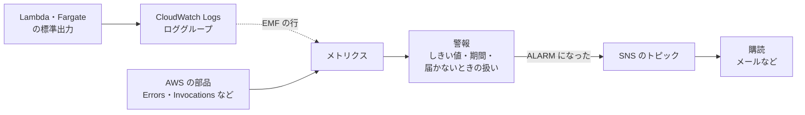

# CloudWatch と SNS

[目次](../README.md) ＞ [技術カード](README.md) ＞ CloudWatch と SNS

## 一言で

**CloudWatch** は、AWS の部品のログと数字（メトリクス）を集め、数字に **警報** を付けるサービスです。**SNS** は、届いたメッセージを購読している宛先（メールなど）に配るサービスで、警報を人に知らせるのに使います。

## 仕組み



- **ロググループ**: 部品ごとのログの入れ物。**残す期間** を決めなければ、ずっと残って費用がかかる
- **メトリクス**: 時刻ごとの数字。AWS の部品が自分で出すもの（Lambda の `Errors` など）と、自分で出すものがある。自分で出すなら、決まった形の JSON をログに書く **埋め込みメトリクス形式**（EMF）が手軽
- **警報**: 「5 分の合計が 1 以上」のように、メトリクスがしきい値を何期間続けて越えたら **ALARM** になる。数字が **届かないとき** の扱い（`treatMissingData`）も決める
- **SNS のトピック**: 警報の行き先。トピックに **購読** を付けると、届いたものが配られる。メールの購読は、確認のメールのリンクを開くまで有効にならない

## 最小の使い方

（[scripts/cdk-samples.ts](../08-aws/scripts/cdk-samples.ts) で合成を確かめた例。配備には AWS が要り、警報 1 つにつき月額がかかります）

```ts
const alarms = new sns.Topic(stack, 'Alarms');
alarms.addSubscription(new subscriptions.EmailSubscription('ops@example.com'));

// 失敗が来たら鳴る
new cloudwatch.Alarm(stack, 'WorkerErrors', {
  metric: worker.metricErrors({ period: Duration.minutes(5), statistic: 'Sum' }),
  threshold: 1,
  evaluationPeriods: 1,
  comparisonOperator: cloudwatch.ComparisonOperator.GREATER_THAN_OR_EQUAL_TO_THRESHOLD,
  treatMissingData: cloudwatch.TreatMissingData.NOT_BREACHING,   // 何も起きなければ数字は来ない
}).addAlarmAction(new cwActions.SnsAction(alarms));

// 2 日続けて 1 回も呼ばれなければ鳴る
new cloudwatch.Alarm(stack, 'NoRecentRun', {
  metric: worker.metricInvocations({ period: Duration.days(1), statistic: 'Sum' }),
  threshold: 1,
  evaluationPeriods: 2,
  comparisonOperator: cloudwatch.ComparisonOperator.LESS_THAN_THRESHOLD,
  treatMissingData: cloudwatch.TreatMissingData.BREACHING,       // 数字が来ないことも異常
}).addAlarmAction(new cwActions.SnsAction(alarms));
```

Lambda から自分の数字を出す（EMF）:

```ts
console.log(JSON.stringify({
  _aws: { Timestamp: Date.now(), CloudWatchMetrics: [{ Namespace: 'MyApp', Dimensions: [['Env']], Metrics: [{ Name: 'SpendRatio', Unit: 'None' }] }] },
  Env: 'dev',
  SpendRatio: 0.42,
}));
```

ロググループの残す期間は、`new logs.LogGroup(stack, 'Logs', { retention: logs.RetentionDays.TWO_WEEKS })` を作って Lambda やタスクに渡します。

## このリポジトリでは

| 場所 | 見どころ | 章 |
|---|---|---|
| [infra/lib/console-stack.ts](https://github.com/duwenji/yorisoi-console/blob/main/infra/lib/console-stack.ts) | 公開の失敗と、2 日公開がないこと（`BREACHING`）の警報 | [8-3](../08-aws/03-lambda-apigw.md)・[8-11](../08-aws/11-watch-and-cost.md) |
| [infra/lib/console-app.ts](https://github.com/duwenji/yorisoi-console/blob/main/infra/lib/console-app.ts) の `NoticesNotSent` | デッドレターキューにたまったら鳴る | [8-7](../08-aws/07-sqs-ses-kms.md) |
| [infra/lib/relay-stack.ts](https://github.com/duwenji/yorisoi-console/blob/main/infra/lib/relay-stack.ts)・[api/src/relay/aws.ts](https://github.com/duwenji/yorisoi-console/blob/main/api/src/relay/aws.ts) の `emitMetric` | EMF で自分の数字を出し、予算・停止・設定・上流の失敗に警報 | [8-9](../08-aws/09-ai-relay.md)・[8-11](../08-aws/11-watch-and-cost.md) |
| [infra/lib/tiles-stack.ts](https://github.com/duwenji/yorisoi-console/blob/main/infra/lib/tiles-stack.ts) | 警報ではなく EventBridge のルールから SNS へ | [8-10](../08-aws/10-spot-tiles.md) |

## よくある間違い

| 間違い | 起きること | 正しくは |
|---|---|---|
| 失敗の警報だけを付ける | 呼ばれなくなっても気づかない | 成功（または呼び出し）が来ないことも見張る |
| 失敗の警報に `BREACHING` を付ける | 何も起きない日に鳴り続ける | 失敗は `NOT_BREACHING`、「来ないこと」は `BREACHING` |
| メールの購読の確認を開かない | 警報が鳴っても届かない | 配備したら確認のリンクを開く |
| ロググループの期間を決めない | ログが溜まり続けて費用がかかる | `retention` を決める |
| ログに個人情報やプロンプトを書く | 残したものが漏れうる | 数や ID だけを書く |

## 版と公式ドキュメント

CDK では `aws-cdk-lib/aws-cloudwatch`・`aws-cloudwatch-actions`・`aws-logs`・`aws-sns`・`aws-sns-subscriptions`（2.272 以上）。

- [CloudWatch の警報](https://docs.aws.amazon.com/ja_jp/AmazonCloudWatch/latest/monitoring/AlarmThatSendsEmail.html)
- [埋め込みメトリクス形式（EMF）](https://docs.aws.amazon.com/ja_jp/AmazonCloudWatch/latest/monitoring/CloudWatch_Embedded_Metric_Format.html)
- [Amazon SNS の開発者ガイド](https://docs.aws.amazon.com/ja_jp/sns/latest/dg/welcome.html)
