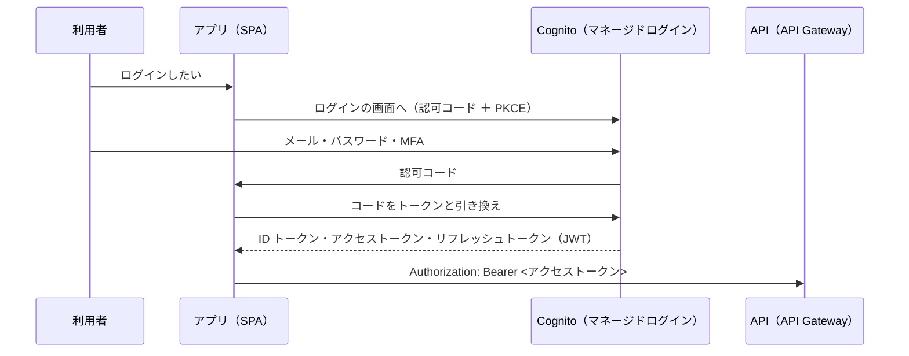

# Cognito

[目次](../README.md) ＞ [技術カード](README.md) ＞ Cognito

## 一言で

利用者の登録・ログイン・MFA・パスワードの再設定などを、丸ごと貸してくれる AWS のサービスです。ログインに成功すると、ログインしたことを示すトークン（JWT）を発行します。

## 仕組み



- **ユーザープール**: 利用者の名簿と、ログインの決まり（MFA・パスワードの強さ・自分で登録できるか）
- **グループ**: 利用者の分け方。トークンの `cognito:groups` に入る
- **アプリクライアント**: ログインを使うアプリごとの設定。SPA は秘密を持たない **公開クライアント** にし、認可コード ＋ PKCE を使う
- **マネージドログイン**: Cognito が用意するログインの画面。パスワードや MFA のコードは、この画面だけが受け取る
- **トリガー**: 決まった場面（登録の確認のあとなど）で Lambda を呼ぶ
- **トークン**: ID トークン（だれか）・アクセストークン（何をしてよいか）・リフレッシュトークン（取り直し用）。JWT なので中身は読めるが、署名があるので書き換えられない

## 最小の使い方

CDK で、ユーザープールと SPA のためのクライアントを作ります（[scripts/cdk-samples.ts](../08-aws/scripts/cdk-samples.ts) で合成を確かめた例。配備には AWS が要ります）。

```ts
const pool = new cognito.UserPool(stack, 'Users', {
  selfSignUpEnabled: true,
  signInAliases: { email: true },
  mfa: cognito.Mfa.REQUIRED,
  mfaSecondFactor: { sms: false, otp: true },   // 認証アプリ（TOTP）
  removalPolicy: RemovalPolicy.DESTROY,
});

const client = pool.addClient('Web', {
  generateSecret: false,                           // SPA には秘密を置かない
  oAuth: {
    flows: { authorizationCodeGrant: true },       // 認可コード（＋ PKCE）
    callbackUrls: ['http://localhost:5173/callback'],
  },
});

pool.addDomain('Domain', { cognitoDomain: { domainPrefix: 'my-app-example' } });   // ログインの画面の場所
```

ブラウザの側は、OIDC のライブラリ（このリポジトリは oidc-client-ts。[9-2](../09-console/02-browser-login.md)、[技術カード: OIDC](oidc.md)）で、ログインの画面への移動とトークンの受け取りを行います。

JWT の中身は、base64url を戻すだけで読めます（[8-4](../08-aws/04-cognito.md) のハンズオン）。

## このリポジトリでは

| 場所 | 見どころ | 章 |
|---|---|---|
| [infra/lib/console-app.ts](../../sanpo-channel-console/infra/lib/console-app.ts) | 1 つのユーザープール、全員に TOTP の MFA、運用者・配信元のグループ、公開クライアント、トークンの期限 60 分 | [8-4](../08-aws/04-cognito.md) |
| [api/src/console/post-confirmation.ts](../../sanpo-channel-console/api/src/console/post-confirmation.ts) | 登録した人は必ず配信元に。運用者は管理者が手で | [8-4](../08-aws/04-cognito.md) |
| 同 `UserPoolWaf` | 本番だけ、WAF で登録・ログインの回数を制限 | [8-4](../08-aws/04-cognito.md) |
| [api/src/notify/handler.ts](../../sanpo-channel-console/api/src/notify/handler.ts) | メールアドレスはデータベースに持たず、送るたびに Cognito から確認済みのものを引く | [8-7](../08-aws/07-sqs-ses-kms.md) |

## よくある間違い

| 間違い | 起きること | 正しくは |
|---|---|---|
| SPA のクライアントに秘密を付ける | ブラウザのコードから秘密が読める | 公開クライアント ＋ PKCE |
| 自分で登録した人が、強い権限のグループに入れる | 登録だけで管理者になれてしまう | 登録時のグループはトリガーで決め、強い権限は管理者が手で |
| JWT に秘密の情報を入れる・JWT の中身を信じて確かめない | 中身はだれでも読める。偽のトークンを信じてしまう | 秘密を入れない。署名と発行元・宛先・期限を確かめる（API Gateway に任せられる） |
| 「このメールアドレスは登録されていません」と答える | 登録されているかを探られる | `preventUserExistenceErrors` |
| トークンの期限を長くする | 漏れたときに長く使われる | 短くし、リフレッシュトークンで取り直す |

## 版と公式ドキュメント

CDK では `aws-cdk-lib/aws-cognito`（2.272 以上）。機能のプランは Essentials（`featurePlan: ESSENTIALS`）。

- [Cognito ユーザープール](https://docs.aws.amazon.com/ja_jp/cognito/latest/developerguide/cognito-user-pools.html)
- [マネージドログイン](https://docs.aws.amazon.com/ja_jp/cognito/latest/developerguide/cognito-user-pools-managed-login.html)
- [トークンの使い方](https://docs.aws.amazon.com/ja_jp/cognito/latest/developerguide/amazon-cognito-user-pools-using-tokens-with-identity-providers.html)
