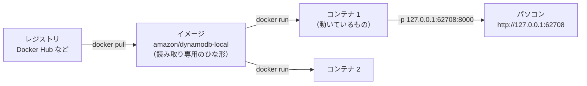

# Docker

[目次](../README.md) ＞ [技術カード](README.md) ＞ Docker

## 一言で

アプリと、それが動くのに要るもの一式（OS の部品・ライブラリ・設定）を **イメージ** にまとめ、どのパソコンでも同じように **コンテナ** として動かす仕組みです。テスト用のデータベースを手元ですぐに立てる、といった使い方もできます。

## 仕組み



- **イメージ**: 動かすものの、読み取り専用のひな形。Docker Hub などのレジストリから取ってくるか、`Dockerfile` から作る
- **コンテナ**: イメージから作った、動いている 1 つの箱。同じイメージから何個でも作れ、互いに干渉しない。止めて消せば、中の変更も消える
- **ポート**: コンテナの中のポートを、パソコンのポートにつなぐ（`-p パソコン側:コンテナ側`）。パソコン側を空けておくと（`-p 127.0.0.1::8000`）、空いている番号が選ばれる
- **仮想マシンより軽い**: OS を丸ごと動かさず、パソコンの OS の仕組みを分け合って動くので、数秒で起動する
- **Windows・Mac では Docker Desktop**: 中で小さな Linux を動かし、その上でコンテナを動かす

## 最小の使い方

Docker Desktop を起動しておきます（下の例は実際に動かして確かめたものです）。

### DynamoDB Local を動かして、止める

```sh
# 裏で起動（-d）、止めたら消す（--rm）、空いている番号につなぐ
ID=$(docker run -d --rm -p 127.0.0.1::8000 amazon/dynamodb-local:latest -jar DynamoDBLocal.jar -inMemory)

# どの番号につながったか
docker port $ID 8000/tcp
#  → 127.0.0.1:62708

# 動いているコンテナの一覧
docker ps

# 止める（--rm なので、止めると消える）
docker stop $ID
```

初めて動かすときは、イメージのダウンロードに少し時間がかかります。

### 動いている DynamoDB Local を使う

管理システムのフォルダの `.local/ddb.mjs`（AWS の SDK は管理システムに入っているものを使う）:

```js
import { CreateTableCommand, DynamoDBClient, ListTablesCommand } from '@aws-sdk/client-dynamodb';

const db = new DynamoDBClient({
  endpoint: process.env.DDB_ENDPOINT,
  region: 'ap-northeast-1',
  credentials: { accessKeyId: 'local', secretAccessKey: 'local' },   // DynamoDB Local は何でもよい
});

await db.send(new CreateTableCommand({
  TableName: 'walks',
  BillingMode: 'PAY_PER_REQUEST',
  AttributeDefinitions: [{ AttributeName: 'id', AttributeType: 'S' }],
  KeySchema: [{ AttributeName: 'id', KeyType: 'HASH' }],
}));
console.log((await db.send(new ListTablesCommand({}))).TableNames);
```

```sh
DDB_ENDPOINT=http://127.0.0.1:62708 node .local/ddb.mjs
#  → [ 'walks' ]
```

本物の DynamoDB と同じ SDK・同じ書き方で、接続先（`endpoint`）だけを手元に向けています。

### よく使うコマンド

| コマンド | 何をするか |
|---|---|
| `docker run [オプション] イメージ [コマンド]` | コンテナを作って動かす |
| `docker ps` / `docker ps -a` | 動いているコンテナ / 止まったものも |
| `docker stop <ID>` | 止める |
| `docker logs <ID>` | コンテナの出力を見る |
| `docker images` | 手元にあるイメージ |
| `docker info` | Docker が動いているかの確認 |

| `docker run` のオプション | 意味 |
|---|---|
| `-d` | 裏で動かす |
| `--rm` | 止めたら消す |
| `-p 127.0.0.1:8000:8000` | ポートをつなぐ（`127.0.0.1` で、パソコンの外からはつなげない） |
| `-e 名前=値` | 環境変数 |
| `--name 名前` | コンテナに名前を付ける |

## このリポジトリでは

| 場所 | 見どころ | 章 |
|---|---|---|
| [api/test/dynamo-local.ts](../../yorisoi-console/api/test/dynamo-local.ts) | テストのファイルごとに DynamoDB Local を `docker run -d --rm -p 127.0.0.1::8000` で起動し、終わったら `docker stop` | [7-4](../07-typescript/04-testing.md) |
| [.github/workflows/ci.yml](../../yorisoi-console/.github/workflows/ci.yml) | CI では `services:` で DynamoDB Local のコンテナを用意し、`DYNAMODB_ENDPOINT` を渡す | [7-4](../07-typescript/04-testing.md)、[技術カード: GitHub Actions](github-actions.md) |
| [infra/lib/console-stack.ts](../../yorisoi-console/infra/lib/console-stack.ts) | CDK の `NodejsFunction` が Lambda の JavaScript をまとめる（Docker を使わない esbuild で） | [8-2](../08-aws/02-cdk.md) |

## よくある間違い

| 間違い | 起きること | 正しくは |
|---|---|---|
| Docker Desktop を起動していない | `docker` のコマンドが失敗する。テストが接続できない | 先に Docker Desktop を起動する（`docker info` で確認） |
| ポートを決め打ちにする（`-p 8000:8000`） | ほかのコンテナやアプリと番号がぶつかる | 空いている番号に任せる（`-p 127.0.0.1::8000`）か、使っていない番号にする |
| `-p 8000:8000` とだけ書く | パソコンの外（同じネットワークの他人）からもつなげてしまう | `127.0.0.1:` を付ける |
| `--rm` を付けずに何度も起動する | 止まったコンテナがたまっていく | `--rm` を付ける。たまったら `docker container prune` |
| コンテナの中にだけ大事なデータを置く | 消すとデータも消える | 残したいものは、ボリュームやパソコンのフォルダに |

## 版と公式ドキュメント

| 項目 | 版 |
|---|---|
| Docker Engine（このパソコン） | 28.5（`docker info`） |
| `amazon/dynamodb-local` | `latest` |

- [Docker のドキュメント](https://docs.docker.com/)
- [docker run のリファレンス](https://docs.docker.com/reference/cli/docker/container/run/)
- [DynamoDB Local（AWS）](https://docs.aws.amazon.com/amazondynamodb/latest/developerguide/DynamoDBLocal.html)
