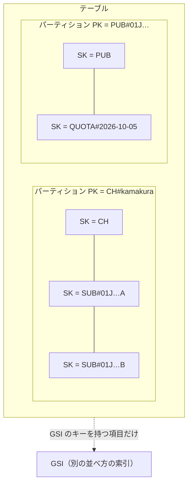

# DynamoDB

[目次](../README.md) ＞ [技術カード](README.md) ＞ DynamoDB

## 一言で

AWS のキーと値のデータベースです。キーで引けば、データがどれだけ増えても速く、サーバーを持たず、使った分だけ払います。その代わり、決まった引き方（キー）しかできないので、読み方を先に決めて設計します。

## 仕組み



- **項目**: JSON に近い値の集まり。項目ごとに持つ属性が違ってよい
- **パーティションキー（PK）とソートキー（SK）**: 項目を決めるキー。PK が同じ項目は SK の順に並ぶ
- **引き方**: `GetItem`（PK と SK で 1 つ）、`Query`（PK と、SK の範囲・`begins_with`）。`Scan`（全部を見る）は遅くて高い
- **GSI**: 別のキーで並べ直した索引。**GSI のキーを持つ項目だけが入る**（疎なインデックス）
- **条件つき書き込み**: 「この条件のときだけ書く」を 1 回で行う。満たさなければ `ConditionalCheckFailedException`
- **トランザクション**: 複数の書き込みを、全部行うか全部行わないか
- **TTL**: 決まった属性（UNIX の秒）を過ぎた項目を、自動で消す
- **料金**: オンデマンドなら、読み書きの回数と保存した量

## 最小の使い方

Docker の DynamoDB Local で、手元で試せます（[技術カード: Docker](docker.md)）。下の例は、[8-5](../08-aws/05-dynamodb.md) の [scripts/single-table.mjs](../08-aws/scripts/single-table.mjs) で実際に動かしたものの一部です。

```js
import { DynamoDBClient } from '@aws-sdk/client-dynamodb';
import { DynamoDBDocumentClient, PutCommand, QueryCommand, UpdateCommand } from '@aws-sdk/lib-dynamodb';

const db = DynamoDBDocumentClient.from(new DynamoDBClient({
  endpoint: process.env.DDB_ENDPOINT,            // DynamoDB Local。本物なら書かない
  region: 'ap-northeast-1',
  credentials: { accessKeyId: 'local', secretAccessKey: 'local' },
}));

// 入れる
await db.send(new PutCommand({ TableName, Item: { PK: 'CH#kamakura-history', SK: 'CH', name: '鎌倉歴史散歩', rev: 1 } }));

// PK が同じで、SK が SUB# で始まるものを、新しい順に
const subs = await db.send(new QueryCommand({
  TableName,
  KeyConditionExpression: 'PK = :pk AND begins_with(SK, :sub)',
  ExpressionAttributeValues: { ':pk': 'CH#kamakura-history', ':sub': 'SUB#' },
  ScanIndexForward: false,
}));

// 条件つき書き込み（rev が 1 のときだけ）
await db.send(new UpdateCommand({
  TableName, Key: { PK: 'CH#kamakura-history', SK: 'CH' },
  UpdateExpression: 'SET #rev = #rev + :one',
  ConditionExpression: '#rev = :expected',
  ExpressionAttributeNames: { '#rev': 'rev' },
  ExpressionAttributeValues: { ':one': 1, ':expected': 1 },
}));
```

`lib-dynamodb` の `DynamoDBDocumentClient` を使うと、JavaScript の値をそのまま読み書きできます（素の SDK は `{ S: '文字列' }` のような形を要求する）。

## このリポジトリでは

| 場所 | 見どころ | 章 |
|---|---|---|
| [docs/data-model.md（DM-001）](../../yorisoi-console/docs/data-model.md) | 22 のアクセスパターンから決めた、1 テーブルのキーの付け方 | [8-5](../08-aws/05-dynamodb.md) |
| [api/src/console/operator.ts](../../yorisoi-console/api/src/console/operator.ts) | `rev` の条件つき書き込みと、操作の記録を含むトランザクション | [8-5](../08-aws/05-dynamodb.md) |
| [api/src/console/publisher.ts](../../yorisoi-console/api/src/console/publisher.ts) | 1 日の上限を条件つきの `ADD` で数え、TTL で消す | [8-5](../08-aws/05-dynamodb.md) |
| [api/src/console/util.ts](../../yorisoi-console/api/src/console/util.ts) | ULID（作った順に並ぶ ID）、暗号化したカーソル | [8-5](../08-aws/05-dynamodb.md) |
| [api/test/dynamo-local.ts](../../yorisoi-console/api/test/dynamo-local.ts) | テストごとに、本物と同じ形のテーブルを DynamoDB Local に作る | [7-4](../07-typescript/04-testing.md) |

## よくある間違い

| 間違い | 起きること | 正しくは |
|---|---|---|
| 読み方を決めずにキーを決める | あとで引けない読み方が出て、`Scan` になる | アクセスパターンを先に並べる |
| 「読んで確かめて書く」を自分で行う | 間に割り込まれて、上書き・二重の書き込み | 条件つき書き込み |
| 一緒に変えるものを別々に書く | 途中で止まると、半分だけ書かれる | トランザクション |
| SK の数を 0 で埋めない | 文字列の順で `10` が `9` より前に来る | 桁をそろえる |
| `LastEvaluatedKey` をそのまま外に返す | キーの形が見え、書き換えて送られる | 暗号化して渡す |
| 予約語（`status`・`name` など）をそのまま式に書く | 式のエラー | `ExpressionAttributeNames`（`#status`） |

## 版と公式ドキュメント

| 項目 | 版 |
|---|---|
| `@aws-sdk/client-dynamodb`・`@aws-sdk/lib-dynamodb` | 3.1146 以上（`api/package.json`） |
| テーブル | `TableV2`（CloudFormation では `AWS::DynamoDB::GlobalTable`）、オンデマンド |

- [DynamoDB の開発者ガイド](https://docs.aws.amazon.com/ja_jp/amazondynamodb/latest/developerguide/Introduction.html)
- [データのモデリング（1 テーブル設計）](https://docs.aws.amazon.com/ja_jp/amazondynamodb/latest/developerguide/bp-modeling-nosql.html)
- [条件式](https://docs.aws.amazon.com/ja_jp/amazondynamodb/latest/developerguide/Expressions.ConditionExpressions.html)
