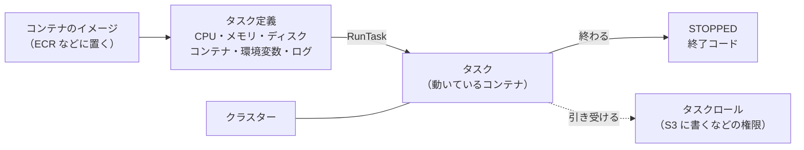

# ECS と Fargate

[目次](../README.md) ＞ [技術カード](README.md) ＞ ECS と Fargate

## 一言で

**ECS**（Elastic Container Service）は、AWS でコンテナを動かすサービスです。**Fargate** は、そのコンテナを動かす計算機を AWS に任せる形で、サーバーを自分で持たずに、時間の上限なくコンテナを動かせます。

## 仕組み



- **タスク定義**: どのイメージを、どれだけの CPU・メモリ・ディスクで、どんな環境変数で動かすかの設計図
- **タスク**: タスク定義から動かした 1 回分。バッチなら終われば止まり、費用も止まる。ずっと動かしたいなら **サービス** にする
- **クラスター**: タスクをまとめる入れ物。Fargate では計算機を自分で足さないので、名前だけの箱に近い
- **2 つのロール**: **タスクロール** はコンテナの中のプログラムが使う権限、**実行ロール** は ECS がイメージを取る・ログを書くための権限
- **VPC の中で動く**: Lambda と違い、タスクには網（サブネット）とセキュリティグループが要る（[技術カード: VPC](vpc.md)）

| | Lambda | Fargate のタスク |
|---|---|---|
| 動いてよい時間 | 15 分まで | 上限なし |
| メモリ | 10GB まで | 120GB まで（CPU の大きさによる） |
| 中身 | 関数のコード（またはコンテナ） | コンテナ（どんな道具でも入れられる） |
| 動き出すまで | ミリ秒〜数秒 | 数十秒〜1 分ほど（イメージを取るため） |
| 料金 | 回数 ＋ 時間 × メモリ | 時間 × （CPU ＋ メモリ） |

## 最小の使い方

（[scripts/cdk-samples.ts](../08-aws/scripts/cdk-samples.ts) で合成を確かめた例。配備と実行には AWS が要り、動いた時間だけ費用がかかります）

```ts
const cluster = new ecs.Cluster(stack, 'Cluster', { vpc });
const task = new ecs.FargateTaskDefinition(stack, 'Batch', { cpu: 1024, memoryLimitMiB: 2048 });
task.addContainer('main', {
  image: ecs.ContainerImage.fromRegistry('public.ecr.aws/docker/library/python:3.12-slim'),
  command: ['python', '-c', "print('hello from Fargate')"],
  logging: ecs.LogDrivers.awsLogs({ streamPrefix: 'batch', logGroup: new logs.LogGroup(stack, 'BatchLogs', { retention: logs.RetentionDays.ONE_MONTH }) }),
  environment: { BUCKET: bucket.bucketName },
});
bucket.grantReadWrite(task.taskRole);   // コンテナの中のプログラムの権限
```

自分の Dockerfile から作るなら、`ContainerImage.fromAsset('path/to/dir')` にします。配備のときに Docker でイメージを組み立てて ECR に上げます（配備する PC に Docker が要る）。

手で 1 回動かす:

```sh
aws ecs run-task --launch-type FARGATE --cluster <クラスター> --task-definition <タスク定義> \
  --network-configuration "awsvpcConfiguration={subnets=[<サブネット>],securityGroups=[<SG>],assignPublicIp=ENABLED}"
```

決まった時刻に動かすなら、EventBridge Scheduler の `EcsRunFargateTask` を使います（[技術カード: EventBridge](eventbridge.md)）。

## このリポジトリでは

| 場所 | 見どころ | 章 |
|---|---|---|
| [infra/lib/tiles-stack.ts](https://github.com/duwenji/yorisoi-console/blob/main/infra/lib/tiles-stack.ts) | 4 vCPU・16GB・ディスク 40GB のタスク、x86-64 のイメージ、自分の配信だけ無効化してよい権限 | [8-10](../08-aws/10-spot-tiles.md) |
| [tiles/Dockerfile](https://github.com/duwenji/yorisoi-console/blob/main/tiles/Dockerfile)・[build.sh](https://github.com/duwenji/yorisoi-console/blob/main/tiles/build.sh) | `osmium` と Python の入ったイメージ、段階ごとに JSON の行をログに出す | [8-10](../08-aws/10-spot-tiles.md) |

## よくある間違い

| 間違い | 起きること | 正しくは |
|---|---|---|
| 15 分を超える処理を Lambda に入れる | 途中で打ち切られる | Fargate などに分ける |
| Arm の PC で作ったイメージを x86-64 のタスクで動かす | `exec format error` で起動しない | `platform: LINUX_AMD64` を指定するか、`runtimePlatform` を Arm にそろえる |
| タスクロールと実行ロールを取り違える | プログラムが S3 に書けない、またはイメージが取れない | プログラムの権限はタスクロールに |
| 公開 IP も NAT もないサブネットで動かす | イメージを取れず、タスクが起動しない | 公開 IP を付けるか、NAT か VPC エンドポイントを置く |
| ディスクの大きさを決めない | 既定の 20GB を超えて失敗する | `ephemeralStorageGiB` を決める |

## 版と公式ドキュメント

CDK では `aws-cdk-lib/aws-ecs`・`aws-ecr-assets`（2.272 以上）。

- [Amazon ECS の開発者ガイド](https://docs.aws.amazon.com/ja_jp/AmazonECS/latest/developerguide/Welcome.html)
- [AWS Fargate](https://docs.aws.amazon.com/ja_jp/AmazonECS/latest/developerguide/AWS_Fargate.html)
- [タスクの IAM ロール](https://docs.aws.amazon.com/ja_jp/AmazonECS/latest/developerguide/task-iam-roles.html)
