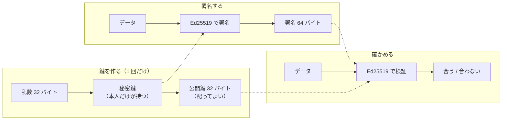

# 公開鍵暗号と Ed25519

[目次](../README.md) ＞ [技術カード](README.md) ＞ 公開鍵暗号と Ed25519

## 一言で

**公開鍵暗号** は、対になった 2 つの鍵（秘密鍵と公開鍵）を使う暗号です。**Ed25519** はそのうちの署名の方式の 1 つで、秘密鍵で署名し、公開鍵でだれでも確かめられます。

## 仕組み



- **秘密鍵から公開鍵は作れるが、逆はできない**: 公開鍵を配っても、秘密鍵は分かりません
- **署名はデータと結びつく**: データを 1 ビットでも変えると、同じ署名では確かめられません。別のデータに署名を使い回すこともできません
- **署名できるのは秘密鍵の持ち主だけ**: 公開鍵を持っていても、新しい署名は作れません
- **決定的**: 同じ秘密鍵・同じデータからは、いつも同じ署名ができます（署名の中で乱数を使わない）。乱数の質に左右されず、テストの期待値も固定できます
- **小さくて速い**: 公開鍵 32 バイト、署名 64 バイト。鍵の大きさの割に強く、計算も速いので、QR コードや ID に収まります

規格は RFC 8032 です。Ed25519 には、データをそのまま署名する普通の方式（PureEdDSA）と、先にハッシュしてから署名する **Ed25519ph** があり、署名が違います。このリポジトリは普通の方式だけを使います。

### 暗号化との違い

公開鍵暗号には「公開鍵で暗号化し、秘密鍵で復号する」使い方もありますが、Ed25519 は **署名専用** です。データを隠すことはできません。中身を隠すのではなく、**中身が本物で、変わっていないこと** を示します。

## 最小の使い方

すべて手元で、お金をかけずに試せます。

### Node.js（TypeScript）

```ts
import { generateKeyPairSync, sign, verify } from 'node:crypto';

const { privateKey, publicKey } = generateKeyPairSync('ed25519');
const message = Buffer.from('鎌倉歴史散歩');
const signature = sign(null, message, privateKey);   // 第 1 引数は null（Ed25519 はハッシュ方式を選ばない）
console.log(signature.length);                        // 64
console.log(verify(null, message, publicKey, signature));   // true
console.log(publicKey.export({ format: 'jwk' }).x);   // 生の公開鍵 32 バイトを base64url で
```

### ブラウザ（WebCrypto）

Node.js 22 以上でも同じコードが動きます。

```ts
const subtle = globalThis.crypto.subtle;
const pair = await subtle.generateKey({ name: 'Ed25519' }, true, ['sign', 'verify']);
const signature = await subtle.sign({ name: 'Ed25519' }, pair.privateKey, message);
const ok = await subtle.verify({ name: 'Ed25519' }, pair.publicKey, signature, message);
const rawPublicKey = new Uint8Array(await subtle.exportKey('raw', pair.publicKey));   // 32 バイト
```

### Java・Kotlin（JVM、Java 15 以上）

```kotlin
import java.security.KeyPairGenerator
import java.security.Signature

val pair = KeyPairGenerator.getInstance("Ed25519").generateKeyPair()
val message = "鎌倉歴史散歩".toByteArray()
val signature = Signature.getInstance("Ed25519").run {
    initSign(pair.private); update(message); sign()
}
val ok = Signature.getInstance("Ed25519").run {
    initVerify(pair.public); update(message); verify(signature)
}
```

Android では Android 13 からしか使えません。それより古い端末も対象にするなら [Tink](tink.md) を使います。

### 鍵の形に注意

同じ Ed25519 の公開鍵でも、ライブラリによって受け取る形が違います。

| 形 | 大きさ | 使う場所 |
|---|---|---|
| 生の鍵（raw） | 32 バイト | API-002 の文書、Tink、WebCrypto の `'raw'`、JWK の `x` |
| DER（SubjectPublicKeyInfo） | 44 バイト（先頭 12 バイトは固定） | Node.js の `createPublicKey`、Java の `X509EncodedKeySpec`、AWS KMS の `GetPublicKey` |

変換は「固定の 12 バイト `302a300506032b6570032100` を前に付ける・外す」だけです（[6-2](../06-trust/02-ed25519-and-ids.md)）。

## このリポジトリでは

| だれが | 何に署名する／何を確かめる | 使っている実装 | 章 |
|---|---|---|---|
| 運営（ルート鍵、オフライン） | 鍵セットに署名 | Node.js（[tools/root-key](../../yorisoi-console/tools/root-key/src/root-key.ts)） | [6-4](../06-trust/04-two-tier-keys.md) |
| 管理システム（署名鍵） | リストの要約・試用チケットに署名 | [AWS KMS](aws-kms.md) | [6-4](../06-trust/04-two-tier-keys.md) |
| チャンネル提供者 | パッケージに署名 | ブラウザの WebCrypto（[web/src/publisher-crypto.ts](../../yorisoi-console/web/src/publisher-crypto.ts)） | [9-3](../09-console/03-keys-in-browser.md) |
| 管理システム | 外に出す前に確かめる、準拠テスト | Node.js（[packages/protocol/src/ed25519.ts](../../yorisoi-console/packages/protocol/src/ed25519.ts)） | [6-6](../06-trust/06-same-rules.md) |
| 機械審査 | チャンネル提供者の署名を確かめる | Java 標準（`JcaEd25519`） | [6-5](../06-trust/05-verify-in-app.md) |
| アプリ | すべての署名を確かめる | [Tink](tink.md)（`TinkEd25519`） | [6-5](../06-trust/05-verify-in-app.md) |

署名が **KMS・Node.js・ブラウザ・Java・Tink** の 5 つの実装の間を行き来します。どこでも同じ方式が使えることが、Ed25519 を選んだ大きな理由です。

## よくある間違い

| 間違い | 起きること | 正しくは |
|---|---|---|
| Node.js の `sign` の第 1 引数に `'sha256'` などを渡す | エラーになる | Ed25519 では `null` を渡す |
| Ed25519 と Ed25519ph を混ぜる | 署名がいつまでも合わない | 署名する側と確かめる側で方式をそろえる。KMS なら `ED25519_SHA_512` と `RAW` |
| 生の鍵と DER を取り違える | 「鍵の長さが違う」「Ed25519 の鍵ではない」などのエラー | 受け取る側のライブラリがどちらの形を求めているか確かめる |
| 署名を確かめずにデータを使う | 書き換えられたデータを使ってしまう | 確かめてから使う。署名つきの JSON なら、確かめてから JSON として読む（[6-3](../06-trust/03-signed-documents.md)） |
| 秘密鍵をリポジトリに入れる | 漏れれば、だれでも署名できる | 秘密鍵は Git の外に置く。このリポジトリは `.gitignore` で `*.pem`・`*.key`・`.local/` を除いている |

## 版と公式ドキュメント

| 環境 | 版 |
|---|---|
| Node.js | 22 以上（yorisoi-console の `package.json`） |
| Java | 17 向けにビルド（Ed25519 は Java 15 から標準） |
| Android（Tink） | `tink-android` 1.23.0（SanpoGuide の `apps/sanpoguide/app/build.gradle.kts`） |

- [RFC 8032（EdDSA の規格、英語）](https://www.rfc-editor.org/rfc/rfc8032)
- [Node.js: crypto.sign](https://nodejs.org/api/crypto.html#cryptosignalgorithm-data-key-callback)
- [MDN: SubtleCrypto.sign（Ed25519）](https://developer.mozilla.org/ja/docs/Web/API/SubtleCrypto/sign)
- [Java: Signature のアルゴリズム名](https://docs.oracle.com/en/java/javase/17/docs/specs/security/standard-names.html#signature-algorithms)
