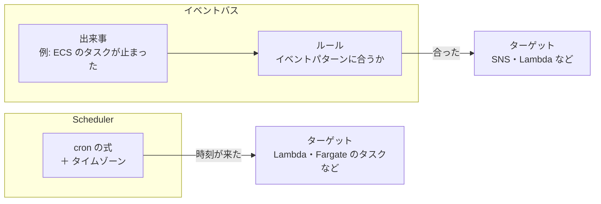

# EventBridge

[目次](../README.md) ＞ [技術カード](README.md) ＞ EventBridge

## 一言で

決まった時刻に何かを動かしたり（**Scheduler**）、AWS の中で起きた出来事に応じて何かを動かしたり（**ルール**）するサービスです。

## 仕組み



- **Scheduler**: 「毎日 3:00」「毎週水曜」などの時刻に、ターゲット（Lambda を呼ぶ、Fargate のタスクを動かすなど）を動かす。**タイムゾーン** を指定でき、指定しなければ UTC
- **ルール**: AWS のサービスが流す **出来事**（イベント、JSON）のうち、**イベントパターン** に合うものだけをターゲットに渡す
- **イベントパターン**: 出来事の JSON と同じ形で、合ってほしい値を並べる。`anything-but`（〜以外）・`prefix`（〜で始まる）などの書き方もある
- 出来事の例: ECS のタスクの状態が変わった（`ECS Task State Change`）、S3 にファイルが置かれた、CodeBuild が終わった

## 最小の使い方

（[scripts/cdk-samples.ts](../08-aws/scripts/cdk-samples.ts) で合成を確かめた例。配備には AWS が要ります）

決まった時刻に、Fargate のタスクを動かす:

```ts
new scheduler.Schedule(stack, 'Weekly', {
  schedule: scheduler.ScheduleExpression.cron({ minute: '0', hour: '3', weekDay: 'WED', timeZone: TimeZone.ASIA_TOKYO }),
  target: new schedulerTargets.EcsRunFargateTask(cluster, {
    taskDefinition: task,
    assignPublicIp: true,
    vpcSubnets: { subnetType: ec2.SubnetType.PUBLIC },
    securityGroups: [outOnly],
  }),
});
```

合成すると `cron(0 3 ? * WED *)` と `Asia/Tokyo` になります。Lambda を呼ぶなら、ターゲットを `new schedulerTargets.LambdaInvoke(fn, { input: ScheduleTargetInput.fromObject({ trigger: 'daily' }) })` にします。

タスクが失敗で止まったら、SNS に渡す:

```ts
new events.Rule(stack, 'BatchFailed', {
  eventPattern: {
    source: ['aws.ecs'],
    detailType: ['ECS Task State Change'],
    detail: { clusterArn: [cluster.clusterArn], lastStatus: ['STOPPED'], containers: { exitCode: [{ 'anything-but': 0 }] } },
  },
  targets: [new eventTargets.SnsTopic(alarms)],
});
```

## このリポジトリでは

| 場所 | 見どころ | 章 |
|---|---|---|
| [infra/lib/console-stack.ts](https://github.com/duwenji/yorisoi-console/blob/main/infra/lib/console-stack.ts) の `DailyPublish` | 毎日 03:00（UTC の 18 時で書く）に公開の Lambda を `{"trigger":"daily"}` で呼ぶ | [8-3](../08-aws/03-lambda-apigw.md) |
| [infra/lib/tiles-stack.ts](https://github.com/duwenji/yorisoi-console/blob/main/infra/lib/tiles-stack.ts) の `Weekly` | 毎週水曜 3:00（`Asia/Tokyo`）に Fargate のタスクを動かす | [8-10](../08-aws/10-spot-tiles.md) |
| 同じく `BatchFailed` | 終了コードが 0 以外で止まったタスクだけを、運営へのメールにする | [8-10](../08-aws/10-spot-tiles.md)・[8-11](../08-aws/11-watch-and-cost.md) |

## よくある間違い

| 間違い | 起きること | 正しくは |
|---|---|---|
| cron の時刻を日本時間のつもりで書く | 9 時間ずれて動く | `timeZone` を指定するか、UTC に直してコメントを残す |
| イベントパターンを広く書きすぎる | 正常に終わったタスクでもメールが来る | 終了コードなど、知りたい出来事だけに絞る |
| 別のクラスターの出来事まで拾う | 関係ないタスクで知らせが来る | `clusterArn` などで自分の部品に絞る |
| 「呼ばれなくなった」を Scheduler に頼る | スケジュールが消えても、だれも気づかない | 成功が来ないことを警報で見張る（[技術カード: CloudWatch と SNS](cloudwatch-sns.md)） |

## 版と公式ドキュメント

CDK では `aws-cdk-lib/aws-scheduler`・`aws-scheduler-targets`・`aws-events`・`aws-events-targets`（2.272 以上）。

- [EventBridge Scheduler のユーザーガイド](https://docs.aws.amazon.com/ja_jp/scheduler/latest/UserGuide/what-is-scheduler.html)
- [EventBridge のイベントパターン](https://docs.aws.amazon.com/ja_jp/eventbridge/latest/userguide/eb-event-patterns.html)
- [ECS が流すイベント](https://docs.aws.amazon.com/ja_jp/AmazonECS/latest/developerguide/ecs_cwe_events.html)
