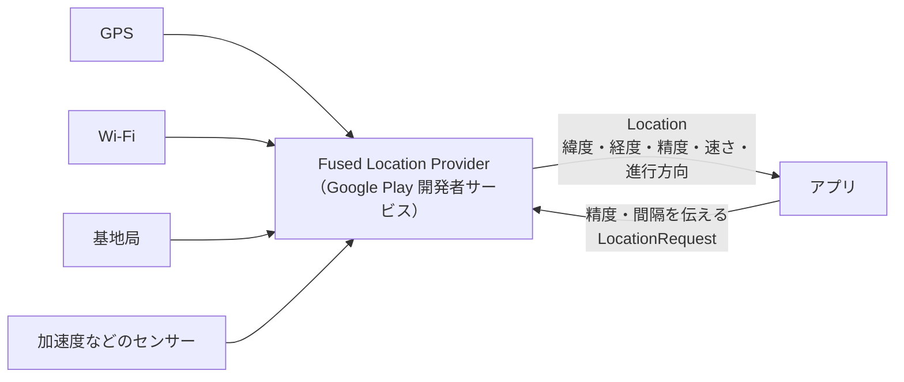

# Fused Location

[目次](../README.md) ＞ [技術カード](README.md) ＞ Fused Location

## 一言で

Google Play 開発者サービスが提供する、端末の位置を受け取るための仕組み（Fused Location Provider）です。GPS・Wi-Fi・携帯の基地局などを組み合わせ、頼んだ精度と電池のつり合いを取りながら位置を届けてくれます。

## 仕組み



- **組み合わせる**: どの方法で測るかを自分で選ばず、「精度を優先」「電池を優先」などの希望を伝えると、使える方法を組み合わせてくれます。動いていないと分かれば、測る回数を減らして電池を節約します
- **2 つの受け取り方**: 今の位置を 1 回だけ（`getCurrentLocation`）と、更新を受け取り続ける（`requestLocationUpdates`）
- **Location に入っているもの**: 緯度・経度のほか、精度の見積もり（`accuracy`、m）、速さ（`speed`、m/秒）、進行方向（`bearing`、北から時計回りの度）、測った時刻
- **権限**: `ACCESS_FINE_LOCATION`（正確な位置）か `ACCESS_COARSE_LOCATION`（大まかな位置）。実行時に利用者の許可が要ります。端末の位置情報の設定がオフなら、権限があっても取れません

### 精度の種類

| `Priority` | 精度 | 電池 |
|---|---|---|
| `PRIORITY_HIGH_ACCURACY` | 最も正確（GPS を使う） | 多い |
| `PRIORITY_BALANCED_POWER_ACCURACY` | 100m 前後 | ふつう |
| `PRIORITY_LOW_POWER` | 数 km | 少ない |
| `PRIORITY_PASSIVE` | ほかのアプリが測ったときだけ | ほぼ使わない |

## 最小の使い方

Google Play 開発者サービスの入った端末かエミュレータで動きます（散策ガイドのプロジェクトの中で、コンパイルが通ることを確かめたものです）。

```kotlin
// build.gradle.kts
dependencies {
    implementation("com.google.android.gms:play-services-location:21.3.0")
    // Task を suspend 関数のように待つ（await）
    implementation("org.jetbrains.kotlinx:kotlinx-coroutines-play-services:1.10.2")
}
```

```xml
<!-- AndroidManifest.xml -->
<uses-permission android:name="android.permission.ACCESS_FINE_LOCATION" />
<uses-permission android:name="android.permission.ACCESS_COARSE_LOCATION" />
```

```kotlin
class LocationSample(context: Context) {
    private val fused = LocationServices.getFusedLocationProviderClient(context)

    // 今の位置を 1 回。取れなければ、端末が最後に知っていた位置
    @RequiresPermission(anyOf = [Manifest.permission.ACCESS_FINE_LOCATION, Manifest.permission.ACCESS_COARSE_LOCATION])
    suspend fun currentLocation(): Location? =
        fused.getCurrentLocation(Priority.PRIORITY_HIGH_ACCURACY, null).await() ?: fused.lastLocation.await()

    // 更新を受け取り続ける
    private val callback = object : LocationCallback() {
        override fun onLocationResult(result: LocationResult) {
            result.lastLocation?.let { println("${it.latitude}, ${it.longitude} ±${it.accuracy}m") }
        }
    }

    @SuppressLint("MissingPermission") // 呼ぶ前に権限を確かめておく
    fun startUpdates() {
        val request = LocationRequest.Builder(Priority.PRIORITY_HIGH_ACCURACY, 10_000L)   // 10 秒ごと
            .setMinUpdateDistanceMeters(10f)                                             // 10m 動いたら
            .build()
        fused.requestLocationUpdates(request, callback, Looper.getMainLooper())
    }

    fun stopUpdates() {
        fused.removeLocationUpdates(callback)   // 必ず止める
    }
}
```

- 権限は、呼ぶ前に Activity で求めておく（[1-3](../01-kotlin-android/03-android-components.md)）
- `setMinUpdateDistanceMeters(10f)` を付けると、動かない間は更新が来ない
- `stopUpdates` を呼ばないと、画面や Service がなくなっても GPS が動き続ける

### 2 点の距離と方向

`Location` には、距離と方向を計算する関数があります。

```kotlin
val meters: Float = here.distanceTo(there)        // 2 点の距離（m）
val bearing: Float = here.bearingTo(there)        // here から there への方向（度、-180〜180）
Location.distanceBetween(lat1, lon1, lat2, lon2, results)   // 緯度・経度から直接
```

### エミュレータで試す

Android Studio のエミュレータの「Extended controls」→「Location」で、位置を指定したり（Single points）、経路にそって動かしたり（Routes）できます。

## このリポジトリでは

| 場所 | 見どころ | 章 |
|---|---|---|
| [MainViewModel.kt](../../SanpoGuide/apps/sanpoguide/app/src/main/java/io/github/duwenji/sanpoguide/ui/MainViewModel.kt) の `refresh` | `getCurrentLocation(…).await()`、取れなければ `lastLocation`、位置情報の設定がオフかの確認 | [3-3](../03-walk/03-location-sensors.md) |
| [WalkService.kt](../../SanpoGuide/apps/sanpoguide/app/src/main/java/io/github/duwenji/sanpoguide/walk/WalkService.kt) の `startLocationUpdates` | 10 秒・10m ごとの更新、`onDestroy` で止める | [3-2](../03-walk/02-service.md)、[3-3](../03-walk/03-location-sensors.md) |
| [WalkSession.kt](../../SanpoGuide/apps/sanpoguide/app/src/main/java/io/github/duwenji/sanpoguide/companion/WalkSession.kt) の `onLocation` | 精度の悪い位置を捨て、8m 未満の動きを足さない。30m の「錨」で休憩を判定 | [3-3](../03-walk/03-location-sensors.md) |
| [Heading.kt](../../SanpoGuide/platform/kit-geo/src/main/java/io/github/duwenji/michizure/kit/geo/map/Heading.kt) | 方位センサーがない端末では、歩いているときの `location.bearing` を使う | [3-3](../03-walk/03-location-sensors.md) |
| [SpotRepository.kt](../../SanpoGuide/platform/kit-geo/src/main/java/io/github/duwenji/michizure/kit/geo/SpotRepository.kt) | 300m 動いたら近くのスポットを検索し直す | [3-1](../03-walk/01-coroutines.md) |

## よくある間違い

| 間違い | 起きること | 正しくは |
|---|---|---|
| 権限を確かめずに位置を求める | `SecurityException` で落ちる | 先に実行時の権限を求め、許可されたときだけ呼ぶ |
| 端末の位置情報の設定がオフの場合を考えない | 位置が取れず、理由も分からない | `LocationManagerCompat.isLocationEnabled` で確かめ、設定を開くよう案内する |
| 更新を止め忘れる | 電池を減らし続ける | `removeLocationUpdates` を必ず呼ぶ |
| 届いた位置をそのまま信じる | GPS の揺れで距離が増える、場所の判定がちらつく | `accuracy` を見て捨てる、小さな動きを無視する |
| 立ち止まっていても更新が来ると思う | 時間で判断したいことが判断されない | `setMinUpdateDistanceMeters` を使うなら、別にタイマーを持つ |
| 遅いときの `bearing` を使う | 進行方向がでたらめになる | 速さ（`speed`）が十分なときだけ使う |

## 版と公式ドキュメント

| 項目 | 版 |
|---|---|
| `com.google.android.gms:play-services-location` | 21.3.0（SanpoGuide の `apps/sanpoguide/app/build.gradle.kts`） |
| `kotlinx-coroutines-play-services` | 1.10.2 |

- [位置情報の概要](https://developer.android.com/develop/sensors-and-location/location?hl=ja)
- [現在地を取得する](https://developer.android.com/develop/sensors-and-location/location/retrieve-current?hl=ja)
- [位置情報の更新をリクエストする](https://developer.android.com/develop/sensors-and-location/location/request-updates?hl=ja)
