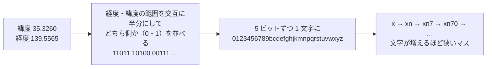

# ジオハッシュ

[目次](../README.md) ＞ [技術カード](README.md) ＞ ジオハッシュ

## 一言で

緯度・経度を、`xn7` のような短い文字列にする方法です。文字列が長いほど狭い場所を指し、**前の部分が同じなら、同じマスの中** にあります。

## 仕組み



- **範囲を半分にしていく**: 経度（-180〜180）を半分にして、東側なら 1、西側なら 0。次に緯度（-90〜90）を半分にして、北なら 1、南なら 0。これを交互にくり返して、ビットを並べます
- **5 ビットで 1 文字**: ビットを 5 つずつ区切り、32 文字の表で文字にします。表は `0`〜`9` と、`a`・`i`・`l`・`o` を除いた英小文字です（読み間違えやすい字を除いている）
- **前の部分が同じなら同じマス**: `xn7` で始まるジオハッシュは、すべて `xn7` のマスの中にあります。だから「この地域のもの」を、文字列の比較だけで探せます
- **文字数で細かさが決まる**: 下の表のとおりです
- **端では隣が別の文字列**: マスの境目のすぐ両側にある 2 つの点は、近くても前の部分が違うことがあります。「近く」を探すときは、自分のマスと周りの 8 マスを合わせて見ます

| 文字数 | マスの大きさ（赤道で、おおよそ） |
|---|---|
| 1 | 5,000km × 5,000km |
| 2 | 1,250km × 625km |
| 3 | 156km × 156km |
| 4 | 39km × 20km |
| 5 | 4.9km × 4.9km |
| 6 | 1.2km × 0.6km |

東西の幅は、緯度が高くなるほど狭くなります（経度 1 度の長さが縮むため）。東京のあたりでは、3 文字のマスは南北約 156km、東西約 128km です。

## 最小の使い方

ライブラリなしで書けます。Node.js で動かせます（お金も AWS も要りません）。

```js
const BASE32 = '0123456789bcdefghjkmnpqrstuvwxyz';

// 経度と緯度の範囲を交互に半分にし、どちら側かを 1 ビットずつ記録する。5 ビットで 1 文字。
function geohash(lat, lon, precision) {
  let latLo = -90, latHi = 90, lonLo = -180, lonHi = 180;
  let even = true, bits = 0, value = 0, out = '';
  while (out.length < precision) {
    if (even) {
      const mid = (lonLo + lonHi) / 2;
      value = value * 2 + (lon >= mid ? 1 : 0);
      if (lon >= mid) lonLo = mid; else lonHi = mid;
    } else {
      const mid = (latLo + latHi) / 2;
      value = value * 2 + (lat >= mid ? 1 : 0);
      if (lat >= mid) latLo = mid; else latHi = mid;
    }
    even = !even;
    if (++bits === 5) { out += BASE32[value]; bits = 0; value = 0; }
  }
  return out;
}

console.log(geohash(57.64911, 10.40744, 11)); // 説明によく使われる例
for (let n = 1; n <= 6; n++) console.log(n, geohash(35.3260, 139.5565, n)); // 鶴岡八幡宮
```

```
u4pruydqqvj
1 x
2 xn
3 xn7
4 xn70
5 xn70z
6 xn70zw
```

1 行目は、ジオハッシュの説明でよく使われる例（デンマークの地点）で、`u4pruydqqvj` になれば正しく書けています。文字を 1 つ増やすたびに、前の部分を保ったまま、マスが細かくなっていくのが分かります。

## このリポジトリでは

| 場所 | 何に使うか | 章 |
|---|---|---|
| SanpoGuide [Regions.kt](https://github.com/duwenji/yorisoi-platform/blob/main/core-format/src/main/kotlin/io/github/duwenji/yorisoi/core/format/material/Regions.kt) の `geohash`・`around` | アプリが、今いる 3 文字のマスと周りの 8 マスに重なる素材集だけを、前もって取る（API-004 P-6） | [5-4](../05-station-format/04-materials-cues.md) |
| 同じく `Regions.of` | 管理システムの機械審査が、素材集の素材の位置から、その素材集の地域（`regions`）を計算する | [5-4](../05-station-format/04-materials-cues.md)、[8-8](../08-aws/08-kotlin-lambda.md) |
| yorisoi-console [geo.ts](https://github.com/duwenji/yorisoi-console/blob/main/packages/protocol/src/geo.ts) の `geohash` | TypeScript 側の同じ計算（API-002 P-15）。準拠テストの V-25 が、リストの `regions` をこれで計算し直して照らす | [5-4](../05-station-format/04-materials-cues.md)、[6-6](../06-trust/06-same-rules.md) |

使う理由は **散策者の居場所を細かく伝えないため** です。素材集を「近づいてから」取りに行くと、どのスポットにいるかが相手に伝わります。3 文字のマス（約 150km 四方）の単位で前もって取れば、伝わるのは「どの地方にいるか」までです。

## よくある間違い

| 間違い | 起きること | どうするか |
|---|---|---|
| 1 つのマスだけで「近く」を探す | マスの境目のそばにいると、すぐ隣の素材を取りこぼす | 自分のマスと周りの 8 マスを合わせて探す（`Regions.around`） |
| 緯度と経度の順番を取り違える | まったく別の場所のジオハッシュになる。エラーにはならない | 関数の引数の順番（ここでは緯度が先）を確かめ、知っている場所の値（鎌倉なら `xn7`）でテストする |
| ID の base32（[6-2](../06-trust/02-ed25519-and-ids.md)）と同じ表だと思う | 文字が食い違う | ジオハッシュの表は `0123456789bcdefghjkmnpqrstuvwxyz`。ID に使う RFC 4648 の base32（`a`〜`z`・`2`〜`7`）とは別物 |
| 細かくすれば便利だと思って文字数を増やす | 伝わる居場所も細かくなる | 目的に足りるいちばん粗い細かさにする |
| 2 つの言語で別々に書いて、確かめない | アプリと管理システムで地域が食い違い、素材集が取られない | 知っている場所の値をテストに書き（`RegionsTest`）、もう一方の言語で計算し直して照らす（準拠テストの V-25） |

## 版と公式ドキュメント

| 項目 | 値 |
|---|---|
| 実装 | ライブラリは使わず、Kotlin（`Regions`）と TypeScript（`geo.ts`）で自作 |
| 細かさ | 3 文字（`Regions.PRECISION`） |
| 解説 | [Geohash（Wikipedia 英語版）](https://en.wikipedia.org/wiki/Geohash) |
