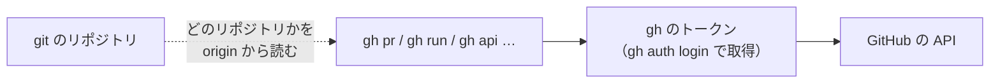

# gh CLI

[目次](../README.md) ＞ [技術カード](README.md) ＞ gh CLI

## 一言で

GitHub の操作（プルリクエスト・Actions の実行・リリース・リポジトリの設定など）を、ブラウザを開かずにコマンドで行う GitHub の公式の道具です。`gh api` で、GitHub の API を直接呼ぶこともできます。

## 仕組み



- **ログイン**: `gh auth login` でブラウザから認証し、トークンを手元に預かる。`gh auth status` でスコープ（権限）を確かめる
- **どのリポジトリか**: Git のリポジトリの中なら `origin` から決まる。外からは `-R <持ち主>/<名前>`
- **出力**: 人が読む形のほか、`--json <項目>` と `--jq <式>` で必要なところだけ取り出せる
- **`gh api`**: GitHub の REST API を、ログインしたトークンで呼ぶ。`{owner}`・`{repo}` はいまのリポジトリに置き換わる

## 最小の使い方

インストールして `gh auth login` を済ませておきます。

```sh
gh auth status                                  # だれで、どのスコープか

# プルリクエスト
gh pr list --state merged --limit 3
gh pr view 41 -R duwenji/yorisoi-platform --json title,mergedAt --jq '.'
gh pr checks 41 -R duwenji/yorisoi-platform

# Actions の実行
gh run list -R duwenji/yorisoi-platform --limit 3
gh run view <番号> -R duwenji/yorisoi-platform --log-failed
gh run rerun <番号> --failed                    # 落ちたジョブだけ流し直す
gh run download <番号> -n reports               # 成果物を取り出す
gh workflow run <ワークフローのファイル>         # workflow_dispatch のものを手で動かす

# API を直接
gh api repos/duwenji/yorisoi-platform --jq '{visibility,default_branch}'
```

## このリポジトリでは

| 場面 | コマンド | 章 |
|---|---|---|
| プルリクエストを出す・確かめる・マージする | `gh pr create`・`gh pr checks`・`gh pr merge --merge` | [11-2](../11-github/02-pull-requests.md) |
| CI の失敗を読む、公開待ちのあとに流し直す | `gh run view --log-failed`・`gh run rerun` | [9-4](../09-console/04-ci.md)、[11-2](../11-github/02-pull-requests.md)、[11-3](../11-github/03-actions.md) |
| リポジトリの設定を読む（Pages・トークンの既定の権限） | `gh api repos/…/pages`・`…/actions/permissions/workflow` | [11-4](../11-github/04-tokens.md)、[11-6](../11-github/06-pages-releases.md) |
| 使わない下書きのリリースを消す | `gh release delete <タグ> --yes` | [11-6](../11-github/06-pages-releases.md) |

## よくある間違い

| 間違い | 起きること | 正しくは |
|---|---|---|
| gh のトークンで GitHub Packages を読もうとする | `You need at least read:packages scope`（403） | Packages には `read:packages` の classic のトークンを別に用意する |
| リポジトリの外で `-R` を付けない | 「どのリポジトリか分からない」と止まる | `-R <持ち主>/<名前>` |
| `gh repo delete` がスコープ不足で失敗する | 消せない | `gh auth refresh -s delete_repo` |
| 人が読む出力を `grep` で切り出す | 版が上がると形が変わる | `--json` と `--jq` |

## 版と公式ドキュメント

| 項目 | 版 |
|---|---|
| gh | 2.93 |

- [GitHub CLI のマニュアル](https://cli.github.com/manual/)
- [gh api](https://cli.github.com/manual/gh_api)
