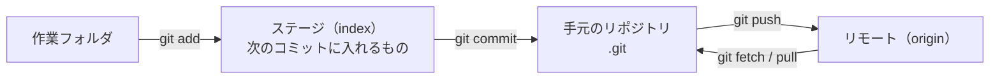

# Git

[目次](../README.md) ＞ [技術カード](README.md) ＞ Git

## 一言で

ファイルの変更を **コミット** という単位で記録し、いつでも前の状態に戻ったり、変更を枝分かれ（ブランチ）させて並べて進めたりできる道具です。記録（リポジトリ）を GitHub などに置くと、ほかの人や自動の仕組みと共有できます。

## 仕組み



- **コミット**: ある時点のファイル一式と、親のコミットへの印。ハッシュ（`21028df…`）で呼ぶ
- **ブランチ**: コミットを指す動く名札。コミットすると先へ進む
- **タグ**: コミットを指す動かない名札。公開した版の印に使う
- **リモート**: ほかの場所にある同じリポジトリ。`clone` した元が `origin`
- **属性**（`.gitattributes`）と **無視**（`.gitignore`）: ファイルごとの改行の扱い、記録しないファイル

## 最小の使い方

GitHub もネットワークも要りません。

```sh
mkdir git-practice && cd git-practice
git init -b main
echo "一行目" > note.txt
git add note.txt
git commit -m "最初のコミット"

git switch -c feat/second        # ブランチを作って移る
echo "二行目" >> note.txt
git commit -am "二行目を足す"

git switch main
git merge --no-ff feat/second -m "Merge feat/second"   # マージ・コミットを作る
git log --oneline --graph
git log --first-parent --oneline  # main に入ったマージだけ
git tag v1.0.0                   # いまのコミットに印
```

Windows（`core.autocrlf=true`）では、`LF will be replaced by CRLF the next time Git touches it` という注意が出ます。リポジトリの中は LF のまま、作業フォルダだけを CRLF にする、という意味です（[11-1](../11-github/01-git-and-repos.md)）。

### よく使う確かめ方

| コマンド | わかること |
|---|---|
| `git status` | 変えたファイル、まだ記録していないファイル |
| `git diff` / `git diff --staged` | 変えた中身（ステージの前・後） |
| `git log --oneline --graph` | 履歴の形 |
| `git show <コミット>:<ファイル>` | そのときのファイルの中身 |
| `git blame <ファイル>` | 各行を最後に変えたコミット |
| `git log -S '<文字列>'` | その文字列が増えた・減ったコミット |
| `git check-ignore -v <ファイル>` | どの `.gitignore` の行で無視されているか |
| `git check-attr -a <ファイル>` | そのファイルに付いた属性 |
| `git ls-files --eol` | リポジトリの中と作業フォルダの改行 |

## このリポジトリでは

- 5 つのリポジトリの関係、`.gitignore` で秘密を入れないこと、`.gitattributes` で改行を固定すること、実行の権限: [11-1](../11-github/01-git-and-repos.md)
- merge commit で入れて `--first-parent` で読む: [11-2](../11-github/02-pull-requests.md)
- 軽量タグで公開の印を付ける: [11-5](../11-github/05-packages-tags.md)
- `gradlew` の実行の権限（`git update-index --chmod=+x`）: [5-3](../05-station-format/03-publish.md)

## よくある間違い

| 間違い | 起きること | 正しくは |
|---|---|---|
| 秘密のファイルをコミットしてから消す | 前のコミットに残り、だれでも読める | 入れる前に `.gitignore`。入れてしまったら鍵を作り直す |
| `core.autocrlf` だけで改行をそろえる | パソコンごとに結果が違う | 改行が意味を持つファイルは `.gitattributes` で決める |
| `.gitattributes` を変えて終わり | 取り出し済みのファイルは変わらない | 取り出し直す |
| `main` で作業を始める | `main` が途中の状態になる | 先に `git switch -c <ブランチ>` |
| 公開したタグを付け替える（`git tag -f`） | タグと公開した中身が食い違う | 新しい版とタグを作る |

## 版と公式ドキュメント

| 項目 | 版 |
|---|---|
| Git | 2.52（Git for Windows） |

- [Git のドキュメント](https://git-scm.com/doc)
- [Pro Git（日本語）](https://git-scm.com/book/ja/v2)
- [gitattributes](https://git-scm.com/docs/gitattributes)
