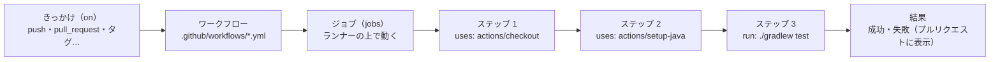

# GitHub Actions

[目次](../README.md) ＞ [技術カード](README.md) ＞ GitHub Actions

## 一言で

GitHub のリポジトリで、push やプルリクエストなどをきっかけに、テストやビルドや公開のコマンドを **GitHub が用意したパソコン（ランナー）の上で自動で実行する** 仕組みです。CI（継続的インテグレーション）や、公開の自動化に使います。

## 仕組み



- **ワークフロー**: リポジトリの `.github/workflows/` に置く YAML のファイル。1 つのファイルが 1 つのワークフロー
- **きっかけ**（`on`）: いつ動かすか。`push`（特定のブランチやタグだけにも絞れる）、`pull_request`、手動（`workflow_dispatch`）、時刻（`schedule`）など
- **ジョブ**（`jobs`）: ランナー（`ubuntu-latest` など、GitHub が用意する使い捨ての仮想のパソコン）の上で動く仕事のまとまり。複数のジョブは、何も指定しなければ同時に動く
- **ステップ**（`steps`）: ジョブの中の手順。`run:` でコマンドを実行するか、`uses:` で **アクション**（ほかの人が作った部品。`actions/checkout` でリポジトリを取ってくる、など）を使う
- **シークレットとトークン**: パスワードなどは `secrets` に預けて `${{ secrets.名前 }}` で使う。`GITHUB_TOKEN` は、実行のたびに自動で発行される、そのリポジトリ用の一時的なトークン
- **権限**（`permissions`）: `GITHUB_TOKEN` に何を許すか（読み取りだけ、パッケージの書き込みも、など）。最小にしておく

ランナーは毎回まっさらな状態から始まるので、「自分のパソコンでは動く」が通用しません。どの環境でも同じ手順で動くかを確かめるのに役立ちます。

## 最小の使い方

Gradle の Kotlin のプロジェクトで、push とプルリクエストのたびにテストを流すワークフローです（YAML として正しいことは確かめてあります。実際に動かすには GitHub のリポジトリが要ります）。

`.github/workflows/ci.yml`:

```yaml
name: CI

on:
  push:
    branches: [main]
  pull_request:

permissions:
  contents: read

jobs:
  test:
    runs-on: ubuntu-latest
    steps:
      - uses: actions/checkout@v4

      - uses: actions/setup-java@v4
        with:
          distribution: temurin
          java-version: '17'

      - uses: gradle/actions/setup-gradle@v4

      - name: Test
        run: ./gradlew test --console=plain
```

1. `main` への push と、すべてのプルリクエストで動く
2. Ubuntu のランナーで、リポジトリを取ってくる
3. JDK 17 を用意し、Gradle のキャッシュなどを整える
4. `./gradlew test` を実行する。失敗すれば、プルリクエストに赤い印が付く

ファイルをリポジトリに push すると、GitHub のリポジトリの「Actions」のタブに実行の記録が出ます。

### よく使う書き方

| 書き方 | 意味 |
|---|---|
| `on: push: tags: ['v*']` | `v` で始まるタグを push したときだけ |
| `services:` | ジョブと一緒に動かすコンテナ（データベースなど） |
| `env:` | 環境変数 |
| `${{ github.actor }}` | 実行のきっかけを作った人 |
| `${{ secrets.GITHUB_TOKEN }}` | 自動で発行されるトークン |
| `working-directory:` | そのステップを実行するフォルダ |
| `if:` | 条件が成り立つときだけ実行 |

### gh で記録を見る

GitHub の CLI（`gh`）を使うと、実行の記録をコマンドで見られます。

```sh
gh run list --limit 5                 # 最近の実行
gh run view <実行のID> --log-failed   # 失敗したステップのログ
```

## このリポジトリでは

| ワークフロー | きっかけ | 何をするか | 章 |
|---|---|---|---|
| [SanpoGuide: publish-station-format.yml](../../SanpoGuide/.github/workflows/publish-station-format.yml) | タグ `station-format-v*` の push | タグと版の照合 → テスト → GitHub Packages に公開（`packages: write`） | [5-3](../05-station-format/03-publish.md) |
| [sanpo-channel-console: ci.yml](../../sanpo-channel-console/.github/workflows/ci.yml) | `main` への push、プルリクエスト | 型の確認・テスト（DynamoDB Local をサービスで起動）・画面のビルド・`validator` のテストと zip の作成・`cdk synth` | [7-4](../07-typescript/04-testing.md)、[9-4](../09-console/04-ci.md) |

管理システムの CI は、`services:` でテスト用のデータベース（DynamoDB Local）のコンテナを一緒に動かし、`packages: read` の権限で SanpoGuide の `station-format` を取ってきています。CDK の確認（`cdk synth`）には、その場で作った使い捨てのルート鍵の公開鍵を渡しています。本物の鍵は CI に置きません（[6-4](../06-trust/04-two-tier-keys.md)）。

## よくある間違い

| 間違い | 起きること | 正しくは |
|---|---|---|
| Windows で作った `gradlew` に実行権限がない | `./gradlew: Permission denied`（SanpoGuide の最初の公開で実際に起きた） | `git update-index --chmod=+x gradlew` |
| 改行が CRLF のシェルスクリプト | Linux のランナーで動かない | `.gitattributes` で LF に固定する |
| パスワードやトークンをワークフローのファイルに書く | リポジトリを読める人全員に漏れる | `secrets` に預ける |
| `permissions` を書かない、広く与える | `GITHUB_TOKEN` に必要以上の権限が付く | 必要なものだけを書く |
| 公開を、ブランチへの push のたびに行う | 意図しない版が公開される | タグや手動のきっかけにする |
| アクションの版を指定しない（`@main` など） | 作った人の変更で、ある日突然動かなくなる | `@v4` のように版を指定する |

## 版と公式ドキュメント

| 項目 | 版 |
|---|---|
| `actions/checkout` | v4（両リポジトリのワークフロー） |
| `actions/setup-java` | v4 |
| `gradle/actions/setup-gradle` | v4 |
| `actions/setup-node` | v4（sanpo-channel-console） |

- [GitHub Actions のドキュメント](https://docs.github.com/ja/actions)
- [ワークフローの構文](https://docs.github.com/ja/actions/writing-workflows/workflow-syntax-for-github-actions)
- [GITHUB_TOKEN の権限](https://docs.github.com/ja/actions/security-for-github-actions/security-guides/automatic-token-authentication)
- [GitHub Packages で Gradle を使う](https://docs.github.com/ja/packages/working-with-a-github-packages-registry/working-with-the-gradle-registry)
