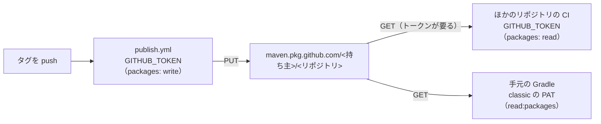

# GitHub Packages

[目次](../README.md) ＞ [技術カード](README.md) ＞ GitHub Packages

## 一言で

GitHub が用意しているパッケージの置き場所です。Maven（Java・Kotlin のライブラリ）・npm・コンテナのイメージなどを、GitHub のリポジトリと結びつけて公開し、版を指定して取ってこられます。

## 仕組み



- **置き場所はリポジトリごと**: Maven の URL は `https://maven.pkg.github.com/<持ち主>/<リポジトリ>`
- **見える範囲と権限はリポジトリに従う**（Maven の場合）: 公開のリポジトリなら公開。書けるのは、そのリポジトリに書ける人と、その `GITHUB_TOKEN`
- **公開でも、取るには認証**: Maven で取ってくるには、`read:packages` を持つトークンが要る
- **同じ版は 2 度公開できない**: 直すときは新しい版
- **最初に公開したリポジトリに結びつく**: 同じ座標を別のリポジトリから公開できない（422）

## 最小の使い方

GitHub のリポジトリと、`write:packages` のトークン（CI なら `GITHUB_TOKEN` と `packages: write`）が要ります。

```kotlin
// build.gradle.kts（公開する側）
plugins { `java-library`; `maven-publish` }
group = "io.github.<ユーザー名>.practice"
version = "0.1.0"
publishing {
    publications { create<MavenPublication>("maven") { from(components["java"]) } }
    repositories {
        maven {
            name = "GitHubPackages"
            url = uri("https://maven.pkg.github.com/<ユーザー名>/<リポジトリ>")
            credentials {
                username = System.getenv("GITHUB_ACTOR")
                password = System.getenv("GITHUB_TOKEN")
            }
        }
    }
}
```

```kotlin
// settings.gradle.kts（使う側）
dependencyResolutionManagement {
    repositories {
        mavenCentral()
        maven {
            url = uri("https://maven.pkg.github.com/<ユーザー名>/<リポジトリ>")
            credentials {
                username = providers.gradleProperty("gpr.user").orNull
                password = providers.gradleProperty("gpr.key").orNull
            }
            content { includeGroup("io.github.<ユーザー名>.practice") }
        }
    }
}
```

## このリポジトリでは

| 置き場所 | グループ | タグ |
|---|---|---|
| yorisoi-platform | `io.github.duwenji.yorisoi`（コアとキット） | `v<版>` |
| yorisoi-sanpoguide | `io.github.duwenji.yorisoi.sanpoguide`（プロンプト・パック） | `prompts-v<版>` |
| yorisoi-cycleguide | `io.github.duwenji.yorisoi.cycleguide`（プロンプト・パック） | `prompts-v<版>` |

Maven の側の設定は [5-3](../05-station-format/03-publish.md)、GitHub の側（権限・タグ・消さない決まり）は [11-5](../11-github/05-packages-tags.md) で見ます。

## よくある間違い

| 間違い | 起きること | 正しくは |
|---|---|---|
| 公開のパッケージだからとトークンなしで取る | 401 や `Could not find` | `read:packages` の classic のトークン |
| fine-grained のトークンを使う | Maven の置き場所で認証できない | classic を使う |
| 同じ版をもう一度公開する | 409 Conflict | 新しい版を出す |
| 別のリポジトリから同じ座標で公開する | 422 Unprocessable Entity | 座標（グループ）を置き場所ごとに分ける |
| `includeGroup` を書かない | ほかのライブラリまでその置き場所に問い合わせ、遅くなる・取り違える | 置き場所ごとにグループを決める |

## 版と公式ドキュメント

- [GitHub Packages について](https://docs.github.com/ja/packages/learn-github-packages/introduction-to-github-packages)
- [Gradle レジストリの利用](https://docs.github.com/ja/packages/working-with-a-github-packages-registry/working-with-the-gradle-registry)
- [パッケージのアクセス制御と可視性](https://docs.github.com/ja/packages/learn-github-packages/configuring-a-packages-access-control-and-visibility)
