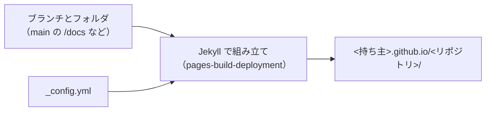

# GitHub Pages

[目次](../README.md) ＞ [技術カード](README.md) ＞ GitHub Pages

## 一言で

GitHub のリポジトリのファイルを、そのまま Web のサイトとして公開する仕組みです。Markdown は Jekyll で HTML に組み立てられ、`https://<持ち主>.github.io/<リポジトリ>/` で読めます。

## 仕組み



- **公開元**: ブランチ（`main` など）とフォルダ（`/` か `/docs`）を選ぶ。または Actions のワークフローで組み立てたものを出す
- **Jekyll**: `_config.yml` の設定と、各ファイルの先頭の front matter（`---` で囲んだ設定）で、Markdown や HTML をページにする
- **`exclude`・`include`**: 組み立てに入れないもの、入れるもの
- **URL**: プロジェクトのサイトは `/<リポジトリ>/` の下。リポジトリの名前を変えると URL も変わる
- **組み立ての記録**: Actions の画面に `pages-build-deployment` として出る

## 最小の使い方

GitHub の公開のリポジトリが要ります。

```yaml
# docs/_config.yml
title: 練習
exclude: ["*.md"]
include: ["hello.md"]
theme: jekyll-theme-primer
defaults:
  - scope: { path: "" }
    values: { layout: default }
```

```sh
printf '# こんにちは\n' > docs/hello.md
git add docs && git commit -m "docs: Pages" && git push
gh api -X POST repos/{owner}/{repo}/pages -f "source[branch]=main" -f "source[path]=/docs"
# 1 分ほど待って
curl -s -o /dev/null -w "%{http_code}\n" "https://<持ち主>.github.io/<リポジトリ>/hello"
```

サイトの中のリンクは、`{{ '/hello' | relative_url }}` のように書くと `/<リポジトリ>/hello` になります。

## このリポジトリでは

yorisoi-sanpoguide と yorisoi-cycleguide が、`main` の `/docs` から、プライバシーポリシー（と散策ガイドのトップのページ）だけを出しています。Play Console に登録した URL です。設計書などのほかの文書は `exclude` で外しています。[11-6](../11-github/06-pages-releases.md) で詳しく見ます。

## よくある間違い

| 間違い | 起きること | 正しくは |
|---|---|---|
| `docs/` を丸ごと出す | 開発の文書まで Web に出る | 全部 `exclude` して、出すものだけ `include` |
| リンクを `/hello` と書く | `<持ち主>.github.io/hello`（別のサイト）を指す | `relative_url` |
| ファイルやリポジトリの名前を変える | 外に知らせた URL が 404 になる | 変えない。変えるなら登録先も直す |
| 非公開のリポジトリで使おうとする | 無料のプランでは使えない | 公開のリポジトリで使う |

## 版と公式ドキュメント

- [GitHub Pages について](https://docs.github.com/ja/pages/getting-started-with-github-pages/about-github-pages)
- [公開元を設定する](https://docs.github.com/ja/pages/getting-started-with-github-pages/configuring-a-publishing-source-for-your-github-pages-site)
- [Jekyll と GitHub Pages](https://docs.github.com/ja/pages/setting-up-a-github-pages-site-with-jekyll/about-github-pages-and-jekyll)
