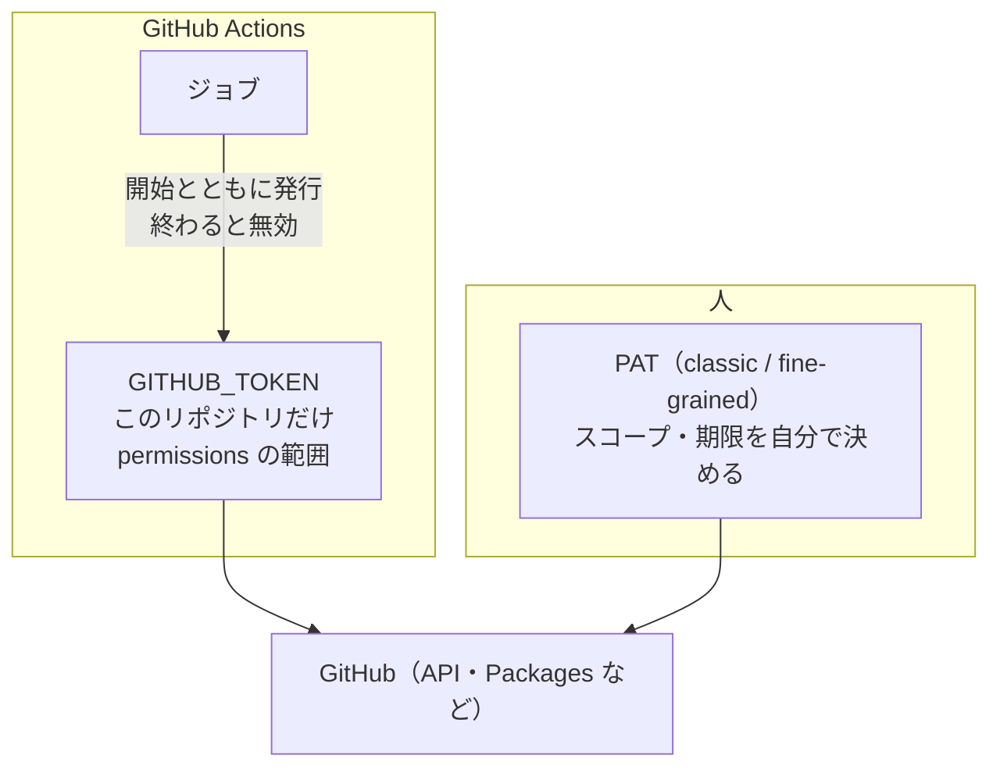

# GITHUB_TOKEN と個人用のトークン

[目次](../README.md) ＞ [技術カード](README.md) ＞ GITHUB_TOKEN と個人用のトークン

## 一言で

GitHub に「だれが、何をしてよいか」を示す合言葉です。ワークフローの実行ごとに GitHub が自動で作る **`GITHUB_TOKEN`** と、人が自分で作って預かる **個人用のトークン（PAT）** があります。どちらも、持っている権限の範囲のことしかできません。

## 仕組み



- **`GITHUB_TOKEN`**: ジョブごとに発行され、ジョブが終わると使えなくなる。そのリポジトリのためのもの。ワークフローでは `${{ secrets.GITHUB_TOKEN }}`
- **`permissions`**: `GITHUB_TOKEN` に許すこと。1 つでも書くと、書かなかったものはすべて「なし」
- **リポジトリの既定**: Settings → Actions → General の Workflow permissions で、`permissions` を書かないときの既定（読み取りだけ／読み書き）を決める
- **PAT**: 人の代わりに動く。classic はスコープ（`repo`・`read:packages` など）で、fine-grained はリポジトリと操作ごとに許す。GitHub Packages の Maven は classic だけ
- **シークレット**: リポジトリや Environment に預けた値。フォークからのプルリクエストには渡らない

## 最小の使い方

GitHub のリポジトリが要ります。Issue を作る権限だけを足したワークフロー:

```yaml
name: Token
on:
  workflow_dispatch:
permissions:
  contents: read
  issues: write
jobs:
  issue:
    runs-on: ubuntu-latest
    steps:
      - run: gh issue create -R "$GITHUB_REPOSITORY" --title "練習" --body "GITHUB_TOKEN で作った"
        env:
          GH_TOKEN: ${{ secrets.GITHUB_TOKEN }}
```

`issues: write` を消すと、`Resource not accessible by integration` で落ちます。

手元の PAT は、リポジトリの外に置きます。

```properties
# ~/.gradle/gradle.properties
gpr.user=<ユーザー名>
gpr.key=<read:packages の classic のトークン>
```

## このリポジトリでは

- 4 つのリポジトリとも、既定は読み取りだけ。ワークフローごとに `contents: read` と、要るときだけ `packages: read`／`packages: write`
- アプリと管理システムの CI は、自分の `GITHUB_TOKEN` で、公開のリポジトリ yorisoi-platform のパッケージを読む
- シークレットは 1 つも使っていない。署名の鍵・Play の鍵・AWS の権限は CI の外

[11-4](../11-github/04-tokens.md) で詳しく見ます。

## よくある間違い

| 間違い | 起きること | 正しくは |
|---|---|---|
| `permissions` を書かない（既定が読み書き） | 要らない権限まで付く | 書く。リポジトリの既定も読み取りだけに |
| `permissions` に 1 つ書いて、ほかを忘れる | 書かなかった権限が「なし」で落ちる | 要るものを 1 つずつ書く |
| PAT をリポジトリのファイルに書く | だれでも読める | リポジトリの外か、環境変数 |
| `pull_request_target` で知らない人のコードを動かす | こちらの権限とシークレットで動く | `pull_request` を使う |
| 長く使える鍵をシークレットに預ける | 漏れたら長く使われる | OIDC で一時的な権限に引き換える。預けるなら Environment と承認 |

## 版と公式ドキュメント

- [GITHUB_TOKEN による認証](https://docs.github.com/ja/actions/security-for-github-actions/security-guides/automatic-token-authentication)
- [ワークフローの permissions](https://docs.github.com/ja/actions/writing-workflows/workflow-syntax-for-github-actions#permissions)
- [個人用のアクセス トークン](https://docs.github.com/ja/authentication/keeping-your-account-and-data-secure/managing-your-personal-access-tokens)
- [Environments](https://docs.github.com/ja/actions/managing-workflow-runs-and-deployments/managing-deployments/managing-environments-for-deployment)
