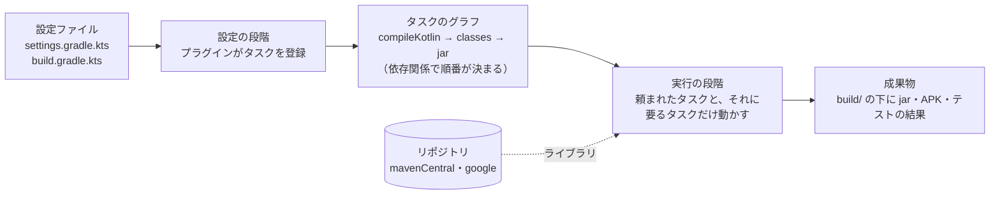

# Gradle

[目次](../README.md) ＞ [技術カード](README.md) ＞ Gradle

## 一言で

Java・Kotlin・Android のプロジェクトを **ビルドする道具** です。ライブラリを取ってきて、コンパイルし、テストし、jar や APK を作るまでの手順を、設定ファイルにもとづいて自動で行います。

## 仕組み



- **タスク**: Gradle の仕事の単位です（`compileKotlin`、`test`、`assembleDebug` など）。タスクどうしには依存関係があり、`./gradlew test` と頼むと、テストに要るコンパイルなどを先に自動で行います
- **プラグイン**: タスクをまとめて足す部品です。`kotlin("jvm")` を使えば Kotlin のコンパイルのタスクが、`com.android.application` を使えば APK を作るタスクが加わります
- **やらなくてよい仕事は飛ばす**: タスクの入力と出力を覚えていて、前回から何も変わっていなければ実行しません（`UP-TO-DATE`）。2 回目のビルドが速いのはこのためです
- **ライブラリを取ってくる**: `グループ:名前:版` で書いた依存を、決めたリポジトリから取ってきて、手元にキャッシュします（`~/.gradle/caches`）。ライブラリが依存するライブラリ（推移的依存）も自動で取ります
- **Gradle Wrapper**: プロジェクトに入っている `gradlew` が、決められた版の Gradle を取ってきて使います。だれの環境でも同じ版の Gradle でビルドできます

### 2 つの段階

Gradle は、まず設定ファイルを全部読んでタスクのグラフを作り（**設定の段階**）、それから頼まれたタスクを実行します（**実行の段階**）。設定ファイルにそのまま書いたコードは設定の段階で動き、`doLast { … }` の中に書いたコードはタスクを実行するときに動きます。

## 最小の使い方

手元で、お金をかけずに試せます。Gradle 本体を入れる必要はありません。SanpoGuide の `gradlew` を借りて、別のフォルダのプロジェクトをビルドできます（`-p` でフォルダを指定）。

### 1. ファイルを 3 つ作る

```
hello-sanpo/
├── settings.gradle.kts
├── build.gradle.kts
└── src/main/kotlin/Main.kt
```

`settings.gradle.kts`:

```kotlin
rootProject.name = "hello-sanpo"
```

`build.gradle.kts`:

```kotlin
plugins {
    kotlin("jvm") version "2.2.0"   // Kotlin をコンパイルする
    application                      // run タスクで main を動かす
}

repositories {
    mavenCentral()
}

dependencies {
    implementation("org.json:json:20240303")
}

kotlin {
    jvmToolchain(17)
}

application {
    mainClass.set("MainKt")
    // Windows のコンソールで日本語が化けないように
    applicationDefaultJvmArgs = listOf("-Dfile.encoding=UTF-8", "-Dsun.stdout.encoding=UTF-8")
}

// 自分で作るタスク
tasks.register("hello") {
    group = "sample"
    doLast { println("Hello, Gradle") }
}
```

`src/main/kotlin/Main.kt`:

```kotlin
import org.json.JSONObject

fun main() {
    val spot = JSONObject().put("name", "鶴岡八幡宮").put("category", "shrine")
    println(spot.toString())
}
```

`Main.kt` の `main` 関数は、Kotlin では `MainKt` というクラスの中に入ります。`mainClass.set("MainKt")` はそのためです。

### 2. 動かす

```sh
/c/Dev/apps/yorisoi-sanpoguide/gradlew -p hello-sanpo run
```

```
{"name":"鶴岡八幡宮","category":"shrine"}
```

初回は Kotlin のプラグインと `org.json` のダウンロードで時間がかかります。

### 3. タスクを調べる

```sh
/c/Dev/apps/yorisoi-sanpoguide/gradlew -p hello-sanpo hello                  # 自分で作ったタスク
/c/Dev/apps/yorisoi-sanpoguide/gradlew -p hello-sanpo tasks --group sample   # グループで絞って一覧
/c/Dev/apps/yorisoi-sanpoguide/gradlew -p hello-sanpo run --console=plain    # どのタスクが動いたか見る
```

最後のコマンドを 2 回続けて実行すると、2 回目は `> Task :compileKotlin UP-TO-DATE` と表示され、コンパイルが飛ばされます。

### よく使うコマンド

| コマンド | 何をするか |
|---|---|
| `./gradlew tasks` | 使えるタスクの一覧 |
| `./gradlew build` | コンパイル・テスト・成果物の作成をまとめて |
| `./gradlew test` | テスト |
| `./gradlew test --tests '*名前*'` | 名前で絞ってテスト |
| `./gradlew :モジュール:タスク` | モジュールを指定して実行（例: `:app:assembleDebug`） |
| `./gradlew dependencies` | 依存ライブラリの木 |
| `./gradlew clean` | `build/` を消す |
| `./gradlew --stop` | 裏で動いている Gradle（デーモン）を止める |

## このリポジトリでは

| 場所 | 中身 | 章 |
|---|---|---|
| [yorisoi-sanpoguide/settings.gradle.kts](https://github.com/duwenji/yorisoi-sanpoguide/blob/main/settings.gradle.kts) | 2 つのモジュール、ライブラリの取得先を 1 か所に固定 | [1-2](../01-kotlin-android/02-gradle.md) |
| [yorisoi-sanpoguide/app/build.gradle.kts](https://github.com/duwenji/yorisoi-sanpoguide/blob/main/app/build.gradle.kts) | Android アプリの設定、Compose の BOM、署名 | [1-2](../01-kotlin-android/02-gradle.md)、[1-4](../01-kotlin-android/04-signing-apk.md) |
| [yorisoi-platform/core-format/build.gradle.kts](https://github.com/duwenji/yorisoi-platform/blob/main/core-format/build.gradle.kts) | JVM ライブラリ、自作のタスク `channelIndex`、GitHub Packages への公開 | [1-2](../01-kotlin-android/02-gradle.md)、[5-3](../05-station-format/03-publish.md) |
| [yorisoi-console/validator/build.gradle.kts](https://github.com/duwenji/yorisoi-console/blob/main/validator/build.gradle.kts) | Kotlin の Lambda。コアとプロンプト・パックを GitHub Packages から取り、Lambda 用の zip を作るタスク | [8-8](../08-aws/08-kotlin-lambda.md) |

## よくある間違い

| 間違い | 起きること | 正しくは |
|---|---|---|
| Gradle 本体を自分で入れて `gradle build` を使う | プロジェクトが想定する版と違い、ビルドが失敗することがある | プロジェクトの `./gradlew` を使う |
| 設定ファイルに処理を直接書く（`doLast` の外） | タスクを実行しなくても、毎回の設定の段階で動いてしまう | 実行時の処理は `doLast { … }` の中に書く |
| 自作のタスクに `inputs`・`outputs` を書かない | 毎回実行される、または必要なときに実行されない | 何を読み、何を書くかを宣言する |
| 依存の種類を間違える（`compileOnly` にすべきものを `implementation` に） | 不要なライブラリが成果物に入り、重複などの問題が起きる | 用途に合った種類を選ぶ（[1-2](../01-kotlin-android/02-gradle.md) の表） |
| Windows で、タスクの中で日本語を `println` する | コンソールで文字化けすることがある | タスクの表示は英語にする。プログラムの出力は `-Dfile.encoding=UTF-8` などで直る |

## 版と公式ドキュメント

| 項目 | 版 |
|---|---|
| Gradle（SanpoGuide） | 8.14.3（`gradle/wrapper/gradle-wrapper.properties`） |
| Android Gradle Plugin | 8.11.1 |
| Kotlin のプラグイン | 2.2.0 |

- [Gradle の公式ドキュメント](https://docs.gradle.org/current/userguide/userguide.html)
- [Kotlin DSL 入門](https://docs.gradle.org/current/userguide/kotlin_dsl.html)
- [Android: ビルドの設定](https://developer.android.com/build?hl=ja)
