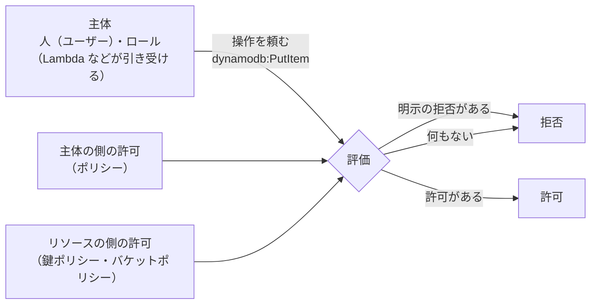

# IAM

[目次](../README.md) ＞ [技術カード](README.md) ＞ IAM

## 一言で

AWS の中で「**だれが**（主体）、**何に**（リソース）、**何を**（アクション）してよいか」を決める仕組みです。AWS のすべての操作は、IAM の許可を確かめてから行われます。許可がなければ、何もできません。

## 仕組み



- **既定は拒否**: 許可を書かなければ、何もできない。明示の拒否（`Deny`）は、どの許可よりも強い
- **ポリシー**: 許可の文書（JSON）。`Effect`（Allow・Deny）・`Action`（`s3:PutObject` など）・`Resource`（ARN）・`Condition`（条件）を並べる
- **ロール**: 許可をまとめた「役」。Lambda・EC2 などの AWS の部品や、別のアカウントが **引き受けて** 使う。引き受けると、一時的な鍵が渡される。長く使う鍵（アクセスキー）を部品に持たせなくて済む
- **主体の側とリソースの側**: 許可は、ロールの側（「このロールはこのテーブルに書いてよい」）にも、リソースの側（「この鍵で署名してよいのはこのロールだけ」）にも書ける
- **最小の権限**: 仕事に要る最小限だけを許す。乗っ取りや誤りの被害を小さくする

### ポリシーの形

```json
{
  "Effect": "Allow",
  "Action": ["s3:PutObject"],
  "Resource": "arn:aws:s3:::intake-bucket/intake/*",
  "Condition": { "Bool": { "aws:SecureTransport": "true" } }
}
```

## 最小の使い方

CDK で書くのが手軽です（下の例は、[scripts/cdk-samples.ts](../08-aws/scripts/cdk-samples.ts) にまとめて、手元で合成できることを確かめたものです。配備には AWS のアカウントが要ります）。

```ts
// 1. 便利な grant…: 要る操作と ARN を組み立ててくれる
table.grantReadWriteData(hello);          // DynamoDB のテーブルの読み書き
queue.grantSendMessages(hello);           // SQS に送る
bucket.grantPut(hello, 'uploads/*');      // S3 の uploads/ にだけ置く

// 2. 自分で書く: 1 つの操作、1 つのリソース、条件つき
hello.addToRolePolicy(new iam.PolicyStatement({
  actions: ['ses:SendEmail'],
  resources: ['arn:aws:ses:ap-northeast-1:123456789012:identity/example.com'],
  conditions: { StringEquals: { 'ses:FromAddress': 'noreply@example.com' } },
}));

// 3. リソースの側に書く（KMS の鍵ポリシー）
key.addToResourcePolicy(new iam.PolicyStatement({
  actions: ['kms:Sign'],
  principals: [new iam.ArnPrincipal(hello.role!.roleArn)],
  resources: ['*'],
}));
```

Lambda を作ると、CDK はその Lambda 専用のロールを作り、`grant…` の許可をそのロールに足します。

## このリポジトリでは

| 場所 | 見どころ | 章 |
|---|---|---|
| [infra/lib/console-app.ts](../../yorisoi-console/infra/lib/console-app.ts) | `grantPut(consoleFn, 'intake/*')` のように、場所（接頭辞）まで絞った許可。コメントに理由 | [8-1](../08-aws/01-aws-basics.md) |
| [infra/lib/console-stack.ts](../../yorisoi-console/infra/lib/console-stack.ts) | KMS の鍵ポリシー: 署名してよいのは決まったロールだけ、決まった方式だけ。`key.grant()` を使わない理由 | [6-4](../06-trust/04-two-tier-keys.md)、[8-1](../08-aws/01-aws-basics.md) |
| 同 `postConfirmation` | 1 つの操作（`AdminAddUserToGroup`）だけ。循環を避けるため `userpool/*` | [8-4](../08-aws/04-cognito.md) |
| ADR-001 A-17 | 配備を自動にするときは、GitHub Actions から OIDC で AWS に入る（長期のアクセスキーを持たない）と決めている。2026-10-05 の時点では、開発者が手で配備している | [9-4](../09-console/04-ci.md) |

## よくある間違い

| 間違い | 起きること | 正しくは |
|---|---|---|
| `"Action": "*"`・`"Resource": "*"` で済ませる | 乗っ取られたとき、何でもできてしまう | 要る操作とリソースだけ |
| 部品にアクセスキーを持たせる | 鍵が漏れると長く悪用される | ロールを使う（一時的な鍵） |
| 動かないとき、すぐに許可を広げる | 必要以上の権限が残る | エラーの `AccessDenied` に出る操作とリソースを見て、それだけを足す |
| ロールの側とリソースの側の両方に、条件の違う許可を書く | 条件のない方が通ってしまう | 守りたい条件は 1 か所に（このリポジトリの KMS の例） |
| 循環する参照（A の許可が B を、B が A を名指し）を作る | CDK・CloudFormation が作る順番を決められない | ワイルドカードや、片方からの参照に |

## 版と公式ドキュメント

ライブラリではなく、AWS のサービスです。CDK では `aws-cdk-lib/aws-iam`（2.272 以上、`infra/package.json`）。

- [IAM ユーザーガイド](https://docs.aws.amazon.com/ja_jp/IAM/latest/UserGuide/introduction.html)
- [ポリシーの評価の論理](https://docs.aws.amazon.com/ja_jp/IAM/latest/UserGuide/reference_policies_evaluation-logic.html)
- [最小の権限のベストプラクティス](https://docs.aws.amazon.com/ja_jp/IAM/latest/UserGuide/best-practices.html)
