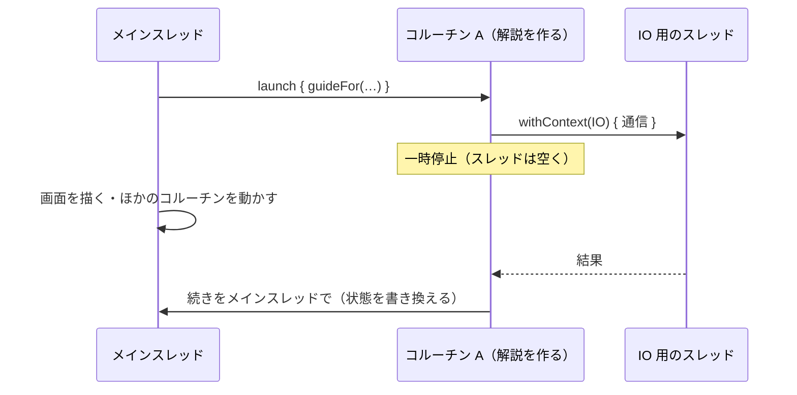

# Kotlin Coroutines

[目次](../README.md) ＞ [技術カード](README.md) ＞ Kotlin Coroutines

## 一言で

通信やタイマーのような「待つ」処理を、スレッドを止めずに、普通の上から下へのコードのように書くための仕組みです。Kotlin の言語の機能（`suspend`）と、ライブラリ（`kotlinx-coroutines`）でできています。

## 仕組み



- **suspend 関数**: 途中で一時停止できる関数です。待っている間、スレッドを手放すので、そのスレッドはほかの仕事ができます。結果が来たら、止まったところから続きます
- **コルーチン**: 一時停止できる処理のかたまりです。スレッドよりずっと軽く、何千個でも作れます。`launch` や `async` で始めます
- **スコープ**: コルーチンの「持ち主」です。スコープが終わると、中のコルーチンはすべてキャンセルされます（**構造化された並行性**）。始めたまま止め忘れる、ということが起きにくくなります
- **ディスパッチャ**: コルーチンをどのスレッドで動かすかを決めます。`withContext` で途中から切り替えられます
- **キャンセル**: `delay` などの一時停止の場所で、キャンセルの知らせに気づいて止まります

### よく使う道具

| 道具 | 役割 |
|---|---|
| `suspend fun` | 一時停止できる関数 |
| `launch { … }` | コルーチンを始める。結果は返さない（`Job` を返す） |
| `async { … }` と `await()` | コルーチンを始め、結果を後で受け取る。同時に待ちたいときに |
| `delay(ms)` | スレッドを止めずに待つ |
| `withContext(Dispatchers.IO) { … }` | ブロックをほかのスレッドで動かし、結果を持って戻る |
| `Mutex` | 同時に 1 つだけ。`withLock`（待つ）、`tryLock`（諦める） |
| `flow { emit(…) }` | 次々に値を流す |
| `Job.cancel()` | コルーチンを止める |

### ディスパッチャ

| ディスパッチャ | スレッド | 向いている仕事 |
|---|---|---|
| `Dispatchers.Main` | Android のメインスレッド | 画面に触る |
| `Dispatchers.IO` | 通信・ファイル用 | スレッドを止めて待つ昔ながらの処理 |
| `Dispatchers.Default` | 計算用（CPU の数だけ） | 重い計算 |

## 最小の使い方

Android がなくても、普通の Kotlin のプログラムで試せます。[技術カード: Gradle](gradle.md) の最小のプロジェクトに、依存を 1 つ足します。

```kotlin
// build.gradle.kts
dependencies {
    implementation("org.jetbrains.kotlinx:kotlinx-coroutines-core:1.10.2")
}
```

```kotlin
// src/main/kotlin/Main.kt
import kotlinx.coroutines.*

suspend fun fetchWeather(): String {
    delay(500)                          // 通信の代わり。スレッドは止めない
    return "晴れ"
}

suspend fun fetchSpots(): List<String> = withContext(Dispatchers.IO) {
    Thread.sleep(500)                   // スレッドを止める昔ながらの処理は IO 用のスレッドで
    listOf("鶴岡八幡宮", "長谷寺")
}

fun main() = runBlocking {
    val start = System.currentTimeMillis()

    // 同時に始めて、両方の結果を待つ
    val weather = async { fetchWeather() }
    val spots = async { fetchSpots() }
    println("天気: ${weather.await()}、スポット: ${spots.await()}（${System.currentTimeMillis() - start}ms）")

    // 1 秒ごとのタイマーを始めて、3.5 秒後に止める
    val ticker = launch {
        var n = 0
        while (isActive) {
            delay(1_000)
            println("tick ${++n}")
        }
    }
    delay(3_500)
    ticker.cancel()
    println("タイマーを止めました")
}
```

```
天気: 晴れ、スポット: [鶴岡八幡宮, 長谷寺]（536ms）
tick 1
tick 2
tick 3
タイマーを止めました
```

- 500ms かかる取得を 2 つ同時に待つので、全体で 500ms 台で済む（順番に待てば 1 秒）
- タイマーは 3 回動いたところで止まる

`runBlocking` は、普通の `main` 関数やテストの中でコルーチンを動かし、終わるまで待つための道具です。Android のアプリのコードでは使いません（メインスレッドを止めてしまうため）。

> Windows のコンソールで Gradle 経由（`gradlew run`）で動かすと、日本語の一部が化けることがあります。数字と動きを見てください。

## このリポジトリでは

| 場所 | 見どころ | 章 |
|---|---|---|
| [MainViewModel.kt](../../SanpoGuide/app/src/main/java/io/github/duwenji/sanpoguide/ui/MainViewModel.kt) の `select` | `viewModelScope.launch` で AI の解説を待つ | [2-2](../02-compose/02-state-viewmodel.md)、[3-1](../03-walk/01-coroutines.md) |
| [WalkService.kt](../../SanpoGuide/app/src/main/java/io/github/duwenji/sanpoguide/walk/WalkService.kt) の `startTicker` | `lifecycleScope` の中の、キャンセルできるタイマー | [3-1](../03-walk/01-coroutines.md) |
| 同 `talk` | `Mutex.tryLock` で、話している最中の話を見送る | [3-1](../03-walk/01-coroutines.md)、[3-4](../03-walk/04-maybe-talk.md) |
| 同 `saveProgress`・`finishWalk` | Service が止まっても保存が打ち切られないよう `appScope` で | [3-1](../03-walk/01-coroutines.md) |
| [WeatherClient.kt](../../SanpoGuide/app/src/main/java/io/github/duwenji/sanpoguide/companion/WeatherClient.kt) ほか通信する部品 | 自分の中で `withContext(Dispatchers.IO)` に移る | [3-1](../03-walk/01-coroutines.md) |
| [SpotRepository.kt](../../SanpoGuide/app/src/main/java/io/github/duwenji/sanpoguide/data/SpotRepository.kt) | `Mutex.withLock` で検索を重ねない | [3-1](../03-walk/01-coroutines.md) |
| [MoodSource.kt](../../SanpoGuide/app/src/main/java/io/github/duwenji/sanpoguide/mood/MoodSource.kt) | `flow { … }` で時計を作る | [2-4](../02-compose/04-theme-mood.md)、[3-1](../03-walk/01-coroutines.md) |

## よくある間違い

| 間違い | 起きること | 正しくは |
|---|---|---|
| メインスレッドで `Thread.sleep` や OkHttp の `execute()` を呼ぶ | 画面が固まる。長いと「応答なし」になる | `delay` を使う。止まる処理は `withContext(Dispatchers.IO)` の中で |
| `GlobalScope.launch` を使う | だれも止めないので、画面を閉じても処理が続く | `viewModelScope`・`lifecycleScope` など、持ち主のあるスコープを使う |
| `catch (e: Exception)` でキャンセルまで捕まえる | キャンセルされたのに処理が続く | `CancellationException` は投げ直す |
| 一時停止しない重いループを書く | キャンセルしても止まらない | ループの中で `ensureActive()` や `yield()` を呼ぶ、または `isActive` を確かめる |
| Android のコードで `runBlocking` を使う | メインスレッドが止まる | テストと `main` 関数だけで使う |
| 途中で止められて困る処理を、短命のスコープで始める | 書き込みの途中で打ち切られる | 処理に合った寿命のスコープを選ぶ |

## 版と公式ドキュメント

| 項目 | 版 |
|---|---|
| `kotlinx-coroutines-android` | 1.10.2（SanpoGuide の `app/build.gradle.kts`） |
| `kotlinx-coroutines-play-services` | 1.10.2（Google の `Task` を `await()` で待つ） |

- [Kotlin のコルーチン（公式）](https://kotlinlang.org/docs/coroutines-overview.html)
- [Android での Kotlin コルーチン](https://developer.android.com/kotlin/coroutines?hl=ja)
- [コルーチンのおすすめの使い方](https://developer.android.com/kotlin/coroutines/coroutines-best-practices?hl=ja)
