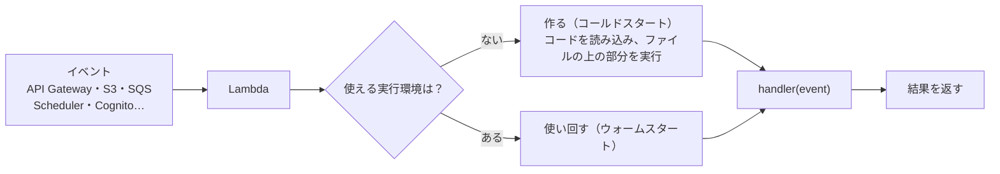

# Lambda

[目次](../README.md) ＞ [技術カード](README.md) ＞ Lambda

## 一言で

何かが起きたとき（HTTP の要求、ファイルの到着、待ち行列のメッセージ、決まった時刻など）に、AWS が関数を呼び出して動かすサービスです。サーバーを持たず、動いた分だけ払います。

## 仕組み



- **ハンドラ**: 入口の関数。イベントを受け取り、結果を返す。イベントの形はきっかけによって違う
- **実行環境**: 関数を動かす入れ物。しばらく使い回される。だから、SDK の部品などは関数の外で作る
- **同時実行**: 呼び出しが重なれば、実行環境が増えて同時に動く。`reservedConcurrentExecutions` で上限を決められる
- **同期と非同期**: 同期（`RequestResponse`）は結果を待つ。非同期（`Event`）は頼むだけで、失敗したら Lambda がやり直す
- **設定**: ランタイム（Node.js・Java など）、メモリ（多いほど CPU も速い）、時間の上限、環境変数、ロール（IAM）
- **料金**: 呼ばれた回数 ＋ 動いた時間 × メモリ

## 最小の使い方

### 関数（Node.js）

```ts
import type { APIGatewayProxyEventV2, APIGatewayProxyResultV2 } from 'aws-lambda';
import { DynamoDBClient } from '@aws-sdk/client-dynamodb';

const db = new DynamoDBClient({});   // 関数の外で作り、使い回す

export async function handler(event: APIGatewayProxyEventV2): Promise<APIGatewayProxyResultV2> {
  const table = process.env.TABLE_NAME;   // 設定は環境変数で
  return { statusCode: 200, headers: { 'content-type': 'application/json' }, body: JSON.stringify({ path: event.rawPath, table }) };
}
```

ハンドラは普通の関数なので、手元でもイベントを渡して呼べます（[8-3](../08-aws/03-lambda-apigw.md) のハンズオン）。

### CDK で定義する

```ts
// 依存ごと esbuild でまとめる（Node.js）
const fn = new nodejs.NodejsFunction(stack, 'Api', {
  entry: 'src/handler.ts',
  runtime: lambda.Runtime.NODEJS_22_X,
  architecture: lambda.Architecture.ARM_64,
  memorySize: 512,
  timeout: Duration.seconds(15),
  environment: { TABLE_NAME: table.tableName },
});

// きっかけをつなぐ
queue.grantConsumeMessages(fn);
fn.addEventSource(new SqsEventSource(queue, { batchSize: 10, reportBatchItemFailures: true }));
```

配備には AWS のアカウントが要ります。[scripts/cdk-samples.ts](../08-aws/scripts/cdk-samples.ts) に、合成で確かめた例があります。

## このリポジトリでは

| Lambda | きっかけ | 見どころ | 章 |
|---|---|---|---|
| 管理 API | API Gateway | 66 の操作を 1 つの Lambda に。`deps ??= await load()` | [8-3](../08-aws/03-lambda-apigw.md) |
| 公開の処理 | 管理 API（非同期）・Scheduler | 同時実行 1、`SeqConflictError` で 1 回だけやり直し | [8-3](../08-aws/03-lambda-apigw.md) |
| メール | SQS | 失敗したものだけを返す（`batchItemFailures`） | [8-7](../08-aws/07-sqs-ses-kms.md) |
| 登録の後処理 | Cognito のトリガー | 登録した人をチャンネル提供者のグループにだけ入れる | [8-4](../08-aws/04-cognito.md) |
| 機械審査（Java 21） | S3 | Kotlin・`RequestHandler`・zip の形・起動の工夫 | [8-8](../08-aws/08-kotlin-lambda.md) |

## よくある間違い

| 間違い | 起きること | 正しくは |
|---|---|---|
| SDK の部品を `handler` の中で毎回作る | 呼ばれるたびに遅い | 関数の外で作る |
| 時間のかかる仕事を API の Lambda で抱える | 利用者を待たせる。API Gateway の時間の上限（約 30 秒）に引っかかる | 非同期の呼び出しや待ち行列で、別の Lambda に |
| 同じイベントが 2 回来る前提がない | 二重の処理（メール 2 通など） | 冪等に作る |
| 例外の中身をそのまま返す | 中の事情が外に漏れる | ログに残し、利用者には要点だけ |
| 依存を全部まとめて大きくする | 起動が遅い | 要るものだけ。Node.js 22 なら AWS の SDK は含めない |

## 版と公式ドキュメント

| 項目 | 版 |
|---|---|
| Node.js のランタイム | `nodejs22.x`（arm64） |
| Java のランタイム | `java21`（arm64、機械審査） |
| `@types/aws-lambda` | 8.10 以上（`api`） |

- [Lambda の開発者ガイド](https://docs.aws.amazon.com/ja_jp/lambda/latest/dg/welcome.html)
- [Node.js の Lambda](https://docs.aws.amazon.com/ja_jp/lambda/latest/dg/lambda-nodejs.html)
- [Java の Lambda](https://docs.aws.amazon.com/ja_jp/lambda/latest/dg/lambda-java.html)
