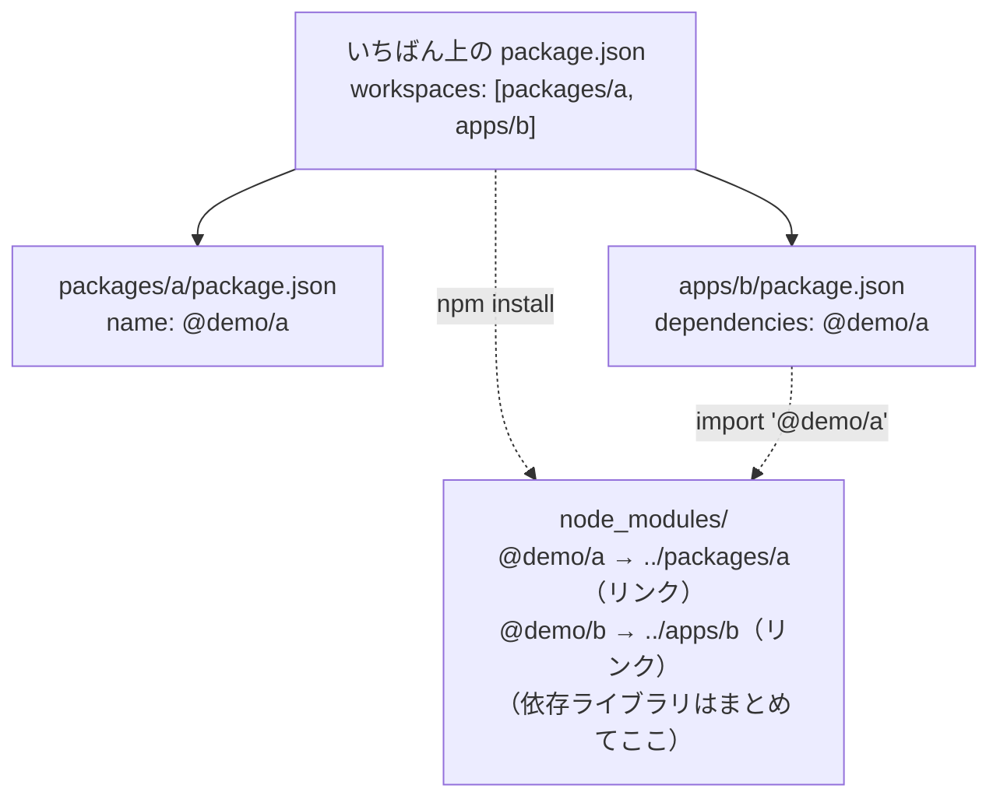

# npm workspaces

[目次](../README.md) ＞ [技術カード](README.md) ＞ npm workspaces

## 一言で

1 つのリポジトリの中に、いくつもの npm のパッケージを置き、互いを **名前で** 参照できるようにする npm の機能です。こうした構成を **モノレポ** と呼びます。

## 仕組み



- **いちばん上の `package.json` の `workspaces`** に、パッケージのフォルダを並べる
- **`npm install`（`npm ci`）を 1 回** 実行すると、全パッケージの依存ライブラリを、いちばん上の `node_modules` にまとめて入れる（同じライブラリは 1 つにまとまる）
- 各パッケージは、`node_modules/<名前>` に **リンク**（シンボリックリンク）として置かれる。だから、ほかのパッケージから `import '@demo/a'` と名前で読み込める。中身を直せば、すぐに使う側に反映される
- **`-w <パッケージ>`** で、そのパッケージのコマンド（`scripts`）を、いちばん上のフォルダから実行できる
- **`package-lock.json` は 1 つ** だけ、いちばん上にある

## 最小の使い方

手元で、ネットワークなしで試せます（下の例は実際に動かして確かめたものです）。

```
ws-min/
├── package.json
├── packages/greeting/
│   ├── package.json
│   └── src/index.js
└── apps/cli/
    ├── package.json
    └── src/main.js
```

いちばん上の `package.json`:

```json
{
  "name": "ws-min",
  "private": true,
  "type": "module",
  "workspaces": ["packages/greeting", "apps/cli"]
}
```

`packages/greeting/package.json` と `src/index.js`:

```json
{
  "name": "@demo/greeting",
  "version": "0.1.0",
  "private": true,
  "type": "module",
  "exports": { ".": "./src/index.js" }
}
```

```js
export const greet = (name) => `こんにちは、${name}さん`;
```

`apps/cli/package.json` と `src/main.js`:

```json
{
  "name": "@demo/cli",
  "version": "0.1.0",
  "private": true,
  "type": "module",
  "dependencies": { "@demo/greeting": "0.1.0" },
  "scripts": { "start": "node src/main.js" }
}
```

```js
import { greet } from '@demo/greeting';
console.log(greet(process.argv[2] ?? '散歩'));
```

```sh
cd ws-min
npm install
ls -la node_modules/@demo/
npm run start -w apps/cli -- 鎌倉
```

```
cli -> …/ws-min/apps/cli
greeting -> …/ws-min/packages/greeting
こんにちは、鎌倉さん
```

### よく使うコマンド

| コマンド | 何をするか |
|---|---|
| `npm install` / `npm ci` | 全パッケージの依存を入れ、リンクを作る（`ci` は lock のとおりに） |
| `npm run <script> -w <フォルダ>` | そのパッケージのコマンドを実行 |
| `npm run <script> --workspaces` | 全パッケージで実行 |
| `npm install <ライブラリ> -w <フォルダ>` | そのパッケージの依存に足す |
| `npm ls -w <フォルダ> --depth 0` | そのパッケージの依存を見る |

## このリポジトリでは

| 場所 | 見どころ | 章 |
|---|---|---|
| [yorisoi-console/package.json](https://github.com/duwenji/yorisoi-console/blob/main/package.json) | 8 つのパッケージ、共通の道具（`typescript`・`vitest`・`tsx`）はいちばん上に 1 回 | [7-2](../07-typescript/02-workspaces.md) |
| [packages/protocol/package.json](https://github.com/duwenji/yorisoi-console/blob/main/packages/protocol/package.json) | `exports` が `.ts` のソースを直接指す。テスト用の入口 `./testing` を分ける | [7-2](../07-typescript/02-workspaces.md) |
| [api/package.json](https://github.com/duwenji/yorisoi-console/blob/main/api/package.json) | `"@yorisoi-console/protocol": "0.1.0"` のように、同じリポジトリのパッケージに依存 | [7-2](../07-typescript/02-workspaces.md) |
| 第 6 部のハンズオン | `npm run publish:local -w api`・`npm run check -w conformance -- …` | [6-7](../06-trust/07-hands-on.md) |

## よくある間違い

| 間違い | 起きること | 正しくは |
|---|---|---|
| パッケージのフォルダの中で `npm install` する | そのフォルダに別の `node_modules` と lock ができ、混乱する | いちばん上のフォルダで `npm install`（足すなら `-w`） |
| パッケージを足したのに `npm install` しない | リンクがなく、`import` で見つからない | `workspaces` に足したら `npm install` |
| `"private": true` を付けない | うっかり npm の公開のリポジトリに公開してしまうおそれ | 公開しないパッケージには付ける |
| 依存を `package.json` に書かずに `import` する | いちばん上の `node_modules` にあるので偶然動くが、何に依存しているか分からなくなる | 使うパッケージの `dependencies` に書く |

## 版と公式ドキュメント

| 項目 | 版 |
|---|---|
| Node.js | 22 以上（yorisoi-console の `engines`。npm workspaces は npm 7 から） |

- [npm workspaces（公式）](https://docs.npmjs.com/cli/using-npm/workspaces)
- [package.json の exports（Node.js）](https://nodejs.org/api/packages.html#exports)
