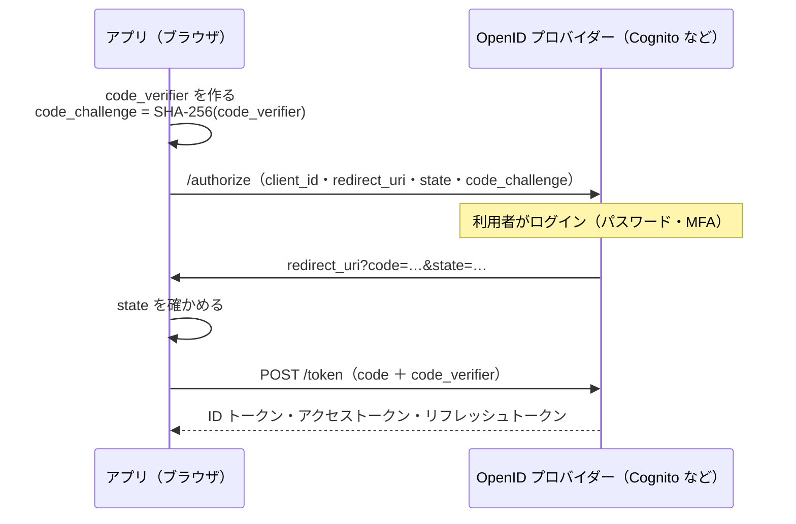

# OIDC

[目次](../README.md) ＞ [技術カード](README.md) ＞ OIDC

## 一言で

「ログインは専門のサービスに任せ、アプリはログインした証明（トークン）だけを受け取る」ための決まりです（OpenID Connect）。OAuth 2.0 の上に、だれがログインしたかを伝える **ID トークン** を足したものです。

## 仕組み



| 言葉 | 意味 |
|---|---|
| OpenID プロバイダー（OP） | ログインを受け持つ側。Cognito・Google・Microsoft Entra ID など |
| クライアント | ログインを頼むアプリ。SPA は秘密を持てない **公開クライアント** |
| ディスカバリー文書 | `<issuer>/.well-known/openid-configuration`。窓口の場所・署名の鍵（`jwks_uri`）などが書いてある |
| 認可コード ＋ **PKCE** | ブラウザのアプリ向けの流れ。URL で戻すのは 1 回だけのコード。引き換えに `code_verifier` が要る |
| `state` | 自分が始めたログインの戻りか確かめる値 |
| ID トークン | だれがログインしたか（`sub`・`email` など）。JWT |
| アクセストークン | API を呼ぶときに見せる。API はその署名・発行元・宛先・期限を確かめる |
| リフレッシュトークン | アクセストークンを取り直すためのもの |

## 最小の使い方

### PKCE を手で作る（Node.js、どこにも送らない）

（[09-console/scripts/pkce.mjs](../09-console/scripts/pkce.mjs)。[9-2](../09-console/02-browser-login.md) のハンズオンで動かしたもの）

```js
const b64url = (bytes) => Buffer.from(bytes).toString('base64url');
const s256 = async (text) => b64url(new Uint8Array(await crypto.subtle.digest('SHA-256', new TextEncoder().encode(text))));

console.log(await s256('dBjftJeZ4CVP-mB92K27uhbUJU1p1r_wW1gFWFOEjXk'));
// → E9Melhoa2OwvFrEMTJguCHaoeK1t8URWbuGJSstw-cM（RFC 7636 の付録の例と同じ）

const verifier = b64url(crypto.getRandomValues(new Uint8Array(32)));
const challenge = await s256(verifier);   // これだけを /authorize に送る
```

### ブラウザでは oidc-client-ts に任せる

```ts
import { UserManager, WebStorageStateStore } from 'oidc-client-ts';

const manager = new UserManager({
  authority: 'https://cognito-idp.ap-northeast-1.amazonaws.com/<ユーザープールの ID>',
  client_id: '<クライアントの ID>',
  redirect_uri: `${location.origin}/callback`,
  response_type: 'code',                          // 認可コード。PKCE は自動
  scope: 'openid email profile',
  userStore: new WebStorageStateStore({ store: sessionStorage }),
  automaticSilentRenew: true,
});

await manager.signinRedirect();                   // ログインの画面へ
// /callback の画面で:
const user = await manager.signinRedirectCallback();   // state を確かめ、コードを引き換える
// API を呼ぶとき:
fetch('/api/me', { headers: { Authorization: `Bearer ${user.access_token}` } });
```

動かすには、OpenID プロバイダー（Cognito のユーザープールなど）に、クライアントと戻り先を登録しておく必要があります。

## このリポジトリでは

| 場所 | 見どころ | 章 |
|---|---|---|
| [web/src/auth.ts](https://github.com/duwenji/yorisoi-console/blob/main/web/src/auth.ts) | `UserManager` の設定、元いた道を `state` に預ける、外の場所へ飛ばさない、Cognito の `/logout` | [9-2](../09-console/02-browser-login.md) |
| [web/src/main.tsx](https://github.com/duwenji/yorisoi-console/blob/main/web/src/main.tsx) の `Callback`・`Gate` | 戻りの処理を 1 回だけ。トークンがなければログインへ | [9-1](../09-console/01-react-vite.md)、[9-2](../09-console/02-browser-login.md) |
| [infra/lib/console-app.ts](https://github.com/duwenji/yorisoi-console/blob/main/infra/lib/console-app.ts) | 公開クライアント、戻り先、トークンの期限（60 分・12 時間） | [8-4](../08-aws/04-cognito.md) |
| ADR-001 A-17 | GitHub Actions から AWS に入るのにも OIDC を使う、という決定（まだ手で配備） | [9-4](../09-console/04-ci.md) |

## よくある間違い

| 間違い | 起きること | 正しくは |
|---|---|---|
| SPA にクライアントシークレットを置く | 配った JS から読める | 公開クライアント ＋ PKCE |
| トークンを URL で受け取る流れ（implicit）を使う | 履歴やログに残り、横取りされやすい | 認可コード ＋ PKCE |
| `state` を確かめない | 他人が仕組んだログインの戻りを受け付ける | ライブラリに任せる（自分で作るなら必ず確かめる） |
| 戻り先の URL が登録と少しでも違う | プロバイダーが断る | 完全に一致させる（ポート・末尾の `/` も） |
| ID トークンを API に見せる | API が受け取るべきはアクセストークン | `Authorization: Bearer <アクセストークン>` |
| ログアウトでアプリのトークンだけ消す | プロバイダーのセッションが残り、すぐ同じ人でログインできる | プロバイダーのログアウトの窓口にも移る |

## 版と公式ドキュメント

| 項目 | 版 |
|---|---|
| `oidc-client-ts` | 3.5 以上（`web/package.json`） |

- [OpenID Connect Core 1.0](https://openid.net/specs/openid-connect-core-1_0.html)
- [RFC 7636（PKCE）](https://datatracker.ietf.org/doc/html/rfc7636)
- [OAuth 2.0 for Browser-Based Applications（ブラウザのアプリの勧め）](https://datatracker.ietf.org/doc/draft-ietf-oauth-browser-based-apps/)
- [oidc-client-ts](https://github.com/authts/oidc-client-ts)
