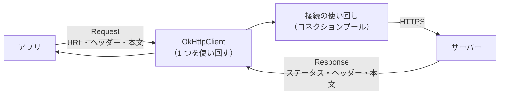

# OkHttp

[目次](../README.md) ＞ [技術カード](README.md) ＞ OkHttp

## 一言で

Java・Kotlin・Android で HTTP の要求を送るための、定番のライブラリです。Square 社が作っていて、Android の多くのライブラリ（Anthropic の Java SDK も）が中で使っています。

## 仕組み



- **OkHttpClient**: 設定（タイムアウトなど）と、接続の使い回しの仕組みを持つ本体です。**アプリで 1 つ（用途ごとに 1 つ）作って使い回します**。要求のたびに作ると、接続やスレッドが無駄に増えます
- **Request と Response**: 送るものと、返ってくるもの。`Request.Builder()` で組み立てます
- **同期と非同期**: `execute()` は応答が来るまでスレッドを止めて待ちます（コルーチンなら `withContext(Dispatchers.IO)` の中で）。`enqueue()` はコールバックで結果を受け取ります
- **応答の本文は必ず閉じる**: `use { }` で囲みます。閉じ忘れると接続が使い回されず、たまっていきます
- **タイムアウト**: 接続・読み取り・書き込みはそれぞれ既定で 10 秒、全体（`callTimeout`）は既定で無制限です

## 最小の使い方

Android がなくても、普通の Kotlin のプログラムで試せます（[技術カード: Gradle](gradle.md) の最小のプロジェクトに依存を足します）。下の例は、実際に Open-Meteo を呼んで動くことを確かめたものです。

```kotlin
// build.gradle.kts
dependencies {
    implementation("com.squareup.okhttp3:okhttp:4.12.0")
    implementation("org.json:json:20240303")   // Android なら不要（最初から入っている）
}
```

```kotlin
import okhttp3.HttpUrl.Companion.toHttpUrl
import okhttp3.OkHttpClient
import okhttp3.Request
import org.json.JSONObject
import java.io.IOException
import java.util.concurrent.TimeUnit

// 1 回作って使い回す（接続やスレッドを共有するため）
val http: OkHttpClient = OkHttpClient.Builder()
    .callTimeout(15, TimeUnit.SECONDS)
    .build()

fun currentTemperature(lat: Double, lon: Double): Double {
    val url = "https://api.open-meteo.com/v1/forecast".toHttpUrl().newBuilder()
        .addQueryParameter("latitude", lat.toString())
        .addQueryParameter("longitude", lon.toString())
        .addQueryParameter("current", "temperature_2m")
        .build()
    val request = Request.Builder()
        .url(url)
        .header("User-Agent", "okhttp-sample/0.1")
        .build()
    http.newCall(request).execute().use { res ->            // use で必ず閉じる
        if (!res.isSuccessful) throw IOException("HTTP ${res.code}")
        val json = JSONObject(res.body!!.string())
        return json.getJSONObject("current").getDouble("temperature_2m")
    }
}

fun main() {
    println("Kamakura: ${currentTemperature(35.3260, 139.5563)} C")
}
```

```
Kamakura: 19.3 C
```

- `toHttpUrl().newBuilder().addQueryParameter(…)` は、URL の `?latitude=…&longitude=…` を、日本語や記号も正しく変換して組み立てる。文字列をつなげて作るより安全
- `res.isSuccessful` は、ステータスが 200 番台かどうか

### POST で送る

```kotlin
// フォームの形（Overpass など）
val form = FormBody.Builder().add("data", query).build()

// JSON の形（AI の API など）
val json = JSONObject().put("model", model).toString().toRequestBody("application/json".toMediaType())

val request = Request.Builder().url(url).post(json).build()
```

### コルーチンの中で使う（Android）

```kotlin
suspend fun fetch(url: String): String = withContext(Dispatchers.IO) {
    http.newCall(Request.Builder().url(url).build()).execute().use { res ->
        if (!res.isSuccessful) throw IOException("HTTP ${res.code}")
        res.body!!.string()
    }
}
```

`execute()` はスレッドを止めるので、メインスレッドで呼ばないよう、部品の中で `Dispatchers.IO` に移します（[技術カード: Kotlin Coroutines](kotlin-coroutines.md)）。

Android では、マニフェストに `<uses-permission android:name="android.permission.INTERNET" />` が要ります。

## このリポジトリでは

| 場所 | 見どころ | 章 |
|---|---|---|
| [OverpassClient.kt](https://github.com/duwenji/yorisoi-platform/blob/main/kit-geo/src/main/java/io/github/duwenji/yorisoi/kit/geo/OverpassClient.kt) | POST、読み取りのタイムアウトを 30 秒に延ばした理由、混んでいたら次のサーバーへ | [4-1](../04-outside/01-http-json.md) |
| [WeatherClient.kt](https://github.com/duwenji/yorisoi-platform/blob/main/kit-geo/src/main/java/io/github/duwenji/yorisoi/kit/geo/weather/WeatherClient.kt) | GET の基本形、15 秒のタイムアウト | [4-1](../04-outside/01-http-json.md) |
| [RouteClient.kt](https://github.com/duwenji/yorisoi-platform/blob/main/kit-geo/src/main/java/io/github/duwenji/yorisoi/kit/geo/RouteClient.kt) | User-Agent、経度が先の URL | [4-1](../04-outside/01-http-json.md) |
| [OpenAiCompatibleClient.kt](https://github.com/duwenji/yorisoi-platform/blob/main/kit-llm/src/main/java/io/github/duwenji/yorisoi/kit/llm/OpenAiCompatibleClient.kt) | JSON の POST、`Authorization` ヘッダー、90 秒のタイムアウト | [4-3](../04-outside/03-ai.md) |
| [GoogleMapTiles.kt](https://github.com/duwenji/yorisoi-platform/blob/main/kit-geo/src/main/java/io/github/duwenji/yorisoi/kit/geo/map/GoogleMapTiles.kt) | `toHttpUrl().newBuilder()` で URL を組み立てる | [4-2](../04-outside/02-map.md) |
| [ChannelSync.kt](https://github.com/duwenji/yorisoi-platform/blob/main/kit-channel/src/main/kotlin/io/github/duwenji/yorisoi/kit/channel/remote/ChannelSync.kt) の `ProviderHttp` | 通信を `fun interface` の後ろに隠し、テストで代役に替える | [2-3](../02-compose/03-manual-di.md) |

## よくある間違い

| 間違い | 起きること | 正しくは |
|---|---|---|
| 要求のたびに `OkHttpClient` を作る | 接続とスレッドが無駄に増え、メモリを食う | 1 つ作って使い回す |
| 応答を閉じない | 接続が使い回されず、警告が出て、やがて詰まる | `execute().use { … }` |
| メインスレッドで `execute()` | 画面が固まる。Android では例外（`NetworkOnMainThreadException`） | `withContext(Dispatchers.IO)` の中で |
| `isSuccessful` を確かめずに本文を読む | エラーの説明文を、正しいデータとして読んでしまう | ステータスを確かめてから |
| 考える時間の長いサービスで既定のタイムアウトのまま | 答えが届く前に諦める | 用途に合わせて `readTimeout`・`callTimeout` を決める |
| URL を文字列の連結で作る | 日本語や `&` を含む値で壊れる | `HttpUrl.Builder` の `addQueryParameter` |
| `res.body!!.string()` を 2 回呼ぶ | 2 回目は読めない（本文は 1 回しか読めない） | 1 回読んで変数に入れる |

## 版と公式ドキュメント

| 項目 | 版 |
|---|---|
| `com.squareup.okhttp3:okhttp` | 4.12.0（SanpoGuide の `app/build.gradle.kts`） |

- [OkHttp の公式サイト](https://square.github.io/okhttp/)
- [レシピ集（よく使う書き方）](https://square.github.io/okhttp/recipes/)
- [タイムアウト](https://square.github.io/okhttp/recipes/#timeouts-kt-java)
