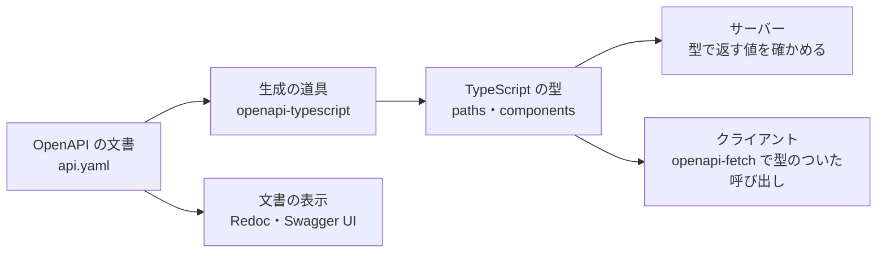

# OpenAPI

[目次](../README.md) ＞ [技術カード](README.md) ＞ OpenAPI

## 一言で

HTTP の API の「どの道（パス）に、どんな要求を送ると、どんな応答が返るか」を、YAML（または JSON）で書くための標準の形式です。人が読む仕様書にもなり、機械が読んで型やクライアントを作ることもできます。

## 仕組み



- **paths**: 道（`/spots/{spotId}`）ごとに、メソッド（`get`・`post`…）、パラメータ（パス・クエリ・ヘッダー）、要求の本文、応答（ステータスごと）を書く
- **components**: 何度も使う形（`schemas`）、パラメータ、応答をまとめて定義し、`$ref` で参照する
- **schema**: データの形は JSON Schema で書く（`type`・`required`・`enum`・`minLength`…）
- **生成**: 文書から、型・クライアント・サーバーのひな形・見やすい文書を作れる。**文書が 1 つの正本** になり、サーバーとクライアントが同じ約束から作られる

## 最小の使い方

手元で試せます（下の例は、管理システムの `openapi-typescript` と `openapi-fetch` で実際に生成と型の確認をしたものです）。

### 1. 文書を書く

`spots.yaml`:

```yaml
openapi: 3.1.0
info:
  title: Spots API
  version: 1.0.0
paths:
  /spots/{spotId}:
    get:
      operationId: getSpot
      parameters:
        - name: spotId
          in: path
          required: true
          schema: { type: string }
      responses:
        '200':
          description: スポット
          content:
            application/json:
              schema: { $ref: '#/components/schemas/Spot' }
        '404':
          description: 見つからない
components:
  schemas:
    Spot:
      type: object
      required: [id, name, category]
      properties:
        id: { type: string }
        name: { type: string }
        category: { type: string, enum: [shrine, temple, park] }
        description: { type: string }
```

### 2. 型を作る

```sh
npx openapi-typescript spots.yaml -o schema.ts
```

```ts
// schema.ts（一部）
schemas: {
    Spot: {
        id: string;
        name: string;
        /** @enum {string} */
        category: "shrine" | "temple" | "park";
        description?: string;
    };
};
```

`required` に入っている項目は必須、それ以外は `?`（任意）、`enum` はユニオン型になります。

### 3. 型のついたクライアントで呼ぶ

```ts
import createClient from 'openapi-fetch';
import type { components, paths } from './schema.js';

type Spot = components['schemas']['Spot'];

const client = createClient<paths>({ baseUrl: 'https://api.example.com' });

export async function spotName(spotId: string): Promise<string | undefined> {
  const { data, error } = await client.GET('/spots/{spotId}', { params: { path: { spotId } } });
  if (error || !data) return undefined;
  const spot: Spot = data;
  return `${spot.name}（${spot.category}）`;
}
```

道を書き間違えたり、ない項目を読んだりすると、コンパイルで止まります。

```
error TS2345: Argument of type '"/spot/{spotId}"' is not assignable to parameter of type '"/spots/{spotId}"'.
error TS2339: Property 'kind' does not exist on type '{ id: string; name: string; category: "park" | "shrine" | "temple"; … }'.
```

### よく使う書き方

| 書き方 | 意味 |
|---|---|
| `required: [a, b]` | 必須の項目 |
| `enum: [x, y]` | 取りうる値 |
| `minLength`・`maxLength`・`minimum`・`pattern` | 値の範囲 |
| `$ref: '#/components/schemas/X'` | 定義を参照 |
| `in: path`・`in: query`・`in: header` | パラメータの場所 |
| `responses: default:` | 決めたステータス以外（エラーなど） |
| `security:` | 認証のしかた |

## このリポジトリでは

| 場所 | 見どころ | 章 |
|---|---|---|
| [docs/api/console.openapi.yaml](../../yorisoi-console/docs/api/console.openapi.yaml) | 管理 API の 66 の操作。正本は契約書（console-api.md）と明記 | [7-3](../07-typescript/03-openapi.md) |
| [packages/api-types](../../yorisoi-console/packages/api-types/package.json) | `npm run generate` で `schema.ts` を作る。手では直さない | [7-3](../07-typescript/03-openapi.md) |
| [api/src/console/http.ts](../../yorisoi-console/api/src/console/http.ts) | `Record<ProblemCode, number>`：エラーコードの HTTP ステータスを決め忘れるとコンパイルエラー | [7-3](../07-typescript/03-openapi.md) |
| [web/src/api.ts](../../yorisoi-console/web/src/api.ts) | `createClient<paths>`（openapi-fetch）。全部の呼び出しに型がつく | [7-3](../07-typescript/03-openapi.md) |
| [SanpoGuide/docs/api/](../../SanpoGuide/docs/api/) | SanpoGuide 側の秘密メッセージ API の OpenAPI と、Redoc で表示する設定 | — |

## よくある間違い

| 間違い | 起きること | 正しくは |
|---|---|---|
| 生成した型を手で直す | 次に生成し直したときに消える | 文書を直して生成し直す |
| 文書を直して、生成し直すのを忘れる | 型が古い約束のまま | 文書を変えたら必ず生成する（CI で差分を確かめると確実） |
| 型があるから、サーバーで入力を確かめない | 型は実行するときには消えるので、おかしな入力が通る | サーバーは本文を実行するときに確かめる |
| `required` を書き忘れる | 必須のつもりの項目が `?` になり、クライアントが省けてしまう | 必須の項目は `required` に並べる |
| 人が読む仕様と文書の 2 つを、どちらも正本にする | 食い違ったときに、どちらが正しいか分からない | どちらが正本かを決めて書いておく |

## 版と公式ドキュメント

| 項目 | 版 |
|---|---|
| OpenAPI | 3.1.0（`console.openapi.yaml`） |
| `openapi-typescript` | 7.13 以上（`packages/api-types`） |
| `openapi-fetch` | 0.17 以上（`web`） |

- [OpenAPI Specification](https://spec.openapis.org/oas/latest.html)
- [openapi-typescript](https://openapi-ts.dev/)
- [openapi-fetch](https://openapi-ts.dev/openapi-fetch/)
- [RFC 9457（Problem Details）](https://www.rfc-editor.org/rfc/rfc9457)
