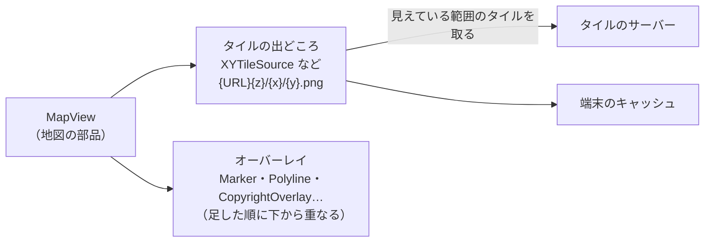

# osmdroid

[目次](../README.md) ＞ [技術カード](README.md) ＞ osmdroid

## 一言で

Android で地図を表示するための、オープンソースのライブラリです。OpenStreetMap のために作られましたが、URL の形を教えれば、国土地理院などいろいろなタイルのサービスを使えます。キーは要りません。

## 仕組み



- **タイル**: 地図は 256×256 ピクセルの画像（タイル）の集まりで、ズーム（z）・横（x）・縦（y）の番号で決まります。osmdroid は、画面に見えている範囲のタイルだけを取ってきて並べ、端末にキャッシュします
- **タイルの出どころ**（`ITileSource`）: どの URL からタイルを取るか。`XYTileSource` に URL の頭と拡張子を渡せば、`{URL}{z}/{x}/{y}{拡張子}` の形のサービスを使えます。URL の形が違うサービスは、`OnlineTileSourceBase` を継承して `getTileURLString` を書きます
- **オーバーレイ**: 地図の上に重ねるもの。印（`Marker`）、線（`Polyline`）、出典の表示（`CopyrightOverlay`）など。`map.overlays` に足した順に、下から重なります
- **User-Agent**: タイルのサーバーに、アプリを名乗る必要があります。`Configuration.getInstance().userAgentValue` で設定します
- **View の部品**: `MapView` は Compose ではない昔ながらの部品なので、Compose では `AndroidView` で置きます

## 最小の使い方

Android のアプリの中で動きます（散策ガイドのプロジェクトの中で、コンパイルが通ることを確かめたものです）。

```kotlin
// build.gradle.kts
dependencies {
    implementation("org.osmdroid:osmdroid-android:6.1.20")
}
```

マニフェストには `INTERNET` の権限が要ります。

### 準備（アプリの起動時に 1 回）

```kotlin
// Application.onCreate など
Configuration.getInstance().userAgentValue = "MyWalkApp/0.1 (Android)"
```

### タイルの出どころ（国土地理院の標準地図）

```kotlin
val GsiStandardTiles = XYTileSource(
    "GSI_std", 5, 18, 256, ".png", arrayOf("https://cyberjapandata.gsi.go.jp/xyz/std/"), "出典：国土地理院",
)
```

引数は、名前（キャッシュの区別に使う）、最小と最大のズーム、タイルの大きさ、拡張子、URL の頭、出典の文です。

### Compose の中に置く

```kotlin
@Composable
fun SimpleMap(center: GeoPoint, modifier: Modifier = Modifier) {
    val context = LocalContext.current
    val mapView = remember {
        MapView(context).apply {
            setTileSource(GsiStandardTiles)
            setMultiTouchControls(true)
            controller.setZoom(17.0)
            overlays += CopyrightOverlay(context)
        }
    }
    DisposableEffect(mapView) {
        mapView.onResume()
        onDispose { mapView.onPause(); mapView.onDetach() }
    }
    AndroidView(factory = { mapView }, modifier = modifier) { map ->
        map.controller.setCenter(center)
        map.overlays.removeAll { it is Marker }
        map.overlays += Marker(map).apply {
            position = center
            title = "ここ"
            setAnchor(Marker.ANCHOR_CENTER, Marker.ANCHOR_BOTTOM)
        }
        map.invalidate()
    }
}
```

- `remember` で `MapView` を 1 回だけ作る。再コンポーズのたびに作ると、地図が初めからになる
- `DisposableEffect` で、画面に出たら `onResume`、消えたら `onPause`・`onDetach`
- `AndroidView` の最後のブロックは、引数（`center`）が変わるたびに呼ばれる。ここでオーバーレイを書き換え、`invalidate()` で描き直す
- `CopyrightOverlay` が、タイルの出どころに書いた出典の文を地図の隅に描く

### 線を引く

```kotlin
val line = Polyline(map).apply {
    outlinePaint.color = 0xCC1E88E5.toInt()
    outlinePaint.strokeWidth = 5 * context.resources.displayMetrics.density
    setPoints(listOf(GeoPoint(35.3190, 139.5536), GeoPoint(35.3260, 139.5563)))
}
map.overlays += line
```

## このリポジトリでは

| 場所 | 見どころ | 章 |
|---|---|---|
| [SanpoApp.kt](../../yorisoi-sanpoguide/app/src/main/java/io/github/duwenji/sanpoguide/SanpoApp.kt) | 起動時の User-Agent の設定 | [4-2](../04-outside/02-map.md) |
| [MapTiles.kt](../../yorisoi-platform/kit-geo/src/main/java/io/github/duwenji/yorisoi/kit/geo/map/MapTiles.kt) | 国土地理院の 4 種類の地図（`XYTileSource`）、Google Map Tiles（`OnlineTileSourceBase` を継承） | [4-2](../04-outside/02-map.md) |
| [SpotMap.kt](../../yorisoi-platform/kit-geo/src/main/java/io/github/duwenji/yorisoi/kit/geo/map/SpotMap.kt) | `AndroidView`、重ねる順番、顔ぶれが変わったときだけマーカーを作り直す、150m 動いたときだけ真ん中を合わせる、向きつきの現在地の印 | [4-2](../04-outside/02-map.md) |

## よくある間違い

| 間違い | 起きること | 正しくは |
|---|---|---|
| User-Agent を設定しない | タイルのサーバーに断られることがある | 起動時に `userAgentValue` を設定する |
| `MapView` を `remember` せずに作る | 再コンポーズのたびに地図が初めからになる | `remember { MapView(…) }` |
| `onPause`・`onDetach` を呼ばない | タイルの取得などが止まらず、メモリが漏れる | `DisposableEffect` の `onDispose` で呼ぶ |
| 毎回マーカーを全部作り直す | 開いた吹き出しが閉じる、重くなる | 中身が変わったときだけ作り直す |
| オーバーレイの順番を気にしない | 小さな印が大きな印に隠れる、現在地が見えない | 下に置きたいものから足す |
| 出典を表示しない | 地図のデータの利用の条件に反する | `CopyrightOverlay` や、サービスの決まりに沿った表示 |
| 緯度と経度を取り違える | 全然違う場所に印が出る | `GeoPoint(緯度, 経度)` の順 |

## 版と公式ドキュメント

| 項目 | 版 |
|---|---|
| `org.osmdroid:osmdroid-android` | 6.1.20（SanpoGuide の `app/build.gradle.kts`） |

- [osmdroid（GitHub）](https://github.com/osmdroid/osmdroid)
- [osmdroid の wiki（使い方）](https://github.com/osmdroid/osmdroid/wiki)
- [地理院タイル一覧（国土地理院）](https://maps.gsi.go.jp/development/ichiran.html)
