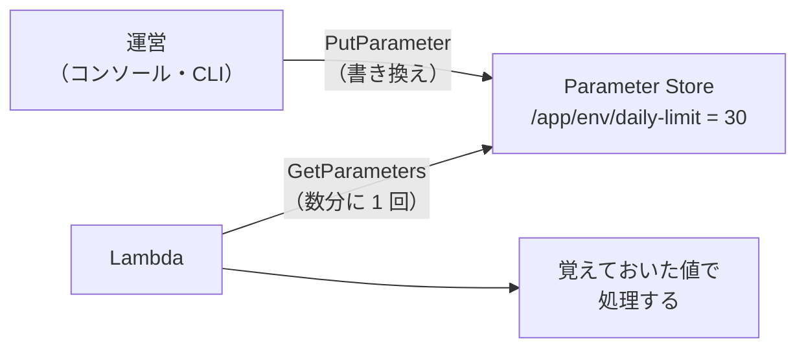

# Parameter Store

[目次](../README.md) ＞ [技術カード](README.md) ＞ Parameter Store

## 一言で

AWS Systems Manager の機能の 1 つで、設定の値を名前つきで置いておく場所です。プログラムは起動したあとに値を読むので、配備し直さずに設定を変えられます。

## 仕組み



- **名前**: `/` で区切った階層の名前を付けられる（例: `/yorisoi-ai-relay/dev/daily-limit`）。環境やアプリで分けておくと、IAM で「この下だけ読める」と絞りやすい
- **種類**: ふつうの文字列（`String`）、一覧（`StringList`）、KMS で暗号化した文字列（`SecureString`）
- **読み方**: `GetParameter`（1 つ）、`GetParameters`（名前を並べて最大 10 個）、`GetParametersByPath`（階層の下を全部）
- **料金**: 標準のパラメータは、置くことにも、ふつうの頻度で読むことにも料金がかからない。値は 4 KB まで
- **Secrets Manager との違い**: パスワードや秘密鍵のように、定期的に替えたり（ローテーション）、厳しく扱ったりしたい秘密は Secrets Manager。ふつうの設定は Parameter Store

## 最小の使い方

（CDK の部分は [scripts/cdk-samples.ts](../08-aws/scripts/cdk-samples.ts) で合成を確かめた例。配備には AWS が要ります）

```ts
const limit = new ssm.StringParameter(stack, 'DailyLimit', {
  parameterName: '/my-app/dev/daily-limit',
  stringValue: '30',
  description: 'Calls a day: an integer from 5 to 100',
});
limit.grantRead(fn);
fn.addEnvironment('PARAM_DAILY_LIMIT', limit.parameterName);
```

読む側は、値を少しの間覚えておきます。

```ts
import { GetParametersCommand, SSMClient } from '@aws-sdk/client-ssm';

const ssm = new SSMClient({});
let cached: { value: number; until: number } | undefined;

async function dailyLimit(): Promise<number> {
  if (cached && cached.until > Date.now()) return cached.value;
  const out = await ssm.send(new GetParametersCommand({ Names: [process.env.PARAM_DAILY_LIMIT!] }));
  const n = Number(out.Parameters?.[0]?.Value);
  const value = Number.isInteger(n) && n >= 5 && n <= 100 ? n : 30; // おかしな値なら既定値で
  cached = { value, until: Date.now() + 5 * 60 * 1000 };
  return value;
}
```

書き換えるとき（運営が手で）:

```sh
aws ssm put-parameter --name /my-app/dev/daily-limit --value 50 --overwrite
```

## このリポジトリでは

| 場所 | 見どころ | 章 |
|---|---|---|
| [infra/lib/relay-stack.ts](https://github.com/duwenji/yorisoi-console/blob/main/infra/lib/relay-stack.ts) | 運営の AI の 1 日の上限・月の予算・モデルの 3 つ。手で変えた値は、配備し直しても戻らない | [8-9](../08-aws/09-ai-relay.md) |
| [api/src/relay/aws.ts](https://github.com/duwenji/yorisoi-console/blob/main/api/src/relay/aws.ts) の `settings`・`readSettings` | 5 分覚えておく。おかしな値は既定の値で動き、警報で知らせる | [8-9](../08-aws/09-ai-relay.md) |

## よくある間違い

| 間違い | 起きること | 正しくは |
|---|---|---|
| 呼び出しのたびに読む | 遅くなる。読む頻度が上がると制限にかかる | 数分覚えておく |
| おかしな値で止まる | 打ち間違い 1 つでサービスが止まる | 既定の値で動き、知らせる |
| 秘密の値を `String` で置く | 権限のある人に平文で見える | `SecureString` か Secrets Manager |
| CDK の値と手で変えた値の関係を知らない | どちらが効いているか分からなくなる | CloudFormation は、コードの値が変わったときだけ書き換える。手で変える値は、コードの値を変えない |

## 版と公式ドキュメント

| 項目 | 版 |
|---|---|
| `@aws-sdk/client-ssm` | 3.1152 以上（`api/package.json`） |

- [AWS Systems Manager Parameter Store](https://docs.aws.amazon.com/ja_jp/systems-manager/latest/userguide/systems-manager-parameter-store.html)
- [Parameter Store の料金とクォータ](https://docs.aws.amazon.com/ja_jp/general/latest/gr/ssm.html)
