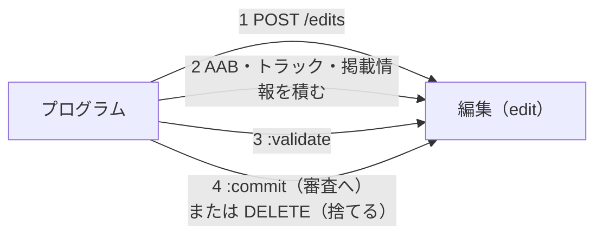

# Google Play Developer API

[目次](../README.md) ＞ [技術カード](README.md) ＞ Google Play Developer API

## 一言で

Play Console の操作の一部（AAB のアップロード、トラックへの公開、ストアの掲載情報、データ セーフティなど）を、プログラムから行うための Google の Web API です。正式な名前は Google Play Android Developer API（`androidpublisher`）です。

## 仕組み



- **編集**（edit）: 変更を積む入れ物。確定（`:commit`）するまで、Play には何も反映されない。確定すると、まとめて審査に出る
- **確かめ**（`:validate`）: 確定せずに、通るかどうかだけを Play に確かめてもらえる
- **編集を使わない操作**: データ セーフティ（`dataSafety`）は、すぐに置き換わる
- **認証**: サービス アカウントで名乗り、`https://www.googleapis.com/auth/androidpublisher` の範囲のアクセス トークンを使う（[技術カード: サービス アカウントと OAuth 2.0](service-account-oauth.md)）
- **認可**: 何をしてよいかは、Play Console の [ユーザーと権限] でサービス アカウントに付ける
- **できないこと**: アプリを作ること、価格・公開する国、テスターのリスト、データ セーフティ以外のアプリのコンテンツの多くは、画面で入れる
- **似た名前の別の API**: Play Developer Reporting API（統計）、Play Integrity API（[技術カード](play-integrity.md)）は別のもの

## 最小の使い方

（呼び出しには、Play Console で権限を付けたサービス アカウントが要ります）

```js
const API = 'https://androidpublisher.googleapis.com/androidpublisher/v3/applications/<パッケージ名>';
const call = async (method, url, body) => {
  const res = await fetch(url, {
    method,
    headers: { Authorization: `Bearer ${token}`, ...(body ? { 'Content-Type': 'application/json' } : {}) },
    body: body ? JSON.stringify(body) : undefined,
  });
  if (!res.ok) throw new Error(`${res.status} ${await res.text()}`);
  const text = await res.text();
  return text ? JSON.parse(text) : {};
};

// トラックとリリースを読むだけ（読み終えたら編集を捨てる）
const { id } = await call('POST', `${API}/edits`, {});
try {
  const { tracks = [] } = await call('GET', `${API}/edits/${id}/tracks`);
  for (const t of tracks) for (const r of t.releases ?? []) console.log(t.track, r.name, r.versionCodes, r.status);
} finally {
  await call('DELETE', `${API}/edits/${id}`);
}
```

AAB は、アップロード用の別の URL（`https://androidpublisher.googleapis.com/upload/androidpublisher/v3/…/edits/{id}/bundles?uploadType=media`）に、ファイルの中身をそのまま送ります。

## このリポジトリでは

| 場所 | 見どころ | 章 |
|---|---|---|
| [tools/play.mjs](https://github.com/duwenji/yorisoi-sanpoguide/blob/main/tools/play.mjs) | Node の標準のライブラリだけ。既定は確かめるだけで、`--commit` で確定。確定しない編集は `finally` で捨てる | [10-4](../10-play/04-api.md) |
| [docs/play-api.md](https://github.com/duwenji/yorisoi-sanpoguide/blob/main/docs/play-api.md) | 準備（API を有効にする・鍵・招待と権限）と、うまくいかないときの表 | [10-4](../10-play/04-api.md) |

## よくある間違い

| 間違い | 起きること | 正しくは |
|---|---|---|
| 確定しない編集を放っておく | Play Console に保存していない変更が残る | 確定しないなら捨てる |
| いきなり確定する | 間違いがそのまま審査に出る | まず `:validate` だけ |
| Google Cloud の側でロールを付ける | 要らない権限が付く | 権限は Play Console で、必要なものだけ |
| 招待の直後に呼んで `403` | 権限が届くまで時間がかかる | 数時間待つ |
| API で出した版が段階的に出ると思う | トラックの全員に出る（`status: completed` で出した場合） | 段階的に出すなら `inProgress` と割合を指定するか、画面で |

## 版と公式ドキュメント

| 項目 | 版 |
|---|---|
| Google Play Android Developer API | v3 |

- [Google Play Developer API の概要](https://developers.google.com/android-publisher?hl=ja)
- [編集（edits）](https://developers.google.com/android-publisher/edits?hl=ja)
- [API を使い始める（サービス アカウントの準備）](https://developers.google.com/android-publisher/getting_started?hl=ja)
