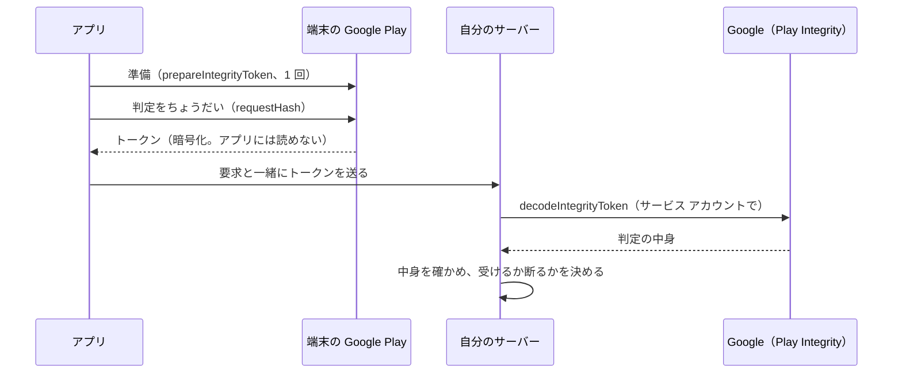

# Play Integrity API

[目次](../README.md) ＞ [技術カード](README.md) ＞ Play Integrity API

## 一言で

サーバーが「この要求は、Google Play から入れた本物のアプリが、まともな端末で送ったものか」を確かめるための、Google の仕組みです。アプリは端末の Google Play から **判定のトークン** を受け取ってサーバーに送り、サーバーはそれを Google に読み解いてもらって中身を確かめます。

## 仕組み



- **Standard request**: 前もって準備しておき、要るときに速く判定を取る形。ほかに、より重い Classic request もある
- **requestHash**: 要求を表すハッシュ。判定に入るので、サーバーは「この要求のための判定か」を確かめられ、盗み見た判定の使い回しを防げる
- **Google Cloud のプロジェクト**: Play Console のアプリにつなぎ、アプリはその **プロジェクト番号** を準備のときに渡す
- **判定の主な項目**:

| 項目 | 例 | 意味 |
|---|---|---|
| `requestDetails.requestPackageName`・`requestHash`・`timestampMillis` | — | どのアプリの、どの要求の、いつの判定か |
| `appIntegrity.appRecognitionVerdict` | `PLAY_RECOGNIZED` | Play が知っている、そのままのアプリか |
| `deviceIntegrity.deviceRecognitionVerdict` | `MEETS_DEVICE_INTEGRITY` | まともな Android の端末か（エミュレータや改造した端末は満たさない） |

- **確かめるのはサーバー**: アプリの中で確かめても、アプリごと書き換えられれば意味がない

## 最小の使い方

アプリ（Kotlin）:

```kotlin
val manager = IntegrityManagerFactory.createStandard(context.applicationContext)
val provider = manager.prepareIntegrityToken(
    PrepareIntegrityTokenRequest.builder().setCloudProjectNumber(cloudProjectNumber).build(),
).await()
// 要るときに
val token = provider.request(
    StandardIntegrityTokenRequest.builder().setRequestHash(requestHash).build(),
).await().token()
```

`await()` は `kotlinx-coroutines-play-services` のもの（[技術カード: Kotlin Coroutines](kotlin-coroutines.md)）。

サーバー（TypeScript）:

```ts
const res = await fetch(`https://playintegrity.googleapis.com/v1/${packageName}:decodeIntegrityToken`, {
  method: 'POST',
  headers: { authorization: `Bearer ${accessToken}`, 'content-type': 'application/json' },
  body: JSON.stringify({ integrity_token: token }),
});
const { tokenPayloadExternal } = await res.json();
// requestHash・時刻・アプリ・端末の判定を確かめる
```

`accessToken` は、サービス アカウントで `https://www.googleapis.com/auth/playintegrity` の範囲を頼んでもらう（[技術カード: サービス アカウントと OAuth 2.0](service-account-oauth.md)）。

## このリポジトリでは

| 場所 | 見どころ | 章 |
|---|---|---|
| kit-llm の [OperatorAi.kt](https://github.com/duwenji/yorisoi-platform/blob/main/kit-llm/src/main/java/io/github/duwenji/yorisoi/kit/llm/OperatorAi.kt) の `PlayIntegrity` | 準備を 1 回にし、失敗したら捨てて準備からやり直す | [10-5](../10-play/05-integrity.md) |
| kit-llm の [RelayClient.kt](https://github.com/duwenji/yorisoi-platform/blob/main/kit-llm/src/main/java/io/github/duwenji/yorisoi/kit/llm/RelayClient.kt) の `requestHash` | installId と nonce の SHA-256 | [10-5](../10-play/05-integrity.md) |
| yorisoi-console の [api/src/relay/integrity.ts](https://github.com/duwenji/yorisoi-console/blob/main/api/src/relay/integrity.ts) | 読み解きと `checkVerdict`。前後 5 分より古い判定は使わない | [8-9](../08-aws/09-ai-relay.md)、[10-5](../10-play/05-integrity.md) |

## よくある間違い

| 間違い | 起きること | 正しくは |
|---|---|---|
| `requestHash` を使わない、固定の値にする | 盗み見た判定を使い回される | 要求ごとの値（使い捨ての値を含む）のハッシュ |
| アプリの中で判定を確かめる | アプリごと書き換えられる | サーバーで確かめる |
| 開発中のアプリで本番の確かめを通そうとする | エミュレータや手で入れたアプリは通らない | 開発用の入口を分ける |
| 判定だけに頼る | すり抜けられたら費用が使われ放題 | 回数・長さ・予算の上限を重ねる |
| 準備した provider を使い続ける | 時間がたつと使えなくなることがある | 失敗したら準備し直す |

## 版と公式ドキュメント

| 項目 | 版 |
|---|---|
| `com.google.android.play:integrity` | 1.6.0（yorisoi-platform の `gradle/libs.versions.toml`） |

- [Play Integrity API の概要](https://developer.android.com/google/play/integrity/overview?hl=ja)
- [Standard request](https://developer.android.com/google/play/integrity/standard?hl=ja)
- [判定の内容](https://developer.android.com/google/play/integrity/verdicts?hl=ja)
