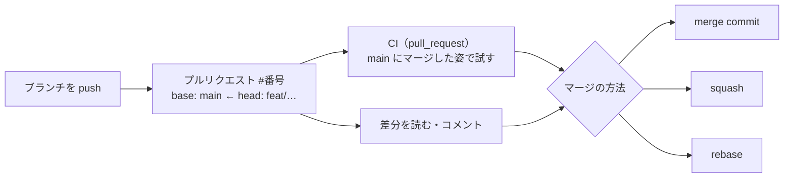

# プルリクエスト

[目次](../README.md) ＞ [技術カード](README.md) ＞ プルリクエスト

## 一言で

「このブランチの変更を、`main` などに入れたい」という GitHub の上の申し出です。差分・説明・CI の結果・やりとりが 1 つの番号（`#41`）にまとまり、確かめてからマージします。

## 仕組み



- **base と head**: 入れる先（`main`）と、入れたいブランチ
- **チェック**: CI などの結果。プルリクエストの画面に緑・赤で出る
- **マージの方法**: merge commit（枝分かれを残す）・squash（1 つにまとめる）・rebase（付け直す）
- **番号**: Issue と通しの番号。コミットの説明や文書から `#41` で呼べる
- **決まりの強制**: ブランチ保護・ルールセットで、CI の成功やレビューを必須にできる

## 最小の使い方

GitHub のリポジトリと、ログインした [gh](gh-cli.md) が要ります。

```sh
git switch -c docs/hello
echo "追記" >> README.md
git commit -am "docs: 追記"
git push -u origin docs/hello

gh pr create --fill          # コミットの説明から題と本文を作る
gh pr checks --watch         # CI を待つ
gh pr view --web             # 差分をブラウザで読む
gh pr merge --merge --delete-branch
```

### 説明に書くこと

| 見出し | 中身 |
|---|---|
| 概要 | なぜ変えるのか。決めた文書や関係する番号 |
| 変更 | 何を変えたか。変えないもの |
| 確認 | 手元で流したもの、その結果 |
| 注意 | マージの前後にすること |

## このリポジトリでは

5 つのリポジトリとも、ブランチ（`feat/`・`docs/`・`fix/` …）からプルリクエストを出し、merge commit で入れています。複数のリポジトリにまたがるときは、yorisoi-platform を先にマージして公開してから、アプリのプルリクエストをマージします。ブランチ保護・ルールセットは使っていません。[11-2](../11-github/02-pull-requests.md) で詳しく見ます。

## よくある間違い

| 間違い | 起きること | 正しくは |
|---|---|---|
| 説明が「修正」だけ | 半年後に理由が分からない | なぜ・何を・確かめたこと |
| CI が赤のままマージする | `main` が組み立てられなくなる | 緑を確かめてから。仕組みで守るならルールセット |
| 1 つのプルリクエストに無関係な変更を混ぜる | 読みにくく、一部だけ戻せない | 理由ごとに分ける |
| 依存先の公開を待たずにマージする | `Could not find <版>` で CI が落ちる | 先に公開し、CI を流し直す |
| マージしたブランチを残す | 作業中のものと見分けにくい | `--delete-branch`、または自動削除の設定 |

## 版と公式ドキュメント

- [プルリクエストについて](https://docs.github.com/ja/pull-requests/collaborating-with-pull-requests/proposing-changes-to-your-work-with-pull-requests/about-pull-requests)
- [マージの方法](https://docs.github.com/ja/repositories/configuring-branches-and-merges-in-your-repository/configuring-pull-request-merges/about-merge-methods-on-github)
- [ルールセット](https://docs.github.com/ja/repositories/configuring-branches-and-merges-in-your-repository/managing-rulesets/about-rulesets)
