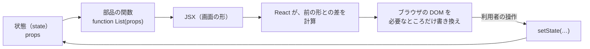

# React

[目次](../README.md) ＞ [技術カード](README.md) ＞ React

## 一言で

ブラウザの画面を、**部品（コンポーネント）** の組み合わせで書くための JavaScript のライブラリです。「今の状態なら、画面はこう」と宣言しておけば、状態が変わったときに React が描き直します。

## 仕組み



- **部品**: データ（**props**）を受け取り、画面の形（**JSX**）を返す関数。名前は大文字で始める
- **JSX**: JavaScript の中に書く HTML に似た記法。`{…}` に式を書く。ビルドで関数の呼び出しに変わる
- **状態**（`useState`）: 部品が覚えている値。変える関数を呼ぶと、部品の関数がもう一度呼ばれ、描き直される（再レンダリング）
- **副作用**（`useEffect`）: 描いたあとで行う処理（API を呼ぶなど）。依存の配列の値が変わったときだけやり直す
- **フック**: `use` で始まる関数（`useState`・`useEffect`・`useContext`…）。部品の関数のいちばん外側で、毎回同じ順番に呼ぶ
- **Context**: 木の下の部品すべてに値を配る（props を何段も渡さずに済む）

Jetpack Compose（[技術カード](jetpack-compose.md)）とほぼ同じ考え方です（`@Composable` ↔ 部品、`remember { mutableStateOf() }` ↔ `useState`、`LaunchedEffect` ↔ `useEffect`）。

## 最小の使い方

（[09-console/scripts/react-demo/app.tsx](../09-console/scripts/react-demo/app.tsx) の一部。[9-1](../09-console/01-react-vite.md) のハンズオンで動かしたもの）

```tsx
import { useEffect, useState } from 'react';

/** 状態（useState）が変わると、React が描き直す。 */
export function Counter() {
  const [count, setCount] = useState(0);
  return (
    <p>
      押した回数: {count} <button onClick={() => setCount(count + 1)}>押す</button>
    </p>
  );
}

/** 画面に出たあとで読み込む（useEffect）。読み込み中・失敗・成功を描き分ける。 */
export function ChannelList() {
  const [items, setItems] = useState<Channel[]>();
  const [error, setError] = useState<string>();
  useEffect(() => {
    fetchChannels().then(setItems, (e: unknown) => setError(String(e)));
  }, []);
  if (error) return <p className="error">{error}</p>;
  if (!items) return <p>読み込んでいます…</p>;
  return (
    <ul>
      {items.map((c) => <li key={c.channelId}>{c.name}</li>)}
    </ul>
  );
}
```

ページに描く入口:

```tsx
import { StrictMode } from 'react';
import { createRoot } from 'react-dom/client';

createRoot(document.getElementById('root')!).render(
  <StrictMode>
    <Counter />
  </StrictMode>,
);
```

### JSX の決まり

| 書きたいこと | JSX |
|---|---|
| CSS のクラス | `className="muted"`（`class` ではない） |
| あるときだけ描く | `{error && <p>{error}</p>}` |
| どちらかを描く | `{ok ? <A /> : <B />}` |
| リスト | `{items.map((x) => <li key={x.id}>…</li>)}`（`key` は変わらない ID） |
| 入力欄（制御された部品） | `<input value={v} onChange={(e) => setV(e.target.value)} />` |

### react-router（道ごとに描き分ける）

```tsx
<BrowserRouter>
  <Routes>
    <Route path="/" element={<Home />} />
    <Route path="/channels/:channelId" element={<ChannelPage />} />
    <Route path="*" element={<p>このページはありません。</p>} />
  </Routes>
</BrowserRouter>
// 部品の中で: const { channelId } = useParams();  <Link to="/">戻る</Link>
```

## このリポジトリでは

| 場所 | 見どころ | 章 |
|---|---|---|
| [web/src/main.tsx](../../sanpo-channel-console/web/src/main.tsx) | 設定 → ログイン（`Gate`）→ 役割で画面を分ける（`Shell`）。`SessionContext`。StrictMode と、1 回しか使えないコード | [9-1](../09-console/01-react-vite.md) |
| [web/src/pages/common.tsx](../../sanpo-channel-console/web/src/pages/common.tsx) | 自作のフック `useLoad`（読み込み中・失敗・成功）、理由を必ず書かせる `ReasonForm` | [9-1](../09-console/01-react-vite.md) |
| [web/src/api.ts](../../sanpo-channel-console/web/src/api.ts) | openapi-fetch と OpenAPI の型。ミドルウェアでトークンと Problem Details | [9-1](../09-console/01-react-vite.md) |
| [web/src/pages/review.tsx](../../sanpo-channel-console/web/src/pages/review.tsx) | 状態を取り替える（`{ ...k, [id]: v }`）。AI の API キーはメモリだけ | [9-3](../09-console/03-keys-in-browser.md) |

## よくある間違い

| 間違い | 起きること | 正しくは |
|---|---|---|
| 状態のオブジェクトや配列を書き換える | 同じものとみなされ、描き直されない | 新しいものを作る（`{ ...obj }`・`[...arr]`） |
| フックを `if` やループの中で呼ぶ | 状態が別の部品のものと入れ替わる | いちばん外側で、毎回同じ順番に |
| `useEffect` の依存の配列を書かない | 描くたびに走る（API を呼び続ける） | `[]`・`[id]` など、要るものを書く |
| 開発中に `useEffect` が 2 回走って驚く | StrictMode がわざと 2 回呼んでいる | 2 回呼ばれても困らない作りに |
| リストの `key` に配列の番号を使う | 並べ替えや削除で、行の状態が混ざる | 変わらない ID を使う |
| 画面で隠せば守れると考える | ブラウザのコードは書き換えられる | 権限はサーバー（API）で確かめる |

## 版と公式ドキュメント

| 項目 | 版 |
|---|---|
| `react`・`react-dom` | 19.3 以上（`web/package.json`） |
| `react-router` | 8.4 以上 |
| `openapi-fetch` | 0.17 以上 |

- [React の公式ドキュメント（日本語）](https://ja.react.dev/)
- [フックのルール](https://ja.react.dev/reference/rules/rules-of-hooks)
- [React Router](https://reactrouter.com/)
