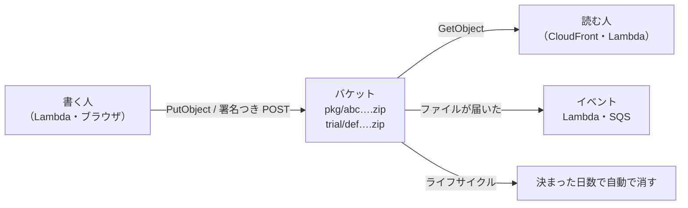

# S3

[目次](../README.md) ＞ [技術カード](README.md) ＞ S3

## 一言で

AWS のファイルの置き場です。ファイル（オブジェクト）を、バケットの中にキー（名前）で置きます。容量の上限を気にせず、置いた量と要求の回数だけ払います。

## 仕組み



- **バケットとキー**: キーの `/` はフォルダのように見えるが、名前の一部
- **公開しないのが基本**: 「パブリックアクセスのブロック」で、うっかり公開する設定を防ぐ。配るなら CloudFront（OAC）を前に置く
- **署名つき URL・署名つき POST**: 「このキーに、この条件で、少しの間だけ」という許可証。持っている人は、自分の鍵なしで読める・置ける
- **イベント**: ファイルができた・消えたときに、Lambda などを呼べる
- **ライフサイクル**: 決まった日数で消す、安い保存の種類に移す
- **版の記録（バージョニング）**: 上書き・削除しても、前の版を残す

## 最小の使い方

### CDK でバケットを作る

（[scripts/cdk-samples.ts](../08-aws/scripts/cdk-samples.ts) で合成を確かめた例。配備には AWS が要ります）

```ts
const bucket = new s3.Bucket(stack, 'Files', {
  blockPublicAccess: s3.BlockPublicAccess.BLOCK_ALL,   // 公開しない
  enforceSSL: true,                                     // HTTP を断る
  encryption: s3.BucketEncryption.S3_MANAGED,
  lifecycleRules: [{ prefix: 'tmp/', expiration: Duration.days(7) }],
  removalPolicy: RemovalPolicy.DESTROY,
  autoDeleteObjects: true,
});
bucket.grantPut(fn, 'uploads/*');                       // 場所を絞った許可
```

### 署名つき POST を作る（手元で、AWS 不要）

署名は手元で計算するだけなので、偽の鍵でも中身を確かめられます（[8-6](../08-aws/06-s3-cloudfront.md) の [scripts/presigned-post.mjs](../08-aws/scripts/presigned-post.mjs)）。

```js
import { createPresignedPost } from '@aws-sdk/s3-presigned-post';

const post = await createPresignedPost(s3, {
  Bucket: 'intake-bucket-example',
  Key: 'intake/kamakura-history/01J0000000000000000000000B.zip',
  Conditions: [['content-length-range', 1, 2 * 1024 * 1024], ['eq', '$Content-Type', 'application/zip']],
  Fields: { 'Content-Type': 'application/zip' },
  Expires: 300,
});
// ブラウザは post.fields をフォームの項目にして、ファイルと一緒に post.url へ POST する
```

### 読む・置く（Lambda から）

```ts
await s3.send(new PutObjectCommand({ Bucket, Key: 'v1/channels.json', Body: bytes, ContentType: 'application/json', CacheControl: 'public, max-age=300' }));
const out = await s3.send(new GetObjectCommand({ Bucket, Key: 'v1/channels.json' }));
const text = await out.Body!.transformToString('utf-8');
```

## このリポジトリでは

| 場所 | 見どころ | 章 |
|---|---|---|
| [infra/lib/console-stack.ts](../../michizure-console/infra/lib/console-stack.ts)・[console-app.ts](../../michizure-console/infra/lib/console-app.ts) | 役割ごとの 4 つのバケット。どれも公開しない。ライフサイクル（7 日・30 日・90 日）、記録用は版の記録 | [8-6](../08-aws/06-s3-cloudfront.md) |
| [api/src/console/handler.ts](../../michizure-console/api/src/console/handler.ts) の `presignUpload` | 大きさと種類を、署名つき POST の条件で S3 に守らせる | [8-6](../08-aws/06-s3-cloudfront.md) |
| 同 `publishApproved` | 承認したファイルを、中身の SHA-256 の名前で写し、長くキャッシュさせる | [8-6](../08-aws/06-s3-cloudfront.md) |
| `intakeBucket.addEventNotification(…)` | `intake/` に届いたら機械審査を呼ぶ | [8-8](../08-aws/08-kotlin-lambda.md) |

## よくある間違い

| 間違い | 起きること | 正しくは |
|---|---|---|
| バケットを公開して配る | 一覧や意図しないファイルまで読まれる。HTTPS を強制しにくい | 公開せず、CloudFront（OAC）を前に |
| 大きなファイルを Lambda 経由で上げる | 遅い・高い・API Gateway の本文の上限 | 署名つき POST・署名つき URL で直接 |
| 署名つき URL の期限を長くする | 漏れたときに長く使われる | 数分〜数十分 |
| イベントのキーをそのまま使う | 空白や日本語が符号化されたまま | URL の形式を戻してから使う |
| 消すための処理を自分で作る | 手間と漏れ | ライフサイクル |

## 版と公式ドキュメント

| 項目 | 版 |
|---|---|
| `@aws-sdk/client-s3`・`s3-presigned-post`・`s3-request-presigner` | 3.1146 以上（`api/package.json`） |

- [S3 のユーザーガイド](https://docs.aws.amazon.com/ja_jp/AmazonS3/latest/userguide/Welcome.html)
- [署名つき POST（POST ポリシー）](https://docs.aws.amazon.com/ja_jp/AmazonS3/latest/API/sigv4-HTTPPOSTConstructPolicy.html)
- [ライフサイクル](https://docs.aws.amazon.com/ja_jp/AmazonS3/latest/userguide/object-lifecycle-mgmt.html)
