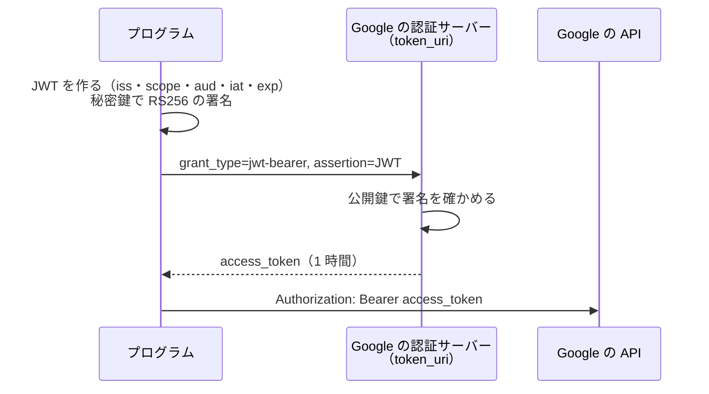

# サービス アカウントと OAuth 2.0

[目次](../README.md) ＞ [技術カード](README.md) ＞ サービス アカウントと OAuth 2.0

## 一言で

**サービス アカウント** は、人ではなくプログラムのための Google のアカウントです。プログラムは、サービス アカウントの秘密鍵で署名した JWT を Google に渡し、引き換えに **アクセス トークン** をもらって API を呼びます（OAuth 2.0 の JWT bearer の流れ）。

## 仕組み



- **JSON の鍵**: Google Cloud のコンソールで作る。`client_email`（名乗る名前）・`private_key`（RSA の秘密鍵）・`token_uri` などが入る。パスワードと同じに扱う
- **JWT**: `ヘッダー.中身.署名` を base64url でつないだもの。中身はだれでも読めるが、書き換えると署名が合わなくなる
- **中身の項目**: `iss`（サービス アカウントのメール）、`scope`（何の API を使うか）、`aud`（`token_uri`）、`iat`（作った時刻）、`exp`（期限。最大 1 時間）
- **アクセス トークン**: 1 時間で切れる。切れたら JWT を作り直してもらい直す
- **認可は API の側**: トークンは「だれか」を示すだけ。何をしてよいかは、使う API の側（Play Console の権限、Google Cloud のロールなど）が決める
- **ログインの OIDC との違い**: [OIDC](oidc.md) は、人がブラウザでログインする流れ。サービス アカウントは、人を介さずにプログラムが自分で名乗る

## 最小の使い方

Node の標準のライブラリだけで書けます（[10-play/scripts/jwt-practice.mjs](../10-play/scripts/jwt-practice.mjs) で、捨てる鍵を使って JWT の作り方と確かめ方を動かした例）。

```js
import { createSign } from 'node:crypto';
import { readFileSync } from 'node:fs';

const key = JSON.parse(readFileSync(process.env.KEY_FILE, 'utf8'));
const now = Math.floor(Date.now() / 1000);
const b64 = (s) => Buffer.from(s).toString('base64url');
const unsigned = `${b64(JSON.stringify({ alg: 'RS256', typ: 'JWT' }))}.${b64(JSON.stringify({
  iss: key.client_email, scope: 'https://www.googleapis.com/auth/androidpublisher',
  aud: key.token_uri, iat: now, exp: now + 3600,
}))}`;
const sig = createSign('RSA-SHA256').update(unsigned).sign(key.private_key, 'base64url');

const res = await fetch(key.token_uri, {
  method: 'POST',
  headers: { 'Content-Type': 'application/x-www-form-urlencoded' },
  body: new URLSearchParams({ grant_type: 'urn:ietf:params:oauth:grant-type:jwt-bearer', assertion: `${unsigned}.${sig}` }),
});
const { access_token, expires_in } = await res.json();
```

## このリポジトリでは

| 場所 | 見どころ | 章 |
|---|---|---|
| SanpoGuide・CycleGuide の [tools/play.mjs](https://github.com/duwenji/yorisoi-sanpoguide/blob/main/tools/play.mjs) の `accessToken` | Play の操作のために名乗る（`androidpublisher` の範囲） | [10-4](../10-play/04-api.md) |
| yorisoi-console の [api/src/relay/integrity.ts](https://github.com/duwenji/yorisoi-console/blob/main/api/src/relay/integrity.ts) の `PlayIntegrity.accessToken` | 中継が Play Integrity の判定を読み解くために名乗る（`playintegrity` の範囲）。トークンを期限の 1 分前まで使い回す | [8-9](../08-aws/09-ai-relay.md)、[10-5](../10-play/05-integrity.md) |

## よくある間違い

| 間違い | 起きること | 正しくは |
|---|---|---|
| 鍵を Git に入れる | だれでもなりすませる | リポジトリの外に置き、パスを環境変数で渡す |
| PC の時刻がずれている | `iat`・`exp` が合わず、`400`・`401` | 時刻を合わせる |
| 呼ぶたびにトークンをもらう | 遅く、制限にかかる | 期限まで使い回す |
| サービス アカウントに広いロールを付ける | 鍵が漏れたときの被害が大きい | 使う API の側で、必要な権限だけ |
| 組織のポリシーで鍵が作れない | 鍵の作成が止められている | 組織のないプロジェクトを使うか、管理者に相談 |

## 版と公式ドキュメント

| 項目 | 版 |
|---|---|
| Node.js の `node:crypto` | Node.js 22 以上 |

- [サービス アカウントの概要](https://cloud.google.com/iam/docs/service-account-overview?hl=ja)
- [サーバー間のアプリケーションでの OAuth 2.0 の使用](https://developers.google.com/identity/protocols/oauth2/service-account?hl=ja)
- [RFC 7523（JWT bearer の流れ）](https://www.rfc-editor.org/rfc/rfc7523)
