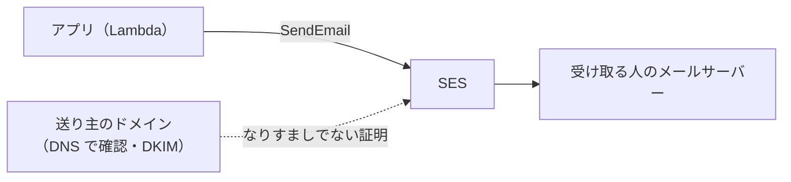

# SES

[目次](../README.md) ＞ [技術カード](README.md) ＞ SES

## 一言で

AWS のメールの送信のサービスです（Simple Email Service）。アプリから、確認済みのドメインやアドレスを送り主にして、メールを送れます。

## 仕組み



- **送り主の確認**: 送り主にするドメイン（またはアドレス）が自分のものだと、DNS の設定（DKIM など）で示す。確認していない送り主からは送れない
- **サンドボックス**: 最初は、確認済みのアドレスにしか送れず、送る量にも上限がある。本番で使うには、AWS に申し出て解除してもらう
- **料金**: 送った通数
- **設定セット**: 送ったメールの到達・はね返り（バウンス）・苦情の記録など

## 最小の使い方

送るには、ドメインの確認とサンドボックスの解除が要ります（AWS のアカウントと DNS の設定が要ります）。

```ts
import { SESv2Client, SendEmailCommand } from '@aws-sdk/client-sesv2';

const ses = new SESv2Client({});
const out = await ses.send(new SendEmailCommand({
  FromEmailAddress: 'noreply@example.com',                 // 確認済みのドメインのアドレス
  Destination: { ToAddresses: ['alice@example.com'] },
  Content: {
    Simple: {
      Subject: { Data: '【例】申請を承認しました', Charset: 'UTF-8' },
      Body: { Text: { Data: '申請を承認しました。', Charset: 'UTF-8' } },
    },
  },
}));
console.log(out.MessageId);
```

Lambda に送る許可を与えるとき（CDK）は、送り主のドメインに絞ります。

```ts
fn.addToRolePolicy(new iam.PolicyStatement({
  actions: ['ses:SendEmail'],
  resources: ['arn:aws:ses:ap-northeast-1:123456789012:identity/example.com'],
}));
```

## このリポジトリでは

| 場所 | 見どころ | 章 |
|---|---|---|
| [infra/lib/config.ts](../../michizure-console/infra/lib/config.ts) の `notify` | `log`（記録だけ）か `ses`（送る）か。送る準備（ドメイン T-7・サンドボックスの解除 T-8）ができるまでは `log` | [8-7](../08-aws/07-sqs-ses-kms.md) |
| [api/src/notify/handler.ts](../../michizure-console/api/src/notify/handler.ts) の `send` | `log` のときは、件名と本文の長さだけを記録。宛先と本文は書かない | [8-7](../08-aws/07-sqs-ses-kms.md) |
| 同 `emailOf` | 送り先は持たず、送るたびに Cognito から確認済みのアドレスを引く | [8-7](../08-aws/07-sqs-ses-kms.md) |
| [infra/lib/console-app.ts](../../michizure-console/infra/lib/console-app.ts) | `ses` のときだけ、送り主のドメインに絞った `ses:SendEmail` を許す | [8-7](../08-aws/07-sqs-ses-kms.md) |

## よくある間違い

| 間違い | 起きること | 正しくは |
|---|---|---|
| サンドボックスのまま本番に出す | 確認していない宛先に届かない | 解除を申し出る。それまでは送らない作りに |
| 送り主のドメインの確認（DKIM など）をしない | 迷惑メールとみなされる・送れない | DNS を設定する |
| 宛先や本文をログに残す | 個人情報がログに広がる | 残すのは件名・ID など最小限 |
| 同じ知らせを何度も送る | 受け取る人が困る | 冪等に（[技術カード: SQS](sqs.md)） |
| はね返り・苦情を放っておく | 送信の評判が下がり、止められることがある | 設定セットで記録して、宛先を見直す |

## 版と公式ドキュメント

| 項目 | 版 |
|---|---|
| `@aws-sdk/client-sesv2` | 3.1146 以上（`api/package.json`） |

- [SES の開発者ガイド](https://docs.aws.amazon.com/ja_jp/ses/latest/dg/Welcome.html)
- [サンドボックスからの移行](https://docs.aws.amazon.com/ja_jp/ses/latest/dg/request-production-access.html)
- [送信元の確認（ID）](https://docs.aws.amazon.com/ja_jp/ses/latest/dg/verify-addresses-and-domains.html)
