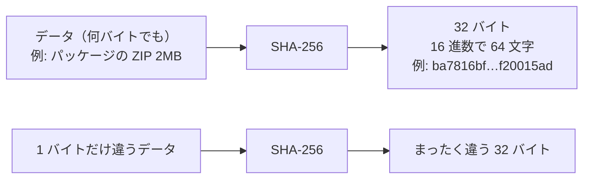

# ハッシュ（SHA-256）

[目次](../README.md) ＞ [技術カード](README.md) ＞ ハッシュ（SHA-256）

## 一言で

どんな大きさのデータからも、32 バイトの「指紋」を計算する関数です。データが 1 ビットでも変われば、指紋はまったく違う値になります。

## 仕組み



- **いつも同じ**: 同じデータからは、いつ・どこで・どの言語で計算しても同じ値が出ます
- **少し変えると大きく変わる**: 1 ビットの違いで、値の約半分のビットが変わります。似た値から元のデータが似ていると推測することはできません
- **戻せない**: 値から元のデータを復元できません
- **ぶつからない**: 同じ値になる別のデータを見つけることは、事実上できません。だから「値が同じなら、データも同じ」とみなせます
- **鍵はない**: だれでも同じ計算ができます。ハッシュだけでは「だれが作ったか」は分かりません。それを示すのは署名です（[Ed25519 のカード](ed25519.md)）

SHA-256 は SHA-2 という規格（FIPS 180-4）の一員で、256 ビット（32 バイト）の値を出します。

## 最小の使い方

すべて手元で、お金をかけずに試せます。

### コマンドで

```sh
printf 'abc' > abc.txt
sha256sum abc.txt          # Git Bash・Linux
```

```
ba7816bf8f01cfea414140de5dae2223b00361a396177a9cb410ff61f20015ad *abc.txt
```

PowerShell なら `Get-FileHash abc.txt -Algorithm SHA256`（16 進数が大文字で出ます）。

### Node.js（TypeScript）

```ts
import { createHash } from 'node:crypto';

const hex = createHash('sha256').update('abc').digest('hex');    // 64 文字の 16 進数
const bytes = createHash('sha256').update('abc').digest();       // 32 バイトの Buffer
```

ブラウザでは `await crypto.subtle.digest('SHA-256', data)` を使います（結果は `ArrayBuffer`）。

### Kotlin（JVM・Android）

```kotlin
import java.security.MessageDigest

val bytes: ByteArray = MessageDigest.getInstance("SHA-256").digest("abc".toByteArray())
val hex = bytes.joinToString("") { "%02x".format(it) }
```

## このリポジトリでは

| 使い道 | 場所 | 章 |
|---|---|---|
| リストに各パッケージ・アイコンの SHA-256 を載せ、アプリが取ってきたファイルと比べる | アプリの `ChannelSync.download`、準拠テストの V-07 | [6-1](../06-trust/01-why-signatures.md)、[6-5](../06-trust/05-verify-in-app.md) |
| リスト本体の SHA-256 を要約に入れ、要約に署名する | `signChannelList`（[list.ts](../../sanpo-channel-console/packages/protocol/src/list.ts)） | [6-4](../06-trust/04-two-tier-keys.md) |
| 公開鍵の SHA-256 から ID（`sc1…`・`sg1…`）を作る | `providerId`・`accountId`（[encoding.ts](../../sanpo-channel-console/packages/protocol/src/encoding.ts)）、Kotlin の `ProviderIds`・`AccountIds` | [6-2](../06-trust/02-ed25519-and-ids.md) |
| チャンネル提供者が、パッケージの各ファイルの SHA-256 の一覧に署名する | `StationValidator` の `verifySignature` | [6-5](../06-trust/05-verify-in-app.md) |
| 公開ファイルの名前を中身の SHA-256 にする（`pkg/<sha256>.zip`） | 公開の処理 | [6-7](../06-trust/07-hands-on.md) |

どれも「信頼できる経路で教わった値と比べて、データが変わっていないことを確かめる」という使い方です。

## よくある間違い

| 間違い | 起きること | 正しくは |
|---|---|---|
| ハッシュが合えば本物だと考える | ハッシュの値そのものが書き換えられていたら見破れない | 値を信頼できる経路（署名つきの文書など）から得る |
| 文字列のハッシュで、文字コードや改行をそろえない | `abc\n` と `abc\r\n` は別の値になる。Windows の Git が改行を CRLF に変えると、ハッシュが合わなくなる | 文字列は UTF-8 のバイト列にしてから計算する。ハッシュを取るファイルは `.gitattributes` で改行を固定する（[0-3](../00-overview/03-setup.md)） |
| 16 進数の大文字と小文字を区別したまま比べる | 同じ値なのに「違う」と判定する（PowerShell は大文字で出す） | 形をそろえて比べる。このリポジトリは小文字の 16 進数に統一している |
| パスワードを SHA-256 で保存する | 計算が速すぎて、総当たりで破られやすい | パスワードには PBKDF2・scrypt・Argon2 などの、わざと遅い関数を使う（チャンネル提供者の鍵ファイルは PBKDF2 で守っている。[9-3](../09-console/03-keys-in-browser.md)） |

## 版と公式ドキュメント

ライブラリは使っていません。Node.js の `node:crypto`、Java・Android の `java.security.MessageDigest`、ブラウザの WebCrypto に標準で入っています。

- [FIPS 180-4（SHA-2 の規格、英語）](https://csrc.nist.gov/pubs/fips/180-4/upd1/final)
- [Node.js: crypto.createHash](https://nodejs.org/api/crypto.html#cryptocreatehashalgorithm-options)
- [Java: MessageDigest](https://docs.oracle.com/en/java/javase/17/docs/api/java.base/java/security/MessageDigest.html)
- [MDN: SubtleCrypto.digest](https://developer.mozilla.org/ja/docs/Web/API/SubtleCrypto/digest)
