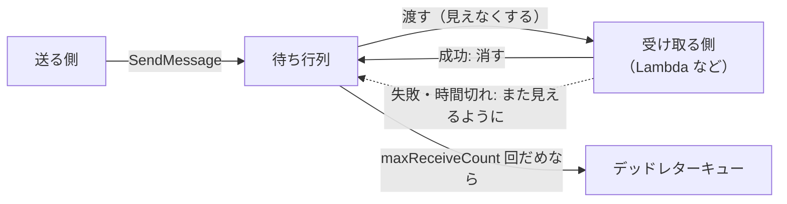

# SQS

[目次](../README.md) ＞ [技術カード](README.md) ＞ SQS

## 一言で

AWS のメッセージの待ち行列です。送る側がメッセージを入れ、受け取る側があとで取り出して処理します。送る側と受け取る側を切り離し、失敗したらやり直させることができます。

## 仕組み



- **少なくとも 1 回**: メッセージは少なくとも 1 回渡される。**まれに 2 回渡る** ことがある（標準の待ち行列）。順番も保証されない（順番と 1 回だけが要るなら FIFO の待ち行列）
- **見えなくする時間**（visibility timeout）: 渡したメッセージを、その間ほかの受け取り手から隠す。時間内に消さなければ、また渡される
- **デッドレターキュー**（DLQ）: 決まった回数渡しても処理できなかったメッセージの行き先
- **Lambda とつなぐ**: イベントソースマッピングで、メッセージを Lambda にまとめて渡す（最大 10 件など）。`reportBatchItemFailures` で、失敗したものだけを返せる

## 最小の使い方

（[scripts/cdk-samples.ts](../08-aws/scripts/cdk-samples.ts) で合成を確かめた例。配備には AWS が要ります）

```ts
const dead = new sqs.Queue(stack, 'Dead', { retentionPeriod: Duration.days(14) });
const queue = new sqs.Queue(stack, 'Jobs', {
  visibilityTimeout: Duration.minutes(2),                     // Lambda の時間の上限より長く
  deadLetterQueue: { queue: dead, maxReceiveCount: 3 },
});

const worker = new lambda.Function(stack, 'Worker', { /* … */ });
worker.addEventSource(new SqsEventSource(queue, { batchSize: 10, reportBatchItemFailures: true }));
queue.grantSendMessages(sender);
```

受け取る Lambda は、失敗したメッセージの ID だけを返します。

```ts
export async function handler(event: SQSEvent): Promise<SQSBatchResponse> {
  const batchItemFailures: SQSBatchResponse['batchItemFailures'] = [];
  for (const record of event.Records) {
    try {
      await work(JSON.parse(record.body), Number(record.attributes.ApproximateReceiveCount));
    } catch {
      batchItemFailures.push({ itemIdentifier: record.messageId });
    }
  }
  return { batchItemFailures };
}
```

送る側:

```ts
await sqs.send(new SendMessageCommand({ QueueUrl, MessageBody: JSON.stringify({ noticeId, event: 'submission.approved' }) }));
```

## このリポジトリでは

| 場所 | 見どころ | 章 |
|---|---|---|
| [infra/lib/console-app.ts](../../yorisoi-console/infra/lib/console-app.ts) | 知らせの待ち行列、3 回でデッドレターキューへ、たまったら警報 | [8-7](../08-aws/07-sqs-ses-kms.md) |
| [api/src/console/deps.ts](../../yorisoi-console/api/src/console/deps.ts) の `notifyAfter` | 送るのに失敗しても、本来の操作（承認など）は失敗させない | [8-7](../08-aws/07-sqs-ses-kms.md) |
| [api/src/notify/handler.ts](../../yorisoi-console/api/src/notify/handler.ts)・[notify.ts](../../yorisoi-console/api/src/notify/notify.ts) | 失敗したものだけを返す。`noticeId` で 2 回送らない（冪等） | [8-7](../08-aws/07-sqs-ses-kms.md) |

## よくある間違い

| 間違い | 起きること | 正しくは |
|---|---|---|
| 1 回しか渡らない前提で作る | まれに二重の処理（メール 2 通など） | ID で冪等に |
| まとめて受け取り、1 件の失敗で全部を失敗にする | 成功した分まで渡し直される | `reportBatchItemFailures` で失敗したものだけ |
| 見えなくする時間を、処理の時間より短くする | 処理中に別の受け取り手にも渡る | Lambda の時間の上限より長く |
| デッドレターキューを見張らない | 送れなかったものに、だれも気づかない | 警報を付ける |

## 版と公式ドキュメント

| 項目 | 版 |
|---|---|
| `@aws-sdk/client-sqs` | 3.1146 以上（`api/package.json`） |

- [SQS の開発者ガイド](https://docs.aws.amazon.com/ja_jp/AWSSimpleQueueService/latest/SQSDeveloperGuide/welcome.html)
- [Lambda と SQS（部分的なバッチの失敗）](https://docs.aws.amazon.com/ja_jp/lambda/latest/dg/with-sqs.html)
