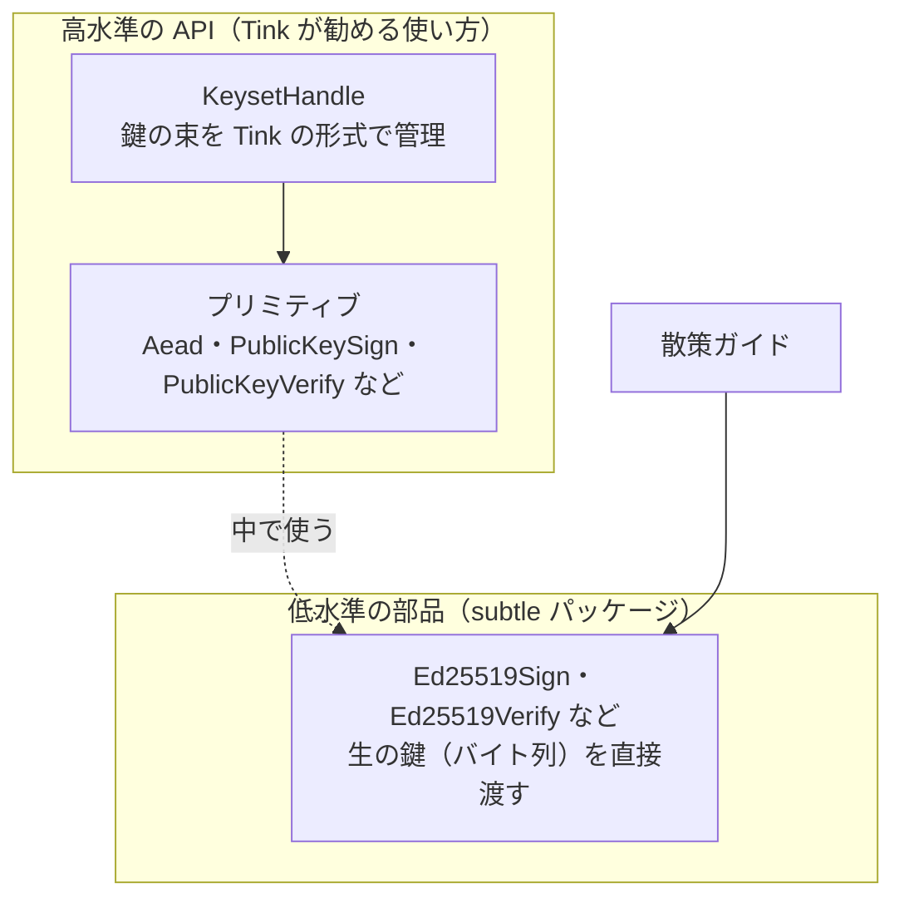

# Tink

[目次](../README.md) ＞ [技術カード](README.md) ＞ Tink

## 一言で

Google が作っているオープンソースの暗号ライブラリです。「正しく使いやすく、間違って使いにくい」ことを目指しています。散策ガイドでは、**Android 8 から Ed25519 の署名を確かめる** ために使っています。

## 仕組み



- **プリミティブ**: Tink は暗号を「何をしたいか」で分けた **プリミティブ**（認証つき暗号化の `Aead`、署名の `PublicKeySign`、検証の `PublicKeyVerify` など）として提供します。使う人は、細かいアルゴリズムや引数を選ばなくて済みます
- **キーセット（Keyset）**: 高水準の API では、鍵を **キーセット** という Tink 独自の形式で持ちます。複数の鍵をまとめて持ち、鍵の入れ替え（ローテーション）を扱いやすくするためです
- **subtle パッケージ**: その下に、個々のアルゴリズムを直接使う低水準の部品があります。生の鍵（バイト列）を直接渡せます
- **Android でも同じ実装**: Tink は Ed25519 を自前で実装しているので、端末の OS が Ed25519 を持っていなくても動きます

### なぜ Android で Tink が要るのか

Java には Java 15 から Ed25519 が標準で入っていますが、Android の標準の暗号機能が Ed25519 を扱えるのは **Android 13** からです。散策ガイドは Android 8（`minSdk = 26`）から動かしたいので、標準の機能では足りません。Tink を入れれば、Android 8 でも Ed25519 を使えます。

## 最小の使い方

手元で、お金をかけずに試せます。Android の版は `tink-android`、普通の JVM の版は `tink` で、ここで使う部分の API は同じです。

```kotlin
// build.gradle.kts（Android）
dependencies {
    implementation("com.google.crypto.tink:tink-android:1.23.0")
}
```

### 生の鍵で署名し、確かめる（subtle）

```kotlin
import com.google.crypto.tink.subtle.Ed25519Sign
import com.google.crypto.tink.subtle.Ed25519Verify
import java.security.GeneralSecurityException

val pair = Ed25519Sign.KeyPair.newKeyPair()
val message = "鎌倉歴史散歩".toByteArray()
val signature = Ed25519Sign(pair.privateKey).sign(message)    // 64 バイト

val verifier = Ed25519Verify(pair.publicKey)                  // 生の公開鍵 32 バイト
verifier.verify(signature, message)                           // 合えば何も起きない

try {
    verifier.verify(signature, "x".toByteArray())
} catch (e: GeneralSecurityException) {
    println(e.message)        // Signature check failed.
}
```

`verify` は **合わないときに例外を投げ、合うときは何も返さない** ことに注意してください。`true`/`false` を返すわけではありません。

32 バイトでない公開鍵を渡すと、`Ed25519Verify` を作る時点で `IllegalArgumentException`（"Given public key's length is not 32."）になります。

上の例は、`tink` 1.23.0 の jar で実際に動かして確かめたものです。

## このリポジトリでは

[TinkEd25519.kt](../../SanpoGuide/apps/sanpoguide/app/src/main/java/io/github/duwenji/sanpoguide/station/remote/TinkEd25519.kt) の、十数行のクラスだけが Tink を使っています。

```kotlin
object TinkEd25519 : Ed25519Verifier {
    override fun verify(publicKey: ByteArray, message: ByteArray, signature: ByteArray): Boolean = try {
        Ed25519Verify(publicKey).verify(signature, message)
        true
    } catch (e: GeneralSecurityException) {
        false
    } catch (e: IllegalArgumentException) {
        false
    }
}
```

- Tink の「例外で知らせる」作りを、コアの約束（`Ed25519Verifier`、`true`/`false` を返す）に合わせています
- 2 つの例外を両方受け止めています。署名が合わないとき（`GeneralSecurityException`）と、公開鍵の長さがおかしいとき（`IllegalArgumentException`）です。どちらも「確かめられなかった」として扱います
- コア（`core-format`）は Tink に依存しません。アプリだけが Tink を持ち込み、`ChannelSync` に `verifier = TinkEd25519` として渡します（[ThirdPartyChannels.kt](../../SanpoGuide/apps/sanpoguide/app/src/main/java/io/github/duwenji/sanpoguide/station/remote/ThirdPartyChannels.kt)）。管理システムの機械審査は、代わりに Java 標準の `JcaEd25519` を渡します

くわしくは [6-5](../06-trust/05-verify-in-app.md) の「差し替え口: Ed25519Verifier」を見てください。

### なぜ高水準の API ではなく subtle を使うのか

Tink は高水準の API（キーセットとプリミティブ）を勧めています。それでも散策ガイドが subtle の `Ed25519Verify` を使うのは、**公開鍵が Tink のキーセットではなく、API-002 の文書に入った生の 32 バイトで届く** からです。運営の公開鍵は、Node.js や AWS KMS が作ったもので、Tink の形式ではありません。生の鍵をそのまま受け取れる subtle が、いちばん素直に合います。

## よくある間違い

| 間違い | 起きること | 正しくは |
|---|---|---|
| `verify` が `false` を返すと思い、戻り値を見る | 戻り値がない（`Unit`/`void`）ので、合わないことに気づけないコードを書いてしまう | 例外を受け止める。合わないときは `GeneralSecurityException` |
| `GeneralSecurityException` だけを受け止める | 長さのおかしい公開鍵で `IllegalArgumentException` が漏れ、アプリが落ちる | `IllegalArgumentException` も受け止める |
| `verify(message, signature)` と引数を逆に渡す | 署名がいつまでも合わない | `verify(signature, message)` の順。Node.js（`verify(null, message, key, signature)`）や Java 標準とは並びが違う |
| Tink の「キーセット（Keyset）」と、API-002 の「鍵セット（keyset）」を同じものだと思う | 名前が似ているだけで、まったく別物 | Tink のキーセットは Tink が鍵を管理する形式。API-002 の鍵セットは、ルート鍵が署名した署名鍵の一覧（[6-4](../06-trust/04-two-tier-keys.md)） |
| 普通の JVM のプロジェクトに `tink-android` を入れる（逆も） | 余計な依存が入る、または Android で動かない | Android は `tink-android`、それ以外は `tink` |

## 版と公式ドキュメント

| 項目 | 版 |
|---|---|
| `com.google.crypto.tink:tink-android` | 1.23.0（SanpoGuide の `apps/sanpoguide/app/build.gradle.kts`） |

- [Tink の公式サイト](https://developers.google.com/tink)
- [Tink（GitHub、Java と Android）](https://github.com/tink-crypto/tink-java)
