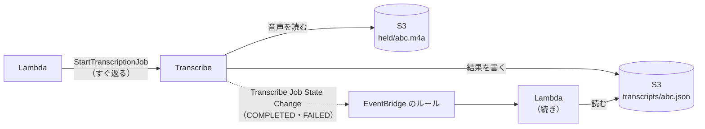

# Amazon Transcribe

[目次](../README.md) ＞ [技術カード](README.md) ＞ Amazon Transcribe

## 一言で

音声のファイルを文字に起こす AWS のサービスです。S3 に置いた音声を指して「ジョブ」を頼むと、終わったときに文字起こしの JSON を S3 に書きます。

## 仕組み



- **バッチ**（ファイルを渡す）と **ストリーミング**（話しながら送る）がある。ファイルが手元にあるならバッチが安く簡単
- **ジョブ**: 名前を付けて頼む。名前はアカウントとリージョンの中で一意。呼び出しはすぐ返り、終わるまで数十秒〜数分かかる
- **終わりの知らせ**: 状態が変わると、EventBridge に `Transcribe Job State Change` の出来事が出る。待ち続けたり、何度も状態を聞きに行ったりしなくてよい
- **権限**: Transcribe は、呼んだ側の権限で S3 の音声を読み、結果を書く。呼ぶ側のロールに、そのバケットの読み書きが要る
- **料金**: 音声の長さで決まる（秒単位、1 回あたりの最低あり）。単価はリージョンと月の量で違うので、料金のページを東京リージョンにして確かめる

## 最小の使い方

```ts
import { StartTranscriptionJobCommand, TranscribeClient } from '@aws-sdk/client-transcribe';

const transcribe = new TranscribeClient({});
await transcribe.send(
  new StartTranscriptionJobCommand({
    TranscriptionJobName: `my-app-dev-${id}-${Date.now()}`,
    LanguageCode: 'ja-JP',
    MediaFormat: 'mp4',
    Media: { MediaFileUri: `s3://${bucket}/held/${id}.m4a` },
    OutputBucketName: bucket,
    OutputKey: `transcripts/${id}.json`,
  }),
);
```

終わりを受けるルール（CDK）。ほかのジョブを拾わないよう、名前の接頭辞で絞ります。

```ts
new events.Rule(stack, 'TranscribeDone', {
  eventPattern: {
    source: ['aws.transcribe'],
    detailType: ['Transcribe Job State Change'],
    detail: { TranscriptionJobName: [{ prefix: 'my-app-dev-' }], TranscriptionJobStatus: ['COMPLETED', 'FAILED'] },
  },
  targets: [new targets.LambdaFunction(fn)],
});
```

結果の JSON の `results.transcripts[0].transcript` が、起こした文です。

## このリポジトリでは

| 場所 | 見どころ | 章 |
|---|---|---|
| yorisoi-console [api/src/studio/placement.ts](https://github.com/duwenji/yorisoi-console/blob/main/api/src/studio/placement.ts) の `startCheck`・`finishTranscription` | 掲載の音声の長さと形式を先に確かめてから頼む。終わったら、起こした文を運営の AI で掲載の決まりに照らす | [8-12](../08-aws/12-studio.md) |
| [infra/lib/studio-stack.ts](https://github.com/duwenji/yorisoi-console/blob/main/infra/lib/studio-stack.ts) の `TranscribeDone` | 終わりの出来事を、確認の Lambda に戻す | [8-12](../08-aws/12-studio.md) |

## よくある間違い

| 間違い | 起きること | 正しくは |
|---|---|---|
| Lambda の中で終わるまで待つ | 待つ時間にも料金がかかり、長い音声では 15 分を超える | 頼んだら終わり、出来事で続きをする |
| 同じ名前でジョブを頼み直す | 名前が重なって断られる | 名前に時刻などを入れて毎回変える |
| ルールを接頭辞で絞らない | 同じアカウントのほかのジョブの終わりでも動く | ジョブの名前の接頭辞で絞る |
| 出来事が 1 度だけ届くと考える | 同じ出来事が 2 度届くと、処理が 2 回走る | 状態を条件付きで書き換えて、2 回目は何もしない |
| 起こした文をそのまま信じる | 固有名詞・数字の聞き違いがある | 確認に使うなら、取り逃しを通報などで拾える仕組みと組み合わせる |

## 版と公式ドキュメント

| 項目 | 版 |
|---|---|
| `@aws-sdk/client-transcribe` | 3.1161 以上（`api/package.json`） |

- [Amazon Transcribe とは](https://docs.aws.amazon.com/ja_jp/transcribe/latest/dg/what-is.html)
- [EventBridge で Amazon Transcribe を使う](https://docs.aws.amazon.com/ja_jp/transcribe/latest/dg/monitoring-events.html)
- [Amazon Transcribe の料金](https://aws.amazon.com/jp/transcribe/pricing/)
