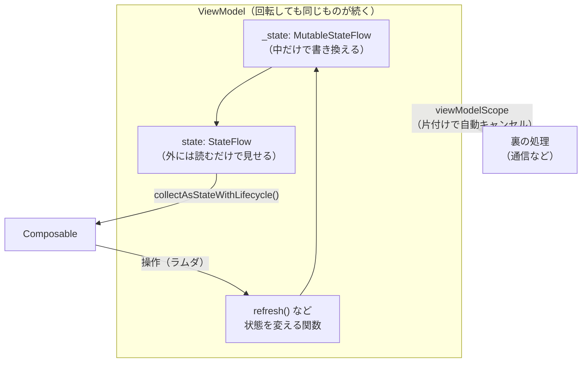

# ViewModel と StateFlow

[目次](../README.md) ＞ [技術カード](README.md) ＞ ViewModel と StateFlow

## 一言で

**ViewModel** は、画面の状態と、状態を変える処理を持つクラスです。画面の回転では壊れません。**StateFlow** は、今の値を 1 つ持ち、値が変わったら見ている側に知らせる入れ物です。ViewModel は状態を StateFlow で画面に見せます。

## 仕組み



### ViewModel

- **寿命が画面より長い**: 端末の回転などで Activity が作り直されても、同じ ViewModel が使われ続けます。画面が本当に閉じられたときに片付けられます（`onCleared`）
- **`viewModelScope`**: ViewModel の中で裏の処理（コルーチン）を始めるための範囲です。ViewModel が片付けられると、その中の処理は自動で止まります
- **画面の部品を持たない**: ViewModel は Activity や View を参照してはいけません。回転で壊れた Activity を持ち続けて、メモリを無駄にするからです

### StateFlow

- **いつも値がある**: 作るときに最初の値を渡し、`.value` でいつでも今の値を読めます
- **変わったら知らせる**: `collect` している側に、新しい値が届きます
- **同じ値なら知らせない**: 前の値と `==` で等しければ届きません。data class なら中身で比べます
- **最新の値だけ**: 値が続けて何度も変わったとき、集める側が遅いと途中の値は飛ばされ、最新の値だけが届きます。「今の状態」を表すのに向いています
- **`combine`・`map`・`stateIn`**: いくつかの流れを組み合わせたり変換したりして、新しい StateFlow を作れます

## 最小の使い方

Android Studio の「Empty Activity」のプロジェクトで動きます（散策ガイドのプロジェクトの中で、コンパイルが通ることを確かめたものです）。`lifecycle-viewmodel-compose` と `lifecycle-runtime-compose` のライブラリが要ります。

### 状態を data class で表す

```kotlin
data class SpotUiState(
    val loading: Boolean = false,
    val spots: List<String> = emptyList(),
    val error: String? = null,
)
```

画面に要る値を 1 つにまとめます。data class なので、`copy` で一部だけ変えた新しい状態を作れます。

### ViewModel

```kotlin
class SpotListViewModel : ViewModel() {
    private val _state = MutableStateFlow(SpotUiState())
    val state: StateFlow<SpotUiState> = _state.asStateFlow()

    fun refresh() {
        _state.update { it.copy(loading = true, error = null) }
        viewModelScope.launch {
            try {
                delay(1_000) // 本物ならネットワークから取ってくる
                _state.update { it.copy(loading = false, spots = listOf("鶴岡八幡宮", "長谷寺", "鎌倉大仏")) }
            } catch (e: Exception) {
                _state.update { it.copy(loading = false, error = e.message) }
            }
        }
    }
}
```

- 中では `MutableStateFlow`（`_state`）を書き換え、外には `StateFlow`（`state`）だけを見せる
- `update { … }` は、今の値から新しい値を作って入れる

### 画面で受け取る

```kotlin
@Composable
fun SpotListScreen(viewModel: SpotListViewModel = viewModel()) {
    val state by viewModel.state.collectAsStateWithLifecycle()
    SpotList(state, onRefresh = viewModel::refresh)
}

@Composable
fun SpotList(state: SpotUiState, onRefresh: () -> Unit) {
    Column(Modifier.padding(16.dp)) {
        Button(onClick = onRefresh, enabled = !state.loading) { Text("周辺を検索") }
        if (state.loading) Text("検索中…")
        state.error?.let { Text("失敗しました: $it") }
        state.spots.forEach { Text(it) }
    }
}
```

- `viewModel()` は、画面に対応する ViewModel を返す（回転後も同じもの）。Activity なら `by viewModels()`
- `collectAsStateWithLifecycle()` は、StateFlow を Compose の状態に変える。画面が見えていない間は集めない
- `SpotList` は状態と操作のラムダだけを受け取るので、ViewModel なしでプレビューできる

```kotlin
@Preview(widthDp = 320)
@Composable
private fun SpotListPreview() {
    MaterialTheme { SpotList(SpotUiState(spots = listOf("鶴岡八幡宮", "長谷寺")), onRefresh = {}) }
}
```

### 流れを組み合わせる

```kotlin
val label: StateFlow<String> = combine(stationId, names) { id, n -> n[id] ?: "?" }
    .stateIn(viewModelScope, SharingStarted.WhileSubscribed(5_000), "")
```

`combine` は、どちらかが変わるたびに新しい値を計算します。`stateIn` で StateFlow にし、最初の値（`""`）を決めます。

| `SharingStarted` | 計算する期間 |
|---|---|
| `WhileSubscribed(5_000)` | 見ている人がいる間。いなくなって 5 秒で止める（画面向き） |
| `Eagerly` | すぐに始めて、ずっと続ける（画面と関係なく使う値向き） |
| `Lazily` | 最初に見る人が来たら始めて、ずっと続ける |

## このリポジトリでは

| 場所 | 見どころ | 章 |
|---|---|---|
| [MainViewModel.kt](https://github.com/duwenji/yorisoi-sanpoguide/blob/main/app/src/main/java/io/github/duwenji/yorisoi/sanpoguide/ui/MainViewModel.kt) | `_selected` と `selected`、sealed の状態（`GuideState`）、遅れて届く結果を捨てる `updateSelected`、3 つの流れの `combine` | [2-2](../02-compose/02-state-viewmodel.md) |
| [SettingsViewModel.kt](https://github.com/duwenji/yorisoi-sanpoguide/blob/main/app/src/main/java/io/github/duwenji/yorisoi/sanpoguide/ui/SettingsViewModel.kt) | 保存するまでの下書き（`_draft`） | [2-2](../02-compose/02-state-viewmodel.md) |
| [SettingsRepository.kt](https://github.com/duwenji/yorisoi-sanpoguide/blob/main/app/src/main/java/io/github/duwenji/yorisoi/sanpoguide/settings/SettingsRepository.kt) | 画面と常駐サービスが共有する設定の StateFlow | [2-2](../02-compose/02-state-viewmodel.md) |
| [StationRepository.kt](https://github.com/duwenji/yorisoi-sanpoguide/blob/main/app/src/main/java/io/github/duwenji/yorisoi/sanpoguide/station/StationRepository.kt) | 設定とチャンネルの一覧を `combine` して、今のチャンネルを作る（`Eagerly`） | [2-2](../02-compose/02-state-viewmodel.md) |
| [MoodSource.kt](https://github.com/duwenji/yorisoi-platform/blob/main/kit-mood/src/main/java/io/github/duwenji/yorisoi/kit/mood/MoodSource.kt) | 時計・位置・スポット・天気の 4 つを `combine` して雰囲気を作る | [2-4](../02-compose/04-theme-mood.md) |

散策ガイドの ViewModel は、Android が作る `AndroidViewModel` を使い、`SanpoApp` から部品を取り出しています。その理由と限界は [2-3](../02-compose/03-manual-di.md) にあります。

## よくある間違い

| 間違い | 起きること | 正しくは |
|---|---|---|
| `MutableStateFlow` をそのまま外に見せる | 画面などから勝手に書き換えられ、状態の流れを追えなくなる | `_state` と `asStateFlow()` の組にする |
| StateFlow の中のリストや data class の中身を書き換える | 同じ値とみなされ、画面に知らせが届かない | `copy` や新しいリストを入れる |
| ViewModel に Activity・Context・View を持たせる | 回転で捨てられた画面を持ち続け、メモリが漏れる | 要るなら `AndroidViewModel` の `application` を使う |
| `GlobalScope` などで裏の処理を始める | 画面を閉じても処理が止まらない | `viewModelScope` を使う |
| 非同期の結果を、そのまま状態に書き込む | 利用者がほかの操作をしたあとに、古い結果で上書きされる | 結果が届いたとき、状況が変わっていないか確かめる |
| JVM の単体テストで `viewModelScope` を使う ViewModel を動かす | `Dispatchers.Main` がなく失敗する | `kotlinx-coroutines-test` の `Dispatchers.setMain` で代わりを用意する。またはロジックを ViewModel の外に出してテストする |

## 版と公式ドキュメント

| 項目 | 版 |
|---|---|
| `androidx.lifecycle:lifecycle-viewmodel-compose` | 2.9.1（SanpoGuide の `app/build.gradle.kts`） |
| `androidx.lifecycle:lifecycle-runtime-compose` | 2.9.1（`collectAsStateWithLifecycle`） |
| `kotlinx-coroutines-android` | 1.10.2（StateFlow を含む） |

- [ViewModel の概要](https://developer.android.com/topic/libraries/architecture/viewmodel?hl=ja)
- [Android での Kotlin Flow（StateFlow と SharedFlow）](https://developer.android.com/kotlin/flow/stateflow-and-sharedflow?hl=ja)
- [UI レイヤ（単方向データフロー）](https://developer.android.com/topic/architecture/ui-layer?hl=ja)
