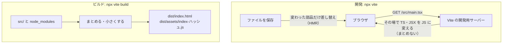

# Vite

[目次](../README.md) ＞ [技術カード](README.md) ＞ Vite

## 一言で

ブラウザで動く画面のコードのための道具です。開発中は、手元にサーバーを立てて、書き換えたものをすぐ画面に反映します。配る前には、すべてを小さなファイルにまとめます（ビルド）。

## 仕組み



- **開発用サーバー**: ブラウザが頼んだファイルだけを、その場で変換して返す。まとめないので、起動も反映も速い。知らない道にも `index.html` を返す（SPA のため）
- **HMR**（Hot Module Replacement）: 保存した部品だけを差し替え、ページを読み込み直さずに反映する
- **ビルド**: まとめて小さくし、ファイル名に **中身のハッシュ** を付ける。中身が変われば名前も変わるので、長くキャッシュさせてよい
- **プラグイン**: React などのための部品（`@vitejs/plugin-react`）
- **型は確かめない**: TypeScript は型を消して JavaScript にするだけ。型は `tsc` で確かめる

## 最小の使い方

`index.html` を入口にします。

```html
<!doctype html>
<html lang="ja">
  <head><meta charset="UTF-8" /><title>React の練習</title></head>
  <body>
    <div id="root"></div>
    <script type="module" src="/main.tsx"></script>
  </body>
</html>
```

`vite.config.ts`:

```ts
import react from '@vitejs/plugin-react';
import { defineConfig } from 'vite';

export default defineConfig({
  plugins: [react()],
});
```

```sh
npx vite                 # 開発用サーバー（http://localhost:5173）
npx vite build           # dist/ にビルド
npx vite preview         # ビルドしたものを手元で配って確かめる
npx tsc --noEmit         # 型の確認は別に
```

[9-1](../09-console/01-react-vite.md) のハンズオン（[scripts/react-demo/](../09-console/scripts/react-demo/)）でビルドした結果:

```text
✓ 91 modules transformed.
../react-demo-dist/index.html                  0.24 kB │ gzip:  0.20 kB
../react-demo-dist/assets/index-BAPdQ7Pi.js  258.55 kB │ gzip: 82.37 kB
✓ built in 114ms
```

### 開発中に API を中継する

```ts
export default defineConfig({
  server: { proxy: { '/api': { target: 'https://example.cloudfront.net', changeOrigin: true } } },
});
```

画面は手元、API は配備済みのもの、という組み合わせで開発できます（同じ場所に見えるので CORS が要らない）。

## このリポジトリでは

| 場所 | 見どころ | 章 |
|---|---|---|
| [web/vite.config.ts](../../michizure-console/web/vite.config.ts) | `CONSOLE_URL` があれば、`/api` と `/config.json` を配備済みの開発用に中継。ソースマップつきのビルド | [9-1](../09-console/01-react-vite.md) |
| [web/tsconfig.json](../../michizure-console/web/tsconfig.json) | JavaScript を書くのは Vite。`tsc` は型を確かめ、宣言だけを書く（`emitDeclarationOnly`） | [9-1](../09-console/01-react-vite.md) |
| [.github/workflows/ci.yml](../../michizure-console/.github/workflows/ci.yml) | `tsc -b` と `npm run build -w web` の両方を流す | [9-4](../09-console/04-ci.md) |
| CloudFront | ハッシュの名前のファイルは 1 年、`index.html` は毎回確かめる | [8-6](../08-aws/06-s3-cloudfront.md) |

## よくある間違い

| 間違い | 起きること | 正しくは |
|---|---|---|
| ビルドが通ったから型も正しいと思う | 型の誤りが本番に出る | `tsc` も流す（CI で両方） |
| 開発用サーバーをそのまま公開する | 遅く、安全でもない | ビルドした `dist/` を配る |
| `index.html` も長くキャッシュさせる | 新しい版を配っても、古い JS を読み続ける | `index.html` は短く、ハッシュの名前のファイルだけ長く |
| 秘密を `import.meta.env` でビルドに入れる | 配った JS から読める | 画面に秘密は置かない |
| 本番の道を直接開くと 404 | 開発用サーバーはよしなにしてくれるが、本番の置き場はしない | 配る側で `index.html` を返す（CloudFront Functions など） |

## 版と公式ドキュメント

| 項目 | 版 |
|---|---|
| `vite` | 8.3 以上（`web/package.json`） |
| `@vitejs/plugin-react` | 6.1 以上 |

- [Vite の公式ドキュメント（日本語）](https://ja.vite.dev/)
- [開発用サーバーの設定（proxy など）](https://ja.vite.dev/config/server-options)
- [本番環境用のビルド](https://ja.vite.dev/guide/build)
