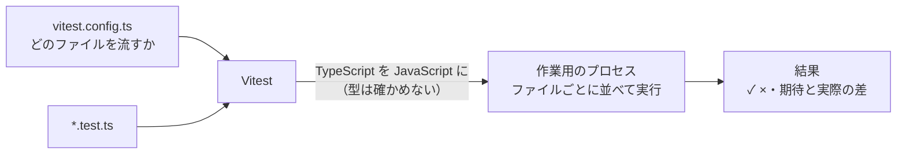

# Vitest

[目次](../README.md) ＞ [技術カード](README.md) ＞ Vitest

## 一言で

TypeScript・JavaScript のテストを書いて流すための道具です。`.ts` のテストを事前のビルドなしで直接流せ、Jest とほぼ同じ書き方で使えます。

## 仕組み



- **テストのファイル**: 決まった名前（既定は `*.test.ts` など）のファイルを探して流す。どのファイルかは `vitest.config.ts` の `include` で決める
- **TypeScript をそのまま**: テストを流すときに JavaScript に変える。**型は確かめない**（型の確認は `tsc` で別に）
- **並べて実行**: ファイルごとに別々に、同時に流す。ファイルの中のテストは順番に流す
- **`describe`・`it`・`expect`**: テストのまとまり、1 つのテスト、確かめる値
- **代役（モック）**: `vi.fn()`・`vi.mock()` で関数やモジュールを代役に替えられる

## 最小の使い方

管理システムのフォルダで、`.local/`（Git の対象外）を使って試せます（下の例は実際に流して確かめたものです）。

`.local/vt/distance.ts`:

```ts
/** 2 点の距離（m、平面の近似）。散歩の距離くらいなら数 m の誤差で済む。 */
export function distanceM(a: { lat: number; lon: number }, b: { lat: number; lon: number }): number {
  const r = 6_371_000;
  const x = ((b.lon - a.lon) * Math.PI) / 180 * Math.cos((((a.lat + b.lat) / 2) * Math.PI) / 180);
  const y = ((b.lat - a.lat) * Math.PI) / 180;
  return Math.hypot(x, y) * r;
}

export async function slowGreeting(name: string): Promise<string> {
  await new Promise((r) => setTimeout(r, 10));
  if (!name) throw new Error('name is required');
  return `こんにちは、${name}さん`;
}
```

`.local/vt/test/distance.test.ts`:

```ts
import { describe, expect, it } from 'vitest';
import { distanceM, slowGreeting } from '../distance.js';

const station = { lat: 35.319, lon: 139.5536 };   // 鎌倉駅のあたり
const shrine = { lat: 35.326, lon: 139.5563 };    // 鶴岡八幡宮のあたり

describe('distanceM', () => {
  it('is zero for the same point', () => {
    expect(distanceM(station, station)).toBe(0);
  });

  it('is about 800 m from the station to the shrine', () => {
    expect(distanceM(station, shrine)).toBeGreaterThan(750);
    expect(distanceM(station, shrine)).toBeLessThan(850);
  });
});

describe('slowGreeting', () => {
  it('greets', async () => {
    expect(await slowGreeting('鎌倉')).toBe('こんにちは、鎌倉さん');
  });

  it('refuses an empty name', async () => {
    await expect(slowGreeting('')).rejects.toThrow('name is required');
  });
});
```

```sh
cd /c/Dev/apps/yorisoi-console
npx vitest run .local/vt
```

```
 Test Files  1 passed (1)
      Tests  4 passed (4)
```

（管理システムの `vitest.config.ts` は `**/test/**/*.test.ts` を探すので、`test/` フォルダに置いています。試し終わったら `rm -rf .local/vt`。）

### よく使う書き方

| 書き方 | 意味 |
|---|---|
| `expect(x).toBe(y)` | 同じもの（数・文字列はこれ） |
| `expect(x).toEqual(y)` | 中身が同じ（オブジェクト・配列） |
| `expect(x).toMatchObject({ … })` | 書いた項目だけが一致 |
| `expect(x).toBeGreaterThan(n)` | 大小 |
| `expect(() => f()).toThrow('…')` | 例外が起きる |
| `await expect(p).rejects.toThrow('…')` | `Promise` が失敗する |
| `beforeEach`・`beforeAll`・`afterAll` | 前後の準備と片付け |
| `vi.fn()` | 呼ばれ方を記録する代役の関数 |

### よく使うコマンド

| コマンド | 何をするか |
|---|---|
| `npx vitest run` | 全部を 1 回流す（CI はこれ） |
| `npx vitest` | 見張りモード。ファイルを保存するたびに、関係するテストを流し直す |
| `npx vitest run <フォルダやファイル>` | そこだけ流す |
| `npx vitest run -t "<名前の一部>"` | 名前で絞って流す |

## このリポジトリでは

| 場所 | 見どころ | 章 |
|---|---|---|
| [vitest.config.ts](../../yorisoi-console/vitest.config.ts) | 全パッケージの `test/**/*.test.ts` を 1 回で流す | [7-4](../07-typescript/04-testing.md) |
| [packages/protocol/test/protocol.test.ts](../../yorisoi-console/packages/protocol/test/protocol.test.ts) | 時刻を固定して、署名つき文書の検証を確かめる | [7-4](../07-typescript/04-testing.md) |
| [api/test/publisher.test.ts](../../yorisoi-console/api/test/publisher.test.ts) | メモリの代役と aws-sdk-client-mock | [7-4](../07-typescript/04-testing.md) |
| [api/test/console.test.ts](../../yorisoi-console/api/test/console.test.ts) | DynamoDB Local（Docker）で管理 API を通しで確かめる | [7-4](../07-typescript/04-testing.md) |

## よくある間違い

| 間違い | 起きること | 正しくは |
|---|---|---|
| Vitest が通れば型も正しいと思う | 型の誤りがあっても、テストは通ることがある | `tsc -b` を別に流す（CI ではテストの前に） |
| `async` のテストで `await` を忘れる | 失敗が検出されずに通ってしまう | `await expect(…).rejects…`、`expect(await …)` |
| `new Date()` や乱数に頼る | 日や回によって結果が変わる | 時刻や乱数を引数で受け取り、テストでは固定する |
| テストどうしでデータを共有する | 流す順番で結果が変わる | `beforeEach` で毎回作り直す |
| `toBe` でオブジェクトを比べる | 中身が同じでも別物なので失敗する | `toEqual` |

## 版と公式ドキュメント

| 項目 | 版 |
|---|---|
| `vitest` | 5.0 以上（yorisoi-console の `package.json`） |
| `aws-sdk-client-mock` | 4.1 以上（`api`） |

- [Vitest（公式）](https://vitest.dev/)
- [expect の一覧](https://vitest.dev/api/expect.html)
- [aws-sdk-client-mock](https://github.com/m-radzikowski/aws-sdk-client-mock)
