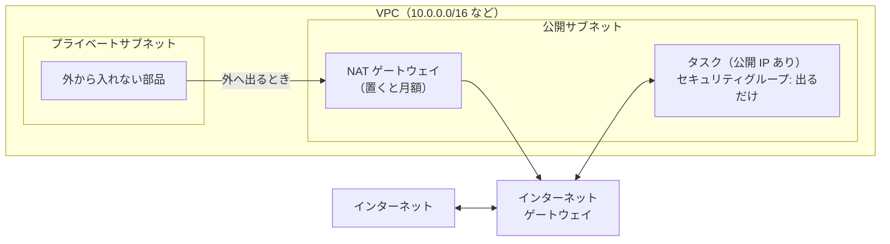

# VPC

[目次](../README.md) ＞ [技術カード](README.md) ＞ VPC

## 一言で

AWS の中に作る、自分専用の網です。部品をどの網（サブネット）に置き、どこからどこへ通信してよいかを決めます。

## 仕組み



- **サブネット**: VPC の中の区画。1 つのアベイラビリティゾーン（データセンターの群れ）に属する。2 つ以上に分けて、片方が止まっても動けるようにする
- **公開サブネット**: ルートテーブルにインターネットゲートウェイへの道がある区画。公開 IP を持つ部品は、ここから直接外へ出られる
- **プライベートサブネット**: 外への道がない区画。外へ出るには **NAT ゲートウェイ**（置くだけで時間あたりの費用）か、AWS のサービスへの近道（**VPC エンドポイント**）が要る
- **セキュリティグループ**: 部品ごとの防火壁。入ってよい通信と出てよい通信を書く。何も書かなければ、入ってくる通信はすべて断る
- Lambda・DynamoDB・S3 などは、VPC を作らなくても使える。VPC が要るのは、Fargate のタスクや EC2 など、網の中で動く部品

## 最小の使い方

（[scripts/cdk-samples.ts](../08-aws/scripts/cdk-samples.ts) で合成を確かめた例。配備には AWS が要ります）

```ts
// 公開サブネットだけ、NAT なし（費用がかからない）
const vpc = new ec2.Vpc(stack, 'Vpc', {
  maxAzs: 2,
  natGateways: 0,
  subnetConfiguration: [{ name: 'public', subnetType: ec2.SubnetType.PUBLIC }],
});
// 出ていく通信だけを許す
const outOnly = new ec2.SecurityGroup(stack, 'OutOnly', { vpc, allowAllOutbound: true });
```

この 2 文だけで、合成したテンプレートには VPC・サブネット 2 つ・ルートテーブル 2 つ・インターネットゲートウェイなど 12 個の部品ができます。何も指定せずに `new ec2.Vpc(stack, 'Vpc')` と書くと、プライベートサブネットと **NAT ゲートウェイがゾーンごとに 1 つずつ** でき、月に数十 USD かかります。

外から入れるようにするなら、セキュリティグループに入ってよい相手を足します（例: `sg.addIngressRule(ec2.Peer.ipv4('203.0.113.0/24'), ec2.Port.tcp(443))`）。

## このリポジトリでは

| 場所 | 見どころ | 章 |
|---|---|---|
| [infra/lib/tiles-stack.ts](https://github.com/duwenji/yorisoi-console/blob/main/infra/lib/tiles-stack.ts) | 公開サブネットだけ・NAT なし、出るだけのセキュリティグループ、タスクに公開 IP | [8-10](../08-aws/10-spot-tiles.md) |
| [infra/test/tiles-stack.test.ts](https://github.com/duwenji/yorisoi-console/blob/main/infra/test/tiles-stack.test.ts) | `pays for no NAT gateway`: NAT がないことをテストで守る | [8-10](../08-aws/10-spot-tiles.md) |

管理システムと AI の中継は、Lambda と AWS のサービスだけで組んでいるので、VPC を使っていません。

## よくある間違い

| 間違い | 起きること | 正しくは |
|---|---|---|
| `new ec2.Vpc()` を既定のまま使う | NAT ゲートウェイがゾーンの数だけでき、使わなくても毎月かかる | `natGateways` を決める。要らなければ 0 |
| 公開サブネットに置いたのに公開 IP を付けない | 外へ出られない（イメージやデータが取れない） | `assignPublicIp: true` |
| セキュリティグループで「すべて入ってよい」を開ける | だれでもつながる | 入ってよい相手とポートだけ |
| Lambda を必要もなく VPC に入れる | 外へ出るのに NAT が要るようになる | 網の中の部品（データベースなど）に触るときだけ入れる |

## 版と公式ドキュメント

CDK では `aws-cdk-lib/aws-ec2`（2.272 以上）。

- [Amazon VPC のユーザーガイド](https://docs.aws.amazon.com/ja_jp/vpc/latest/userguide/what-is-amazon-vpc.html)
- [NAT ゲートウェイ（料金の考え方を含む）](https://docs.aws.amazon.com/ja_jp/vpc/latest/userguide/vpc-nat-gateway.html)
- [セキュリティグループ](https://docs.aws.amazon.com/ja_jp/vpc/latest/userguide/vpc-security-groups.html)
