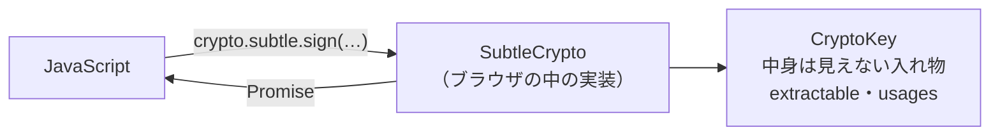

# WebCrypto

[目次](../README.md) ＞ [技術カード](README.md) ＞ WebCrypto

## 一言で

ブラウザに最初から入っている暗号の道具です（Web Crypto API）。ハッシュ・署名・暗号化・鍵の作成を、ライブラリを足さずに、ブラウザの中で安全に行えます。Node.js にも同じものがあります。

## 仕組み



- **`crypto.subtle`**: 道具の入口。どの関数も非同期（Promise）
- **`CryptoKey`**: 鍵の入れ物。JavaScript から中身のバイト列は直接見えない
  - `extractable`: `exportKey` で取り出せるか。`false` なら、ページに悪いスクリプトが入っても抜き出せない
  - `usages`: 使い道（`sign`・`verify`・`encrypt`・`decrypt`・`deriveKey`…）。ほかには使えない
- **`crypto.getRandomValues`**: 暗号に使える乱数（`Math.random` は使わない）
- **安全な場所でだけ使える**: HTTPS か `localhost`。`http://192.168.…` では `crypto.subtle` がない
- **方式**: SHA-256 など（ハッシュ）、Ed25519・ECDSA・RSA（署名）、AES-GCM（暗号化）、PBKDF2・HKDF（鍵を作る）。Ed25519 は 2023〜2025 年にかけて主なブラウザに入った新しい方式

| 関数 | すること |
|---|---|
| `digest(方式, データ)` | ハッシュ |
| `generateKey(方式, extractable, usages)` | 鍵・鍵の組を作る |
| `sign`・`verify` | 署名・確かめ |
| `encrypt`・`decrypt` | 暗号化・戻す |
| `importKey`・`exportKey` | バイト列（`raw`・`pkcs8`・`spki`・`jwk`）と `CryptoKey` の行き来 |
| `deriveKey`・`deriveBits` | 合言葉などから鍵を作る |

## 最小の使い方

（[09-console/scripts/webcrypto-card.mjs](../09-console/scripts/webcrypto-card.mjs)。Node.js 20 以上で `node webcrypto-card.mjs`、ブラウザの開発者ツールのコンソールでも動く）

```js
const subtle = globalThis.crypto.subtle;
const text = new TextEncoder().encode('こんにちは');

// ハッシュ
const hash = new Uint8Array(await subtle.digest('SHA-256', text));

// Ed25519 の署名
const pair = await subtle.generateKey({ name: 'Ed25519' }, false, ['sign', 'verify']);
const sig = await subtle.sign({ name: 'Ed25519' }, pair.privateKey, text);
await subtle.verify({ name: 'Ed25519' }, pair.publicKey, sig, text);   // true

// AES-GCM の暗号化（iv は毎回新しく）
const key = await subtle.generateKey({ name: 'AES-GCM', length: 256 }, false, ['encrypt', 'decrypt']);
const iv = crypto.getRandomValues(new Uint8Array(12));
const enc = await subtle.encrypt({ name: 'AES-GCM', iv }, key, text);
const dec = await subtle.decrypt({ name: 'AES-GCM', iv }, key, enc);
```

```text
SHA-256: 125aeadf27b0459b…
署名の長さ: 64 ／ 確かめ: true
暗号文の長さ: 31 （本文 15 ＋ 認証タグ 16）
戻す: こんにちは
1 ビット変えると: OperationError
取り出せない鍵の exportKey: InvalidAccessException
```

AES-GCM は、暗号文が 1 ビットでも変われば戻すのを断ります（認証タグ）。`extractable: false` の鍵は取り出せません（エラーの名前は、ブラウザでは `InvalidAccessError`）。

合言葉から鍵を作る（PBKDF2）:

```js
const material = await subtle.importKey('raw', new TextEncoder().encode(passphrase), 'PBKDF2', false, ['deriveKey']);
const wrapping = await subtle.deriveKey(
  { name: 'PBKDF2', hash: 'SHA-256', salt, iterations: 600_000 },
  material, { name: 'AES-GCM', length: 256 }, false, ['encrypt', 'decrypt'],
);
```

## このリポジトリでは

| 場所 | 見どころ | 章 |
|---|---|---|
| [web/src/publisher-crypto.ts](https://github.com/duwenji/yorisoi-console/blob/main/web/src/publisher-crypto.ts) | チャンネル提供者の鍵をブラウザの中で作る。秘密鍵を PBKDF2 ＋ AES-GCM で包んでファイルに。使う鍵は取り出せない鍵として読み込み直す | [9-3](../09-console/03-keys-in-browser.md) |
| 同 `openKeyFile` | 開いた秘密鍵で試しに署名し、ファイルの公開鍵で確かめる | [9-3](../09-console/03-keys-in-browser.md) |
| 同 `signPackage` | パッケージのファイルごとの SHA-256 と、Ed25519 の署名 | [9-3](../09-console/03-keys-in-browser.md)、[5-2](../05-station-format/02-package-format.md) |
| oidc-client-ts の中 | ログインの PKCE の `code_challenge`（SHA-256） | [9-2](../09-console/02-browser-login.md) |

## よくある間違い

| 間違い | 起きること | 正しくは |
|---|---|---|
| `Math.random()` で鍵や iv を作る | 予測できる値になる | `crypto.getRandomValues` |
| AES-GCM の iv を使い回す | 暗号が破れる | 暗号化のたびに新しく作り、暗号文と一緒に保存する |
| 合言葉をそのまま鍵にする | 総当たりで破られやすい | PBKDF2 などで、salt と十分な回数をかけて鍵にする |
| 使う鍵を `extractable: true` のままにする | ページに入ったスクリプトに抜き出される | 保存のために一度だけ取り出し、使う鍵は `false` |
| `http://` で開いて「`crypto.subtle` がない」 | 安全な場所でしか使えない | HTTPS か `localhost` |
| `await` を忘れる | Promise のまま扱い、`[object Promise]` が混ざる | どれも非同期 |
| ブラウザが方式に対応しているか確かめない | 古いブラウザで失敗する | 最初に試して、だめなら案内する（`ed25519Supported`） |

## 版と公式ドキュメント

ブラウザ・Node.js の標準の機能です（ライブラリではない）。Node.js では `globalThis.crypto`（20 以上で既定で使える）。

- [Web Crypto API（MDN）](https://developer.mozilla.org/ja/docs/Web/API/Web_Crypto_API)
- [SubtleCrypto（MDN）](https://developer.mozilla.org/ja/docs/Web/API/SubtleCrypto)
- [W3C Web Cryptography](https://www.w3.org/TR/WebCryptoAPI/)
